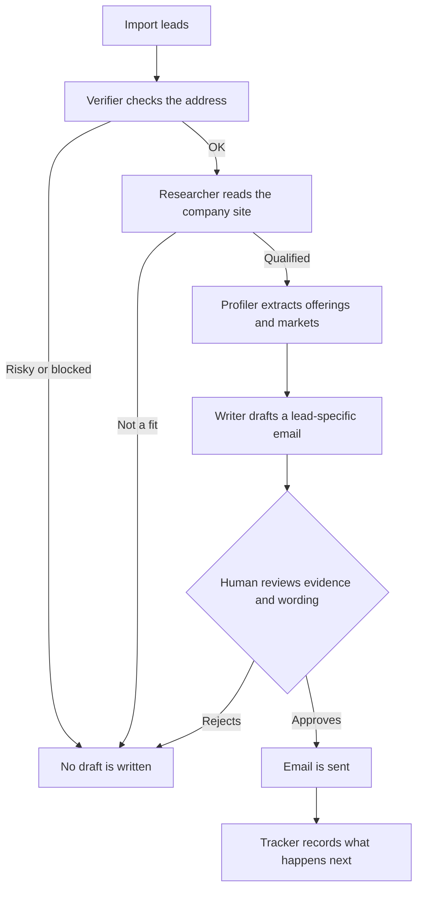
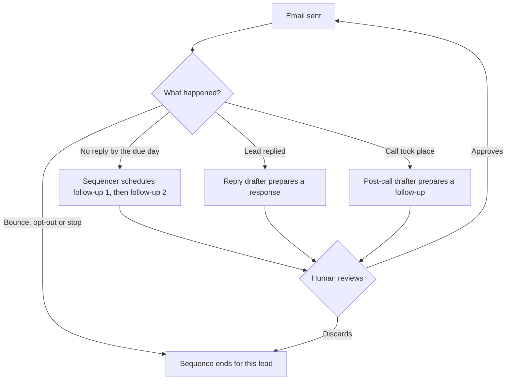
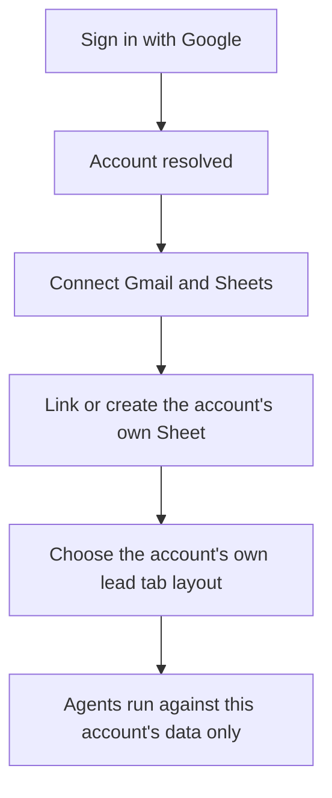

# groundtruth-outreach

A multi-agent cold outbound platform. Every lead gets its own researched, specialised outreach,
every step is tracked, and nothing is sent that a human has not read.

## Why this exists

Most outbound tools treat leads as a list to blast a template at. This platform treats each lead
as its own small project: a chain of narrow, specialised agents verifies the contact, researches
the company, writes an email that only that company could receive, follows up on a schedule,
reacts to replies and calls, and measures what happened.

One rule holds the whole thing together: **an agent may never state a fact it cannot point to.**
Every company-specific sentence in an email traces back to a stored quote and the page it came
from. If there is no evidence, there is no draft.

## The agents

Each agent does one job, reads only what earlier agents proved, and writes its result back to a
shared record that anyone can open and audit.

| Agent | Job | How it decides |
| --- | --- | --- |
| **Verifier** | Is this address safe to email? | Rules: MX records, live-domain checks, duplicates. Marks each lead OK, RISKY or blocked. |
| **Researcher** | Is this company a fit, and what proves it? | An LLM reads the company's own site and keeps only quotes it can cite with a URL. |
| **Profiler** | What does the company offer, and to whom? | An LLM extracts offerings and markets, again as cited quotes. |
| **Writer** | Compose the first email for this one lead. | An LLM writes from the playbook and the stored quotes. The draft is rebuilt and re-checked before it can be approved. |
| **Sequencer** | What is due for this lead today? | Rules over recorded events: follow-up 1, follow-up 2, or stop. |
| **Reply drafter** | A lead wrote back. What could we say? | Composes a reply candidate from saved facts for a human to edit. |
| **Post-call drafter** | A call happened. What is the follow-up? | Composes an email candidate from the recorded call outcome and notes. |
| **Tracker** | What happened after sending? | Records sends, opens, clicks, replies, bounces and opt-outs as events. |
| **Analyst** | Answer questions about the pipeline. | An LLM that can only read the recorded data. It cannot send, draft or change anything. |

## End-to-end workflow

After the first email, the lead enters a loop that reacts to what actually happens:

A sequence is one initial email and at most two follow-ups in the same thread. A reply, an
opt-out, a bounce, a call outcome that says stop, or the suppression list ends it immediately.

## Metrics and tracking

Everything the platform does is written down as an event, so the numbers are counted from the
record rather than estimated.

- **Per lead:** tracked sends, opens (estimated, since mail clients pre-load images), clicks,
  when it was sent, when the lead replied, how many follow-ups went out, and the next action due.
- **Funnel:** how many leads are verified, researched, profiled, drafted, sent and replied, with
  the count stuck at each stage.
- **Outcomes:** replies, opt-outs, bounces, follow-ups sent and call outcomes.
- **A/B tests:** two named variants, each lead assigned to one by a stable hash so it can never
  drift between them. Every rate is reported with its explicit denominator. Positive replies and
  meetings are reported only when they have actually been recorded, never inferred.
- **Run log:** every agent run records what it did, what it skipped and why.

## Guardrails

- **Evidence or nothing.** Company facts come from stored quotes with their source page.
- **A human approves every send.** Exactly two code paths can send: a person's click, or a
  capped scheduled drip of drafts a person already approved. A test scans the codebase to keep it
  that way.
- **Suppression is checked at the last moment.** Opt-outs, bounces and call outcomes are re-read
  at the point of drafting and sending, so a late change is still honoured.
- **Your columns are yours.** Agents only write to their own columns and re-check a row before
  writing, so a sort or an edit mid-run cannot put a result on the wrong lead.
- **Daily cap.** One limit covers initial emails and follow-ups together.

## Multi-tenant

The platform began as a single-account tool and is being extended so that several accounts can
run their own outreach side by side, each fully isolated.

- **Isolation in the database.** Postgres row-level security scopes every query to the active
  account, so one account cannot read another's rows even if application code has a bug.
- **Encrypted credentials.** Each account's Google refresh token is encrypted with Cloud KMS and
  bound to that account, so a copied ciphertext cannot be reused elsewhere.
- **Several accounts, one browser.** A person can hold more than one account (for example one
  for sales leads and one for referrals) and switch without signing in again.
- **Per-account layout.** Each account decides which Sheet tabs hold its leads.

**Status.** Running per account today: sign-in, Google connections, Sheet linking, and the
Verifier, Researcher, Profiler and Writer agents. Not yet per account: sending, the Sequencer,
the reply and post-call drafters, tracking, A/B tests and the Analyst. Those work in the
single-account product and are being ported.

## Stack

- **Backend:** Python and Flask
- **Frontend:** React, TypeScript and Vite
- **Models:** Gemini on Vertex AI
- **Record:** Google Sheets for leads, events and metrics; Postgres for accounts and connections
- **Infrastructure:** Cloud Run, Cloud SQL, Cloud KMS, Secret Manager
- **Auth:** Google Identity Services for sign-in, OAuth 2.0 with PKCE for Gmail and Sheets access
