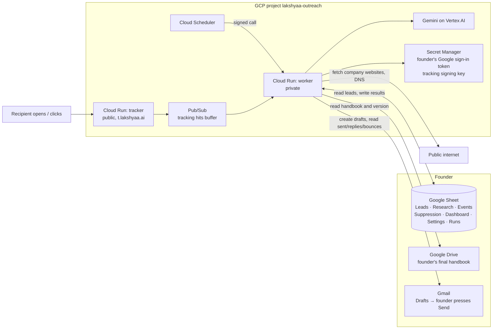

# Outreach automation — architecture

Prepared 2026-09-22. Status: **plan; current implementation is in `AS_BUILT.md`.** Where this conflicts with
`PIPELINE_2026-09-14.md`, this document wins.

**Founder decision, 2026-09-22:** the final outreach handbook is **not in Drive
yet**. Before stage 3 starts, the founder will put the final version in Google
Drive. The Cloud Run worker in GCP must then read that document; a repository
file or local settings file will not be the production handbook. Google Sheets
(also in Drive) remains the outreach business record. Gmail holds drafts and
messages, and GCP hosts the worker, model calls and secrets. Local files may
support development and tests, but production drafting must not depend on them.

## 1. What it does

The founder keeps tiered leads in a Google Sheet. The system:

1. checks each email address as far as possible without sending,
2. researches the company from its own website: what it sells or does, who it serves,
   relevant projects, and whether it fits the commercial trade-subcontractor campaign,
3. writes an email from the founder's handbook and puts it in **Gmail Drafts**,
4. — the founder opens the draft, edits if needed, and presses **Send** —
5. watches Gmail and the tracking address, and writes sends, bounces, replies, opt-outs,
   opens and clicks back into the Sheet,
6. prepares follow-up drafts when there is no reply, which the founder also sends by hand.

## 2. Rules that do not bend

| Rule | How it is enforced |
| --- | --- |
| **The system never sends.** | No send call exists in the code. A test fails the build if `drafts.send`, `messages.send` or an SMTP client appears. Google has no drafts-only permission — `gmail.compose` also allows sending — so this is our code's promise, and the Sent folder is the founder's check. |
| **Google Sheets is the only outreach business record.** | No database. Every lead, result, event and metric is a row in the Sheet. Pub/Sub temporarily buffers tracking hits; Gmail retains the actual drafts and messages. A hit is not recorded until the worker has written its event to Sheets. |
| **The founder's future Drive document is the only production handbook.** | Stage 3 waits until the founder puts the final handbook in Drive. The private GCP worker then reads that file with read-only authorization. Each preview and draft records its version or content hash. If it cannot read the file or the version changes after approval, drafting stops for review; no local copy silently takes its place. |
| **No third-party tools.** | Only Google: Workspace (Gmail, Sheets), GCP (Cloud Run, Scheduler, Pub/Sub, Secret Manager), Gemini on Vertex AI. Apollo only supplied the addresses. |
| **Never draft to someone who should not get one.** | A lead gets a draft only if: the email check is acceptable under the selected policy, fit QUALIFIED, no HOLD, no matching address or domain on Suppression, no existing or uncertain draft action, and the day's cap not reached. A plausibility check does not establish that the mailbox is active. |
| **Never overwrite the founder's columns.** | The system writes only to columns and tabs it created. Rows are identified by a Lead ID the system adds, never by row number, so the founder can sort and filter freely. |
| **Every company-specific assertion is supported.** | Research stores verbatim quotes with their URL. Code verifies that each quoted span appeared in fetched content; approved templates render claims from validated evidence fields. A quote match alone cannot prove that a free-form sentence follows from it, so unsupported paraphrases require review. |
| **US law (CAN-SPAM).** | Every draft carries a postal address and an opt-out line. Opt-outs go to Suppression automatically and are never drafted to again ([FTC guide](https://www.ftc.gov/business-guidance/resources/can-spam-act-compliance-guide-business)). |

## 3. The picture



Two Cloud Run services, deliberately separate: the **worker** holds the Gmail,
Sheets and (once authorized) read-only Drive sign-in and accepts authenticated
job calls; the **tracker** is public and holds only its
tracking verification key. The tracker's service account has no mailbox or Sheet access.

## 4. The Google Sheet

The founder's existing Leads tab keeps its columns, tiers and order. The system adds its own
columns to the right and its own tabs.

| Tab | Who writes | Contents |
| --- | --- | --- |
| **Leads** (founder's) | Founder: existing columns, plus Call outcome / Notes / HOLD. System: its added columns | Added: Lead ID, Email check, Email check reason, Fit, Fit reason, Status, Draft link, Sent at, Replied at, Opens (est.), Clicks, Follow-ups sent, Last event, Next action |
| **Research** | System | One row per verified quote with its company, lead, category, page URL and time. Fit evidence and factual product/service and market evidence remain separate so writing can select a supported detail. |
| **Events** | System, append-only | Every observed thing: DRAFTED, SENT, BOUNCED, REPLIED, AUTO_REPLY, OPT_OUT, OPEN, CLICK, FOLLOWUP_DRAFTED — with lead, time, message, detail |
| **Suppression** | System and founder | Addresses and domains never to draft to, with reason and date |
| **Dashboard** | Sheet formulas only | By tier: drafted, confirmed sent, observed bounces and replies, positive replies, opt-outs, observed open and click rates, and tracking coverage. A sent message is not proof of delivery. |
| **Settings** | Founder | Daily draft cap, follow-up spacing, handbook version, postal address, whether catch-all addresses get drafts |
| **Runs** | System | One row per job run: started, finished, rows handled, errors |

Lead **Status** is a current summary, not an append-only history. A lead may enter or leave
`HOLD` or `REVIEW_NEEDED`, a reply may arrive after `SENT`, and `BOUNCED` or `OPTED_OUT` may
supersede earlier states. The append-only Events tab retains every transition and its reason.

## 5. The jobs

Cloud Scheduler calls the worker. Configure one instance and request concurrency one to
serialize this service's jobs, then recheck each lead's current Sheet state immediately before
any external action. Scheduler retries, request timeouts and deployments still require durable
action IDs, deduplication and reconciliation after an uncertain Gmail or Sheets response. A
batched Sheets update is not a transaction with Gmail or Pub/Sub. Preserve a run cursor in
the Runs tab and make retries safe before enabling a recurring job.

| Job | Every | Does |
| --- | --- | --- |
| **check** | 30 min | New rows get a Lead ID. Email checked: format, duplicate, on Suppression, generic inbox (`info@`, `office@`), domain has mail servers (DNS), company website loads, Apollo's own status column if present. Result: OK / RISKY / INVALID with the reason. |
| **research** | 30 min | For CHECKED leads: read the company's own site (home plus a few linked pages like About, Services, Projects; respects robots.txt, page cap per company). Gemini proposes structured quotes; the worker keeps only quotes that appear on the named page. Fit: QUALIFIED / REVIEW_NEEDED / DISQUALIFIED with reasons. For a small draft pilot, a separate profile pass also records verified products/services and markets without changing fit. |
| **draft** | weekdays, morning | For QUALIFIED leads in tier order, up to the daily cap: the worker reads the designated Drive handbook and its version, then Gemini writes from it and the stored quotes. The validator checks approved factual fields, length, postal address and opt-out line. A changed or unavailable handbook blocks creation. Passing drafts go to Gmail Drafts with the handbook version recorded in the Sheet; stage 3 drafts are untracked, and stage 5 may add tracking to new drafts. The row gets the draft link. Failing drafts go to REVIEW_NEEDED with why. |
| **sync** | 10 min | Reads Gmail changes since the last check. Confidently associates a new sent message with the intended action using recipient, thread, time and content evidence; ambiguous matches go to review and do not start follow-up timers. Messages from the recipient → REPLIED (auto-replies flagged separately). Detected bounce notices → BOUNCED, address to Suppression, follow-ups cancelled. Replies asking to stop → OPTED_OUT, to Suppression. |
| **followup** | weekdays, morning | After the founder actually sends the initial email, draft follow-up 1 on the third business day after its sent date, if there is no reply. After the founder sends follow-up 1, draft follow-up 2 on the third business day after that sent date. Use America/New_York dates; the next Monday–Friday date is day 1, and weekends do not count. Holiday exclusions still need a calendar decision. Keep drafts in the same thread, at most two; the founder sends each by hand. |
| **tracking** | 5 min | Pulls buffered hits from Pub/Sub, turns them into OPEN / CLICK events, updates the lead's counts. |

## 6. Checking email addresses without sending

Asking a recipient's mail server whether a mailbox exists needs outbound port 25. GCP blocks
it ([Google](https://docs.cloud.google.com/compute/docs/tutorials/sending-mail)), and it is
blocked from the founder's PC too (tested 2026-09-22). So before sending, the system can only
say an address is **plausible** — the checks in the `check` job. **The real test is the
bounce**, which `sync` catches.

Protection while bounces teach us: drafts are capped per day, verified-by-Apollo tiers go
first, and if a tier's bounce rate crosses the threshold in Settings, `draft` stops for that
tier and says why in Runs.

## 7. Tracking — owned, and honest about its limits

Starting in stage 5, the worker can add these to new drafts:

- a 1×1 image: `https://t.lakshyaa.ai/o/<token>`
- every link rewritten to `https://t.lakshyaa.ai/c/<token>` which redirects to the real page

The token is signed (HMAC) and carries opaque action and link IDs, never an email address or
other personal data. A click token also carries its approved HTTPS destination; the tracker
checks a configured destination-host allowlist before redirecting. The tracker needs no Sheet
lookup; the worker resolves IDs and writes events in batches. Signing rejects altered tokens
but cannot stop a scanner or anyone holding a real link from triggering a hit. Pub/Sub
redelivery must not duplicate an event in Sheets.

What the numbers mean:

- **Observed reply rate** uses replies the connected Gmail mailbox can associate with sent
  messages. Unmatched replies and sync gaps go to review.
- **Observed bounce rate** includes detected bounce notices. A missing notice does not prove
  delivery.
- **Open rate is an estimate** — the same is true in Brevo or any tool. Apple Mail loads
  images automatically (false opens), Outlook often blocks them (missed opens), and Gmail
  loads through its own image proxy. Hits before the send time are ignored.
- **Click rate is closer to real**, but security scanners at some companies click every link;
  clicks within seconds of delivery are marked as likely scanner.

Tracked links can hurt deliverability of cold email, so the tracker lives on the founder's
own subdomain, never a shared one. Settings can switch the image and link rewriting off.

## 8. Identity and permissions

| Piece | Set up as |
| --- | --- |
| Google sign-in app | OAuth app, user type **Internal** to the `lakshyaa.ai` organisation, in the `lakshyaa-outreach` project. Internal apps skip Google's review for restricted Gmail permissions ([Google](https://developers.google.com/identity/protocols/oauth2/production-readiness/restricted-scope-verification)). |
| Permissions asked for | `gmail.compose` (create drafts), `gmail.readonly` (see sends, replies, bounces), `spreadsheets` (read and update the Sheet). The Sheet is never shared outside the domain. |
| Founder's sign-in | Done once on the founder's PC with a small command; the refresh token goes straight into Secret Manager. |
| Worker's own identity | A service account with only: read that one secret, call Vertex AI, pull from the Pub/Sub subscription. |
| Scheduler → worker | Scheduler signs each call (OIDC); the worker refuses unsigned calls. |
| Tracker | Public; can only publish to the Pub/Sub topic. |

## 9. GCP layout

Confirmed 2026-09-22 with `gcloud`: signed in as `admin@lakshyaa.ai`; organisation
`lakshyaa.ai` (787760867942) exists.

Project **`lakshyaa-outreach`** under the organisation (created 2026-09-22, billing linked,
APIs enabled). Region `us-central1` unless the domain mapping check below says otherwise.

| Service | Use |
| --- | --- |
| Cloud Run `outreach-worker` | Private, max 1 instance, scales to zero |
| Cloud Run `outreach-tracker` | Public, scales to zero |
| Cloud Scheduler | The six jobs |
| Pub/Sub | One topic, one pull subscription for tracking hits |
| Secret Manager | Sign-in token, tracking key |
| Vertex AI | Gemini |
| Artifact Registry | Container images |

`t.lakshyaa.ai` to the tracker: Cloud Run's own domain mapping is in Preview and available
only in some regions ([Google](https://docs.cloud.google.com/run/docs/mapping-custom-domains));
check the chosen region supports it at setup. If it does not, the fallback is a load balancer,
which has a monthly cost.

Running cost is **not estimated yet**. Cloud Run and Scheduler at this volume should be small;
Gemini cost depends on pages read and drafts written and will be measured in stage 3, not
guessed.

## 10. Code layout

```
outreach/
  worker/        jobs: check, research, draft, sync, followup, tracking
  tracker/       /o and /c endpoints
  sheets/        the only code that reads or writes the Sheet
  gmail/         create drafts, read changes — no send
  research/      fetch pages, extract quotes, fit
  writing/       Drive handbook loader, prompts, validator
  handbook/      non-production fixtures only; Drive document is authoritative
  tests/         includes the no-send test
  deploy/        Dockerfiles, Scheduler and IAM setup scripts
```

Python, one repository folder, two container images.

## 11. Build order

Each stage is usable on its own and must pass before the next starts.

| Stage | Builds | Passes when | Sends anything? |
| --- | --- | --- | --- |
| 0 Setup | Project, APIs, Internal sign-in app, founder signs in, worker reads the Sheet and writes to Runs | A Runs row appears from GCP | No |
| 1 Check | Lead IDs, `check` job | Every lead has a check result and reason; founder spot-checks 20 | No |
| 2 Research | `research` job, Research tab, company profile facts for drafting | Founder agrees with fit on a sample and can inspect verified products/services and markets with their URLs | No |
| 3 Drafts | Read-only Drive handbook loader, Gemini writer, validator, `draft` job, **no tracking yet** | **Decision point:** how many drafts the founder would send with no or light edits | Drafts only |
| 4 Sync | `sync` and `followup` jobs, Suppression, auto opt-out | Founder sends a few real drafts; SENT, REPLIED and a bounce all land correctly | Founder sends |
| 5 Tracking | Tracker service, `t.lakshyaa.ai`, Pub/Sub, Dashboard | A test email to the founder's own other inbox shows open and click | Founder sends |
| 6 Calls | Call outcome columns drive reply drafts | — | Drafts only |

## 12. Decisions the founder owns

1. **Sending address** — `@lakshyaa.ai`, or a second domain just for outreach to reduce
   risk to the company mailbox. Google's Workspace policy forbids "unsolicited bulk
   commercial email" without a number ([AUP](https://workspace.google.com/terms/use_policy/)).
2. **Billing account** for the new project — "Lakshyaa Billing account" or "My Billing Account".
   Stage 0 also needs the founder's chosen Sheet and authorization to create cloud resources;
   selecting billing alone does not complete setup.
3. **Postal address** for the email footer.
4. **The handbook** — the founder will place the final version in Google Drive, then provide its link or file ID and authorize read-only access for the worker. Its content and version must be read from Drive before a preview can be approved. No link is needed before the document exists.
5. **Settings defaults** — daily draft cap, follow-up spacing, whether catch-all addresses get
   drafts, bounce-rate stop threshold.
6. **DMARC record** for the sending domain (none existed for `lakshyaa.ai` on 2026-09-14).

## 13. Not yet tested — to prove in the stages above

- Whether the tracking image and rewritten links survive the founder editing a draft in the
  Gmail web editor (stage 5).
- How reliably a sent message matches its draft after edits, deletion or a new composition:
  thread membership alone is insufficient. An ambiguous case goes to REVIEW_NEEDED rather
  than guessing (stage 4).
- Whether Apollo's terms on the founder's plan allow this use of exported addresses.
