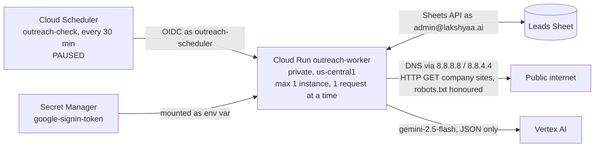

# Outreach — as built

What exists and runs today. `ARCHITECTURE.md` is the plan; this file is the truth about what
is actually built. **Updated after every change**, newest entry first in the change log.

Last updated: 2026-09-22.

## Stage status

| Stage | Status | Proof |
| --- | --- | --- |
| 0 Setup | **Done** 2026-09-22 | Cloud Run worker read 318 A + 174 B leads, wrote a Runs row |
| 1 Email checks | **Built, review fixes applied, awaiting founder spot-check** 2026-09-22 | All 492 leads checked from Cloud Run; 98 rows rechecked after review fixes; 45 tests pass in a container; schedule paused |
| 2 Research | **Bulk fit research paused; four company profiles piloted** 2026-09-22 | 69 leads fit-researched (sample 30 + batch 1 39); 26 draft-eligible; 396 pending, not to be resumed for now; four verified offerings/markets profiles saved; no research schedule exists |
| 3 Drafts (pilot) | **Template draft under founder review** | `docs/OUTREACH_HANDBOOK_DRAFT.md` has three placeholder-only emails; MVP facts, trial action and postal address remain unfilled; no draft-generation code yet |
| 4 Gmail sync | Not started | Founder chose two follow-up drafts, each due on the third business day after the preceding email is actually sent; all emails are sent by hand |
| 5 Tracking | Not started | |
| 6 Calls | Not started | |

## What runs where

**Nothing touches Gmail yet.** The sign-in includes Gmail permissions for later stages; no
code reads or writes mail.

## GCP — project `lakshyaa-outreach`

Org `lakshyaa.ai` (787760867942). Billing: "My Billing Account" `01A2E0-CC6FD1-A94FDA`.

| Resource | Setting |
| --- | --- |
| Cloud Run `outreach-worker` | `https://outreach-worker-30387157876.us-central1.run.app`; `--no-allow-unauthenticated` (unsigned call → 403, tested); max instances 1, concurrency 1, timeout 600 s; runs as `outreach-worker@` |
| Service account `outreach-worker@` | `secretAccessor` on `google-signin-token`; `aiplatform.user` on the project (Gemini, added for stage 2) |
| Service account `outreach-scheduler@` | `run.invoker` on `outreach-worker` only |
| Cloud Scheduler `outreach-check` | `*/30 * * * *` America/New_York → `POST /jobs/check`; **paused** |
| Secret `google-signin-token` | JSON: account, OAuth client id/secret, refresh token, scopes |
| OAuth app | Internal to `lakshyaa.ai`; Desktop client `outreach-local-signin`; scopes `gmail.compose`, `gmail.readonly`, `spreadsheets` |
| Build | Default compute account holds `cloudbuild.builds.builder` (source deploys) |
| Enabled APIs | Sheets, Gmail, Drive, Cloud Run, Scheduler, Pub/Sub, Secret Manager, Vertex AI, Artifact Registry, Cloud Build, IAM Credentials |

Deploy: `sh deploy/deploy_worker.sh`.

## Worker endpoints

| Endpoint | Does |
| --- | --- |
| `POST /jobs/ping` | Counts leads in A and B, writes a Runs row |
| `POST /jobs/check` | Stage 1 email check (below) |
| `POST /jobs/research?limit=40` or `?ids=A-0001,B-0002` | Stage 2 company research (below). **Not scheduled.** |
| `POST /jobs/profile?limit=5&ids=A-0001,...` (optional `dry_run=1`) | Pilot extraction of company offerings and markets for later drafts. Available on the private `profile-review` tag only; serving revision remains 00013. No schedule. |

## The Sheet

`OCILB_A_and_B_Outreach_2026-09-21`, id `1eEVkxc0gJMFptYSr_u9prQ5O850TOX28AEq17CKaFiA`.

| Tab | Rows | System use |
| --- | --- | --- |
| Summary | — | Not touched |
| A_Contact_Now | 318 | Read; system columns added at right |
| B_Contact_Now | 174 | Read; system columns added at right |
| C_Phone_Only | 242 | Not touched (no emails) |
| Runs | 1 per job run | Written by the system |
| Research | 1 per verified quote per research run | Written by the system; append-only history, so re-researched leads have older rows too — the lead row's `Researched at` names the current run |

Row 1 of A and B is a description; **headers are in row 2**. Columns are found by header
name, never by position — A and B have different layouts.

**Stage 2 columns** (added 2026-09-22, right of the stage 1 columns): `Fit`, `Work mix`,
`Fit reason`, `Fit evidence` (up to three verified quotes with page URLs), `Researched at`.

**Company-profile pilot columns** (added 2026-09-22 to A and B): `Profile status`,
`Offerings evidence`, `Markets evidence`, `Profile reason`, `Profiled at`. Offerings and markets
are separate from the fit verdict. The Research tab also holds append-only `OFFERING` and
`MARKET` quote rows with their source URLs. These are source material for a later draft, not
email copy.

**System columns** (added 2026-09-22, right of the founder's columns): `Lead ID`,
`Email check`, `Reason`, `Checked at`.

**Founder columns the system reads:** `BEST EMAIL`, `Website`, `Warning`, `Sent by hand`.
`Where it came from` is no longer used by any rule: it was wrong for A-0155 (see below).

**Column changes made with founder approval, 2026-09-22** (`tools/tidy_columns_2026_09_22.py`):
removed from A — two empty unlabelled columns, `Sheet`, `Commercial confidence`,
`Apollo lookup`; removed from B — `Strong proof`, `Sheet`, `Commercial confidence`,
`Apollo lookup`, `Bucket`. Tab A's unlabelled column of "Sent email on 9/22/2026" marks
named `Sent by hand` (14 marks kept). Undo: File → Version history.

## Stage 1 — email check

Code: `outreach/checks.py` (rules), `outreach/job_check.py` (job).

- Gives each lead a permanent `Lead ID` (`A-0001`…, `B-0001`…); existing IDs are never changed.
- Checks only rows whose `Email check` is blank. **Clear that cell to re-check a row.**
- A before B, top to bottom: the first row with an address keeps it; later ones are DUPLICATE.
- **Write safeguard** (`Tab.write`, since the review fixes). Just before writing, the tab is
  re-read and every lead is found again: by its `Lead ID` (must be the only row with that ID),
  or, for a lead getting its first ID, by its full set of founder values among rows without an
  ID (must match exactly one row). Its founder values must be unchanged, and the system cells
  about to be written must still hold what was read. Otherwise that row is skipped, left
  blank for the next run, and named in the Runs row (result PARTIAL). Sorting, inserting,
  deleting, editing and swapping rows that share an email are all covered by tests.
  Remaining limit: Sheets has no transactions, so an edit landing in the moment between that
  re-read and the write is not detected.

| Result | Rule |
| --- | --- |
| SENT BY HAND | `Sent by hand` is filled. Never drafted to. |
| INVALID | No address; malformed; or DNS says the domain takes no mail (no domain, or null MX) |
| DUPLICATE | Same address as an earlier Lead ID (named in Reason) |
| RISKY | Apollo `Warning`; email domain differs from website; a personal mailbox (Gmail, Yahoo, ISP…) **not found on the company's own site** or the site could not be read; generic inbox (`info@`, `office@`, `hr@`…); website does not load; no website; DNS could not be read |
| OK | None of the above. **Not proof the mailbox exists** — outbound port 25 is blocked, so only a real send's bounce proves that |

**Website probe:** 2xx/3xx loads. 401/403/429 means the server is up but refuses robots — the
site exists, noted in Reason. 404, 410, other 4xx and 5xx do not load. If the listed page is
missing but the homepage answers, the site loads (noted). Each request is retried up to three
times: a passing SSLError on a working site (A-0151) otherwise marked it dead.

**Personal mailbox:** OK only if the address is actually found on the company's site — the
listed page, the homepage and up to six same-site contact/about pages, honouring robots.txt,
reading plain text, `mailto:` links, Cloudflare-protected addresses and `[at]`/`[dot]`
spellings. Image names (`logo@2x.png`) and form placeholders are ignored. Not found or not
readable → RISKY with what the site does show.

DNS is asked of Google Public DNS: the default resolvers on the founder's PC and on Cloud
Run timed out on `neo.rr.com`, which Google answers. A lookup that cannot be completed is
RISKY ("could not check"), never INVALID.

**Current results (after the role-inbox recheck, 2026-09-22):**

| | A | B | Total |
| --- | --- | --- | --- |
| OK | 202 | 115 | 317 |
| RISKY | 91 | 57 | 148 |
| DUPLICATE | 10 | 2 | 12 |
| SENT BY HAND | 14 | 0 | 14 |
| INVALID | 1 | 0 | 1 |

**Role-inbox recheck** (`tools/recheck_role_inboxes_2026_09_22.py`, Runs row
`recheck-role-inboxes`): department and role mailboxes added to the generic-inbox rule
(`checks.ROLE_INBOXES`: employment, hiring, recruiting, resumes, apply, orders, quotes,
marketing, warranty, parts, purchasing, projects, customer.service, payroll, invoices,
safety, scheduling and variants). Only OK/RISKY rows with such an address were re-checked:
5 rows, all OK→RISKY — A-0147 `customer.service@`, A-0200 `employment@`, A-0224
`employment@`, A-0275 `marketing@`, B-0062 `apply@`. No founder column written.

**Review-fix recheck** (`tools/recheck_2026_09_22_fixes.py`, run locally, Runs row
`recheck-fixes`): only OK/RISKY rows that are personal mailboxes or whose website is not a
clean load were re-evaluated, and only rows whose result or reason changed were written —
98 rows (82 OK→OK with evidence added to Reason, 16 OK→RISKY). No founder column written.
No site returned 404 for its homepage; two listed pages 404 with a live homepage (B-0058,
B-0074). The 16 now RISKY are personal mailboxes not found on the company's site:
A-0155, A-0170, A-0171, A-0177, A-0181, A-0208, A-0221, A-0223, A-0287, B-0045, B-0084,
B-0087, B-0088, B-0090, B-0134, B-0160. Of these, A-0155, A-0170, A-0171, A-0177, A-0287 and
B-0090 publish a different address on their own site.

**A-0155** (Apex Mechanical Systems, `apex.mechanical@sbcglobal.net`): labelled "read from
their website", but its `Kind` column says "on the licence", and the site's contact page and
homepage show only `apex@apexmechsys.com` (checked by hand and by the new rule). RISKY for
review; `BEST EMAIL` left as the founder has it.

**Earlier first run, 2026-09-22 20:24 UTC (492 leads), superseded above:**

| | A | B | Total |
| --- | --- | --- | --- |
| OK | 215 | 123 | 338 |
| RISKY | 78 | 49 | 127 |
| DUPLICATE | 10 | 2 | 12 |
| SENT BY HAND | 14 | 0 | 14 |
| INVALID | 1 | 0 | 1 |

RISKY reasons: generic inbox 105, Apollo warning 21, domain differs 1. The Stage 1 probe
reported every website as loading; its current status threshold also accepts HTTP 404.
INVALID: `A-0313` `tom@wrmechanical.com` — the domain publishes a null MX (accepts no mail);
the company's site is `wrmech.com`.

### Independent review, 2026-09-22

A read-only check of the live Sheet confirmed all five totals above. Nineteen selected rows
covered OK, RISKY, DUPLICATE, SENT BY HAND and INVALID; their labels agreed with the source
fields and reasons in the Sheet. The 13 local tests also passed in an isolated container.
Of four sampled personal-mailbox OK rows labelled "read from their website", three addresses
were visible on the company homepage. The fourth was not found on the homepage or its one
linked contact/about page; its source claim remains unconfirmed and needs a human check.
This sample does not validate every row or prove mailbox activity. The founder spot-check gate
remains open, and the 30-minute schedule remains paused.

Two implementation limits surfaced in review: the website probe currently treats HTTP 404 as
"loads" because it accepts any status below 500, and the pre-write row guard compares only
`BEST EMAIL`, so a sort or edit involving rows with the same email may escape detection.
These should be corrected before relying on recurring checks. The current deployed service
and 492 recorded results have not been changed by this review.

## Stage 2 — company research

Code: `outreach/research.py` (reading, verification, verdict), `outreach/job_research.py`
(job), `outreach/gemini.py` (Vertex AI), `outreach/eligibility.py` (who may get a draft).

**Company fit is separate from email risk.** Research runs for OK and RISKY leads alike and
never looks at the address. Stage 3 may draft only when `Email check` is OK **and** `Fit` is
QUALIFIED (`eligibility.draft_eligible`, tested): a RISKY address never gets a draft, however
good the company.

1. **Read the company's own site** — the listed page, the homepage and same-site pages whose
   links suggest about/services/projects/markets, up to 8 pages, 8,000 characters each;
   robots.txt honoured; scripts and styles stripped.
2. **Gemini proposes quotes** (`gemini-2.5-flash`, temperature 0, JSON schema), each tagged
   COMMERCIAL_PROJECT, COMMERCIAL_SERVICE, RESIDENTIAL or GENERAL_CONTRACTOR.
3. **The code keeps a quote only if it is on the page it names**, word for word (case, spacing
   and curly quotes ignored), and stores the page's own text, not the model's copy.
4. **Categories must be supported by the quote's own words.** A general-contractor quote with
   no general-contracting signal counts as project work. A project quote with no project
   signal at all counts as service. **A project quote counts only if it is specific**
   (`research.is_specific`, founder review 2026-09-22): it names construction activity
   (construction, build-out, fit-out, tenant, design-build, new build, bid, general
   contractor/GC, builders, prevailing wage, union, plan-and-spec, portfolio, turn-key), or
   names a commercial sector (school, hospital, industrial, facility, municipal…) together
   with project or installation work. A quote that also mentions homes or residential work
   must name construction activity. Otherwise it is **COMMERCIAL_GENERIC** — shown as
   evidence, counted like service, never qualifying. So "residential and commercial projects",
   "150+ Commercial Projects Done" and a list of customer types cannot qualify a company.
5. **The verdict is computed in code** ("project quote" below means a specific one):

| Fit | Work mix | When |
| --- | --- | --- |
| QUALIFIED | COMMERCIAL | ≥2 specific project quotes, no residential; or exactly 1, **and** a verified non-residential quote (that one or another) explicitly shows commercial construction or installation work |
| REVIEW_NEEDED | COMMERCIAL | exactly 1 specific project quote and nothing explicit (founder rule 2026-09-22: `research.is_explicit` needs a commercial setting — commercial, industrial, office, school, hospital, facility… — **and** construction or installation work — construct, install, build-out, fit-out, design-build, new build, wiring, renovat — with no residential mention) |
| QUALIFIED | MIXED | ≥2 specific project quotes and residential quotes |
| REVIEW_NEEDED | MIXED | 1 specific project quote against residential, or only generic/service plus residential |
| REVIEW_NEEDED | COMMERCIAL_SERVICE | generic or service/repair wording for businesses, no specific project work |
| REVIEW_NEEDED | GENERAL_CONTRACTOR | presents itself as a GC, construction manager or developer |
| REVIEW_NEEDED | UNCLEAR | site read, nothing says who they work for |
| REVIEW_NEEDED | UNREADABLE | no website, blocked (403 or robots.txt), no answer, or no readable text |
| DISQUALIFIED | RESIDENTIAL | residential quotes only |

A model or network failure leaves the row blank for the next run (Runs row PARTIAL). Clear
`Fit` to research a lead again.

**Final sample, 2026-09-22 — 30 leads, every 15th OK/RISKY lead across A and B.** Researched
from Cloud Run; then re-evaluated twice from the stored, verified quotes
(`tools/refit_sample_2026_09_22.py`, Runs rows `refit-sample`; no site re-read, no model call,
so each change is the rule alone): the specific-evidence rule, then the single-quote
explicit-work rule.

| | Count | Leads |
| --- | --- | --- |
| QUALIFIED — COMMERCIAL | 7 | A-0062 Conti, A-0078 Harrington, A-0112 Cincinnati Air, A-0188 Current Systems, A-0219 Guenther, A-0234 ICS, A-0280 Reddy |
| QUALIFIED — MIXED | 2 | A-0030 Monroe, A-0173 Bromack |
| REVIEW_NEEDED — COMMERCIAL | 2 | A-0250 Langdon, B-0100 HEAT |
| REVIEW_NEEDED — MIXED | 15 | A-0015, A-0127, A-0143, A-0158, A-0204, A-0295, A-0310, B-0009, B-0024, B-0039, B-0055, B-0070, B-0085, B-0115, B-0145 |
| REVIEW_NEEDED — UNREADABLE | 3 | A-0046 (HTTP 403); A-0265, B-0130 (no readable text, likely script-built) |
| REVIEW_NEEDED — GENERAL_CONTRACTOR | 1 | A-0095 Pleasant Valley |
| DISQUALIFIED | 0 | |

By email check: **OK+QUALIFIED 7 — the only draft-eligible leads** (A-0030, A-0062, A-0078,
A-0112, A-0173, A-0188, A-0219); RISKY+QUALIFIED 2 (A-0234, A-0280); OK+REVIEW 15;
RISKY+REVIEW 6.

**Single-quote rule changes** (dry run: exactly these 2 rows; 2 written):

| Lead | Was | Now | Evidence |
| --- | --- | --- | --- |
| A-0188 Current Systems | QUALIFIED/COMMERCIAL | unchanged | its one project quote is explicit: "Commercial and industrial installation of electrical power equipment." |
| A-0250 Langdon | QUALIFIED/COMMERCIAL | REVIEW_NEEDED/COMMERCIAL | one project quote, "the opportunity to bid on your project… sheet metal fabrication", names no commercial setting or installation work; its other quotes are generic or product ("spiral ductwork… ensuring easy shipping and installation" has no commercial setting) |
| B-0100 HEAT | QUALIFIED/COMMERCIAL | REVIEW_NEEDED/COMMERCIAL | one project quote, "Over 75 School District Projects Completed", names no construction or installation work; its installation quotes ("Installing occupancy sensors…") name no commercial setting |

Current Systems' row was not rewritten: its verdict did not change, and only the wording of
its reason would have.

**Verdict changes from the re-evaluation** (dry run shown to the founder before applying;
14 rows written — these 6 plus 8 QUALIFIED leads whose generic quotes were re-labelled; 12
rows whose reason would differ only in wording were left as they were):

| Lead | Was | Now | Why — the quotes it had |
| --- | --- | --- | --- |
| A-0015 Efficient Electric | QUALIFIED/MIXED | REVIEW_NEEDED/MIXED | one specific quote ("…and tenant build-outs") against three residential; "services for residential, commercial, and industrial projects" is generic |
| A-0143 Waterworks | QUALIFIED/MIXED | REVIEW_NEEDED/MIXED | only a list of customer types ("restaurants… hospitals… warehouses") and "we serve many municipalities" — no construction work named |
| A-0204 Enviro Flow | QUALIFIED/MIXED | REVIEW_NEEDED/MIXED | one specific quote (conduit lining with "the GC" at the White House); "For commercial projects, we serve the full state of Ohio" is generic |
| B-0039 Alpine Electric | QUALIFIED/MIXED | REVIEW_NEEDED/MIXED | the banner "ALL YOUR RESIDENTIAL, COMMERCIAL, OR INDUSTRIAL ELECTRICAL PROJECTS" is generic; only the heading "New Construction" is specific |
| B-0115 Kouris Electric | QUALIFIED/MIXED | REVIEW_NEEDED/MIXED | "150 + Commercial Projects Done" and "estimating and project management" are generic; four residential quotes |
| B-0145 Rapid Electric | QUALIFIED/MIXED | REVIEW_NEEDED/MIXED | "all sizes of residential and commercial projects" (twice in different words) is generic; the rest is service |

(At this point A-0188, A-0250 and B-0100 still qualified on a single specific quote; the
single-quote rule above then moved Langdon and HEAT to review.) The rule is conservative in the other direction too: Harrington's "performed work
at manufacturing plants… wastewater treatment plants" is labelled generic (no project word),
though Harrington qualifies on four other quotes.

**Bulk research of the remaining 435 leads** (founder-approved 2026-09-22; batches of at most 40
through the private worker, `POST /jobs/research?limit=40`, revision `outreach-worker-00012-fmn`,
confirmed serving 100% and matching commit `1a0045e` before the first batch; pending count
confirmed 435 = A 186 OK + 87 RISKY, B 109 OK + 53 RISKY; the 30 reviewed rows are never
selected because their `Fit` is filled).

| Batch | Researched | QUALIFIED | REVIEW_NEEDED | DISQUALIFIED | Failed (left blank) | Tokens in / out / thinking |
| --- | --- | --- | --- | --- | --- | --- |
| 1 | 39 of 40 | 25 (18 commercial, 7 mixed) | 13 | 1 | 1 — A-0026, Gemini read timeout after 120 s | 222,125 / 16,005 / 100,503 |

No reviewed row changed; nothing skipped.

**Stopped after batch 1** (founder instruction: stop if generic wording starts qualifying
firms). Every new QUALIFIED verdict was read against its stored project quotes. Most are
clearly right (e.g. A-0041 Warner's contract list, A-0017 Gateway's projects with named GCs,
A-0035 Regal's middle school). But **A-0040 The Pattie Group**, a landscape design firm,
qualified as MIXED on "from design and permits to construction" and "The Design/Build
Approach… horticulture and installation experts" — no commercial setting named — and
**A-0021 Halpin Plumbing** on "service, excavation, and construction plumbing". Cause: the
words "construction" and "design-build" make a quote specific on their own.

Candidate fix, simulated read-only over all 69 researched leads (no writes): those words count
only with a commercial setting in the same quote; commercial-only terms (tenant, build-out,
fit-out, general contractor/GC, plan-and-spec, prevailing wage, union) still count alone.
Result: 3 changes — A-0021 and A-0040 to REVIEW_NEEDED as intended, and **A-0059 Cinfab** to
REVIEW_NEEDED too, although it is a commercial sheet-metal subcontractor ("prime sheet metal
partner to a construction manager, general contractor or building owner"); none of the 30
reviewed rows changes.

**Founder decision (option 2, narrow), implemented 2026-09-22:**

- `research.is_specific`: commercial-construction-only terms (tenant, build-out, fit-out,
  general contractor/GC, plan-and-spec, prevailing wage, union) count on their own; other
  construction words (construction, design-build, new build, bid, builders, portfolio,
  turn-key) count only with a commercial setting in the same quote; with a residential
  mention, only a named sector plus construction counts; bare "commercial projects" never.
- `research.subcontracting_support` (A-0059 rule): for a commercial-only firm with one
  specific project quote, it also qualifies if a verified non-residential quote says it works
  as a subcontractor, or as a subcontractor/partner to a general contractor or construction
  manager, **and** a verified non-residential quote names construction or installation work.
  Subcontracting alone never qualifies.
- Dry run over all 69 researched leads: 2 Fit changes, 2 Work-mix-only changes, 23 rows whose
  verdict and label stay the same but some quotes would now be labelled generic. **Only the 4
  rows whose Fit or Work mix changes were written** (founder: update only affected rows):

| Lead | Was | Now |
| --- | --- | --- |
| A-0021 Halpin Plumbing | QUALIFIED/MIXED | REVIEW_NEEDED/MIXED — "construction plumbing" names no commercial setting; one specific quote left against three residential |
| A-0040 The Pattie Group | QUALIFIED/MIXED | REVIEW_NEEDED/MIXED — landscape design; no specific commercial project quote left |
| A-0058 Cabling Concepts | REVIEW_NEEDED/COMMERCIAL | REVIEW_NEEDED/COMMERCIAL_SERVICE — label only |
| A-0250 Langdon (reviewed) | REVIEW_NEEDED/COMMERCIAL | REVIEW_NEEDED/COMMERCIAL_SERVICE — label only; "bid on your project" is no longer specific |

A-0059 Cinfab stays QUALIFIED under the subcontracting rule. The 23 unwritten rows keep their
stored evidence labels, which predate this rule; their verdicts are what this rule gives.
Worker redeployed as revision `outreach-worker-00013-6vx`.

**Bulk research paused by the founder** (2026-09-22): the goal is a small set of useful Gmail
drafts, not researching every lead. The 396 pending leads stay unresearched. Next: a draft
pilot from the already-qualified leads once the founder's handbook is available.

**Draft-eligible now (OK email and QUALIFIED fit): 26 leads** — A-0017 Gateway, A-0020 Graft,
A-0022 Industrial Reliability and Repair, A-0025 Koch Refrigeration, A-0028 MJB, A-0030 Monroe,
A-0031 Muetzel, A-0033 Perfection Group, A-0036 Reliant, A-0039 Geopfert, A-0043 Wuest,
A-0045 Accurate Electric Construction, A-0047 All Phase, A-0049 Applied Mechanical, A-0051 Bay,
A-0052 Bell & Blaire, A-0053 Blau, A-0055 BMWC, A-0056 Bonham, A-0059 Cinfab, A-0062 Conti,
A-0078 Harrington, A-0112 Cincinnati Air, A-0173 Bromack, A-0188 Current Systems,
A-0219 Guenther. 23 have a named owner, president or CEO; A-0173, A-0188 and A-0219 use a
company or office mailbox. QUALIFIED with a RISKY address (no draft): 6.

**How the rule got here.** The first sample run used "any project quote qualifies": 22
QUALIFIED, and reading them showed the model labelling fixture lists, product lines, a dealer
statement and a customer testimonial as project work (A-0295, B-0039, A-0127, A-0204). Adding
the project-signal check and the two-quote bar for mixed firms gave 15/15; the model then
called two trades (A-0112 design-build HVAC, B-0115 electrical) general contractors, fixed by
the general-contracting signal check. Founder review then found generic wording still
qualifying mixed firms (B-0039, B-0145, A-0143): the specific-evidence rule took the sample
from 17 to 11 QUALIFIED; the single-quote explicit-work rule took it to 9. Each fix has a test from the case that caused it
(`tests/test_research_specific.py` uses the sample's own quotes).

**Cost, measured:** the 30-lead sample used 164,522 input, 10,303 output and 81,206 thinking
tokens — about 5,500 / 340 / 2,700 per company. No price is stated here; it has not been
checked against current Vertex AI pricing.

## Known limits after the review fixes

- Company-profile extraction selects exact 5–50-word quotes from the company's own site,
  verifies each quote against its named page, and marks a profile READY only when it has an
  offering quote. A READY result still needs human review before its facts enter a draft:
  Gateway Electric's dry-run quotes described project coordination, not a concrete electrical
  offering, so that lead was not written. Monroe's profile includes a residential-service
  quote; a commercial draft should select its separately verified commercial offerings.
- The profile job selects only unsent leads with OK email and QUALIFIED fit, and does not
  change fit or research the contact's private life. `dry_run=1` makes no Sheet changes.
  There is no profile schedule, draft generator, or sending code.

- A 403 to robots varies between runs on some sites; it changes only a note, never a result.
- The role-inbox list is a fixed word list; a role mailbox using a word not on it is still OK.
- OK is still not proof a mailbox exists; only a bounce after a real send proves that.
- Research: script-built sites with no server-rendered text read as UNREADABLE.
- Research: "specific" is a word test. It can miss specific work phrased without its words
  (Harrington's plant list) and would accept a construction word used loosely. "Explicit"
  is a word test too; A-0188 Current Systems is the one sample lead qualifying on a single
  project quote.
- Research: the model is not fully repeatable at temperature 0; re-running a lead can change
  which quotes it proposes, and so occasionally its verdict.

## Safety checks in code

- `tests/test_no_send.py` fails if any sending code appears (`.send(`, `smtplib`, `SMTP(`,
  `gmail.send`, `sendmail`). Proven to fail on a planted `import smtplib`.
- `tests/test_checks.py` covers every stage 1 rule, the website status codes (200/301/401/403/
  429 load; 400/404/410/500/503 do not), homepage fallback, retry, address finding
  (mailto, Cloudflare, `[at]`, robots.txt, other sites ignored, junk dropped).
- `tests/test_sheet_write.py` drives the write safeguard against a fake Sheet: sort, swap of
  two rows sharing an email, insert, delete, founder edit, copied Lead ID, identical new rows,
  and a system cell filled by someone else.
- `tests/test_research.py` runs research against fake sites and a fake model: commercial,
  residential, mixed (two and one project quotes), service-only, unclear, four unreadable
  cases (no answer, HTTP 500, robots.txt, script-only), paraphrased and misattributed quotes
  discarded, script text ignored, fixture-list downgrade, GC and mislabelled-GC cases, and
  draft eligibility (RISKY never eligible, even when QUALIFIED).
- `tests/test_research_specific.py` replays the sample's own quotes: generic phrases (Alpine,
  Rapid, Waterworks, Efficient, Kouris, Enviro) never qualify; Monroe (mixed), Conti and Reddy
  still do. Single-quote cases: Current Systems qualifies; Langdon's and HEAT's full stored
  evidence does not; a single project quote backed by another explicit verified quote does.
- Batch-1 cases: A-0040 Pattie and A-0021 Halpin do not qualify; A-0059 Cinfab does; subcontracting
  without construction or installation work, or mentioning homes, does not count.
- `tests/test_company_profile.py` covers quote verification, off-domain redirects, unreadable
  sites, long navigation text, pilot selection, and dry-run write isolation.
- All 138 tests run in a clean container with no network:
  `docker build -f deploy/test.Dockerfile -t outreach-tests . && docker run --rm --network none outreach-tests`
- `.secrets/` and client/token JSON are git-ignored; a pre-commit hook refuses them
  (proven to block a planted file).

## Change log

- **2026-09-22** Founder corrected the cadence: **three business days**, superseding the
  calendar-day wording below. Count Monday–Friday in America/New_York; the next business
  date after an actual send is day 1. A September 22 send is due September 25; a September
  23 send is due Monday, September 28. Holiday exclusions are not decided yet. Updated the
  architecture and template draft. No follow-up job or Gmail drafts exist yet.

- **2026-09-22** Reviewed the founder's pasted handbook and prepared a placeholder-only
  revision in `docs/OUTREACH_HANDBOOK_DRAFT.md`. Removed unverified pay-app product examples,
  false select-group scarcity, ambiguous company-name fields, and the drift to business-day
  follow-ups. Follow-ups remain at least three calendar days after each actual send and stop
  for replies, bounces, opt-outs or holds. The handbook is awaiting founder review and real
  MVP/trial/footer facts; no Gmail drafts or sends were created.

- **2026-09-22** Founder chose a three-email sequence: initial email, follow-up 1 at least
  three days after the initial is sent, and follow-up 2 at least three days after follow-up 1
  is sent. Templates are forthcoming. This is a plan only; no follow-up job, draft or send
  exists yet.

- **2026-09-22** Company-profile pilot added in response to the founder's clarification:
  research what each company offers and which markets it serves so verified details can inform
  later email drafts. The five-lead tagged-revision dry run returned profiles for Gateway,
  Monroe, Conti, Harrington and Cincinnati Air; Gateway's generic project-coordination quotes
  were held back. Four profiles (A-0030, A-0062, A-0078, A-0112) were written with exact
  offerings/markets quotes and URLs. A repeat dry run selected none of those four. 138 tests
  pass in a network-isolated container. Private review revision `outreach-worker-00016-rop`
  has tag `profile-review` and 0% traffic; serving revision 00013 retains 100%. Check schedule
  PAUSED, no research/profile schedule, no drafts or sends. Bulk 396 remain paused.

- **2026-09-22** Batch-1 fix (founder option 2, narrow): construction words need a commercial
  setting; subcontracting to GCs/CMs plus verified installation work can support a single
  project quote. 4 rows written (A-0021, A-0040 → REVIEW_NEEDED; A-0058, A-0250 label only);
  A-0059 Cinfab stays QUALIFIED. 131 tests pass in a container. Revision 00013. Bulk research
  paused by the founder; next is a draft pilot from the 26 draft-eligible leads once the
  handbook arrives. Schedules off; no drafts; nothing sent.

- **2026-09-22** Bulk research batch 1: 39 researched (25 QUALIFIED, 13 REVIEW_NEEDED,
  1 DISQUALIFIED), 1 Gemini timeout left blank; tokens 222,125 in / 16,005 out / 100,503
  thinking. Stopped: construction/design-build wording without a commercial setting qualified
  A-0040 and A-0021. Candidate fix simulated only. 396 pending. Schedules off; nothing sent.

- **2026-09-22** Single-quote rule: a commercial-only firm with one specific project quote
  qualifies only if a verified non-residential quote explicitly shows commercial construction
  or installation work. Sample re-evaluated from stored quotes: A-0250 Langdon and B-0100 HEAT
  QUALIFIED→REVIEW_NEEDED; A-0188 Current Systems stays QUALIFIED; 2 rows written. Sample now
  9 QUALIFIED (7 draft-eligible), 21 REVIEW_NEEDED. 118 tests pass in a container. Worker
  revision 00012. Schedules off; no drafts; nothing sent.

- **2026-09-22** Specific-evidence rule: a generic phrase ("residential and commercial
  projects", project counts, customer-type lists) can no longer establish commercial project
  work; mixed firms still qualify on two specific quotes. Sample re-evaluated from stored
  quotes (no model calls): 6 QUALIFIED→REVIEW_NEEDED (A-0015, A-0143, A-0204, B-0039, B-0115,
  B-0145), 14 rows written, BEST EMAIL and founder columns untouched. 107 tests pass in a
  container. Worker revision 00011. Schedules off; no drafts; nothing sent.

- **2026-09-22** Stage 2 built: research of OK and RISKY leads from the company's own site,
  verbatim quotes with URLs in the lead row and a Research tab, verdict computed in code,
  REVIEW_NEEDED for unclear or unreadable sites; draft eligibility needs OK email and
  QUALIFIED fit. 30-lead sample researched from Cloud Run (17 QUALIFIED, 13 REVIEW_NEEDED)
  after two rule tightenings found by reading the sample. Worker has `aiplatform.user`;
  revision 00010. No research schedule; check schedule still paused; nothing sent.

- **2026-09-22** Role inboxes (employment@, hiring@, orders@, quotes@, marketing@,
  warranty@ and others) added to the RISKY rule with tests; 5 matching rows rechecked, all
  OK→RISKY. Totals now OK 317, RISKY 148.

- **2026-09-22** Review fixes: HTTP 404/4xx no longer counts as a loaded site (homepage
  fallback, retries); write safeguard re-finds each lead by Lead ID or full founder
  fingerprint and skips anything ambiguous; personal mailboxes must be found on the company's
  site (A-0155 was not). 98 affected rows rechecked, 16 OK→RISKY. 45 tests pass in a
  container. Worker redeployed (revision 00006); schedule still paused; nothing sent.

- **2026-09-22** Independent read-only Stage 1 review: live totals confirmed, 19 rows sampled,
  one personal-mailbox website source unconfirmed; identified the 404 website probe and
  same-email row-guard limits. Scheduler remains paused.
- **2026-09-22** Stage 1 built and run from Cloud Run. Two rule fixes found on real data:
  personal mailboxes (Gmail, Yahoo, ISP) that the company publishes on its own website were
  wrongly RISKY (92 rows) — now OK with a note; a DNS timeout was wrongly INVALID — now
  retried against Google Public DNS and, if still unknown, RISKY. Scheduler
  `outreach-check` created and paused; a forced run proved the scheduler identity.
- **2026-09-22** Removed founder-approved columns from A and B; named `Sent by hand`.
- **2026-09-22** Stage 0: project, sign-in, private worker, Runs tab.
- **2026-09-22** Repo started; architecture plan.
