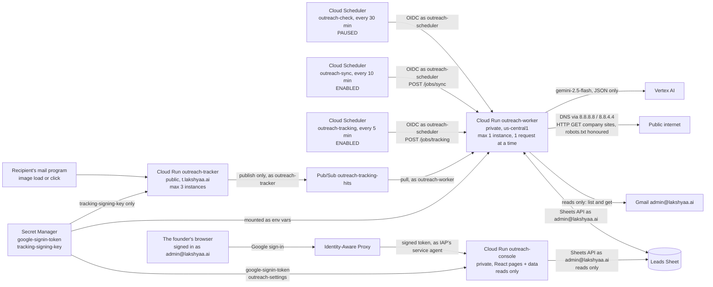

# Outreach — as built

What exists and runs today. `ARCHITECTURE.md` is the plan; this file is the truth about what
is actually built. **Updated after every change**, newest entry first in the change log.

Last updated: 2026-09-29.

Pilot-readiness evidence and blockers: `docs/PILOT_READINESS_AUDIT.md`. Nothing is sent by
this system; drafts wait for the founder's approval. The founder decided on 2026-09-28 that
Approve in the console (the web app) will send one approved email; that is console step 3 and
not built, so today nothing sends.

## Stage status

Corrected 2026-09-28: rows 2 and 3 still read as of 2026-09-22 although the sections below had
moved on (the handbook was already in Drive and all 26 eligible leads were profiled).

| Stage | Status | Proof |
| --- | --- | --- |
| 0 Setup | **Done** 2026-09-22 | Cloud Run worker read 318 A + 174 B leads, wrote a Runs row |
| 1 Email checks | **Built, review fixes applied, awaiting founder spot-check** 2026-09-22 | All 492 leads checked from Cloud Run; 98 rows rechecked after review fixes; 45 tests pass in a container; schedule paused |
| 2 Research | **Bulk fit research paused; all 26 draft-eligible leads profiled** 2026-09-23 | 69 leads fit-researched (sample 30 + batch 1 39); 26 draft-eligible, all profiled: 25 READY, 1 REVIEW_NEEDED (A-0028). 396 pending, not to be resumed for now. No research schedule exists. |
| 3 Drafts (pilot) | **Drive → Gemini → checks pipeline built and run read-only; blocked only by the unapproved offer** 2026-09-23 | The handbook is a Google Doc in Drive and the sign-in holds `drive.readonly`. Read-only over all 26 eligible leads: 21 pass, 5 held. Every passing preview's only blocker is that the founder has not approved the offer wording, so no approval hash exists, Gmail drafting has never run and no draft exists. Since 2026-09-28 the draft endpoints are in the deployed revision, and draft creation is refused there (403): `ENABLE_GMAIL_DRAFTS` is not set on the service. |
| 4 Sync and follow-ups | **Sync deployed and scheduled every 10 minutes** 2026-09-28; no follow-up drafted | 396 tests pass offline in the container with no network; 69 deliberate breaks of the new code, all caught. Revision `outreach-worker-00017-nin` serves 100%; Cloud Scheduler `outreach-sync` (`*/10`, America/New_York) is ENABLED, and its first run returned 200 in 2.4 s. The first real sync (run locally) recorded the 14 hand-sent emails in a new Events tab and 14 A rows. See "Stage 4" below. Its pass test (the founder sends real drafts; SENT, REPLIED and a bounce land correctly) has not been run. |
| 5 Tracking | **Built and deployed 2026-09-28; off for new drafts; t.lakshyaa.ai live over HTTPS (DNS added by the founder, certificate issued 23:55 UTC); pass test: both test emails in the Inbox (personal Gmail and a Google Workspace inbox), one genuine open and one click recorded on the personal one; tracking not yet switched on for drafts** | 460 tests pass offline in the container; 49 deliberate breaks, 48 caught, 1 equivalent. Public tracker `outreach-tracker` smoke-tested live (forged links counted nothing, an off-site click was refused, genuine hits queued with no IP address); the worker picks up hits every 5 minutes (`outreach-tracking`); the Dashboard tab computes 14 emailed, 1 match to check. Its pass test (a test email to the founder's other inbox shows an open and a click) waits for the DNS record and certificate. See "Stage 5" below. |
| 6 Calls | Not started | |
| Console (web app) | **Step 2 deployed 2026-09-29, with an assistant and a light redesign.** 25 first emails in a Drafts tab (21 waiting only for the offer approval, 4 held); the assistant answers questions about the Sheet and can change nothing. Steps 3-4 (approve the offer, edit and Approve-sends; sources and uploads) not built | 571 Python and 43 React tests pass; 30 more deliberate breaks all caught (step 2: 43 of 46; step 1: 42 of 42). Live: revision `outreach-console-00003-b9v`; strangers go to Google sign-in and the assistant route answers 401 without it. **The founder has not yet seen the redesign or asked the live assistant anything.** See "Console" below. |

## What runs where

**The deployed worker reads Gmail, and writes nothing to it.** Since 2026-09-28 the scheduled
sync lists and reads the mailbox every ten minutes. The draft and follow-up endpoints are in the
same revision, but creating a draft is refused (403, tested on the deployed revision) because
`ENABLE_GMAIL_DRAFTS` is not set on the service; the only environment value is the sign-in
token. No code anywhere sends.

## GCP — project `lakshyaa-outreach`

Org `lakshyaa.ai` (787760867942). Billing: "My Billing Account" `01A2E0-CC6FD1-A94FDA`.

| Resource | Setting |
| --- | --- |
| Cloud Run `outreach-worker` | `https://outreach-worker-30387157876.us-central1.run.app`; `--no-allow-unauthenticated` (unsigned call → 403, tested again 2026-09-28); max instances 1, concurrency 1, timeout 600 s; runs as `outreach-worker@`; secrets `GOOGLE_SIGNIN_TOKEN`, `TRACKING_KEY`; **memory 1 GiB** (was the default 512 MiB); gunicorn replaces its process after 6-8 requests. **Serving: `outreach-worker-00023-rav` (tag `next`), 100%, since 2026-09-28 (the memory fix).** Earlier: `00021-das`, `00019-xow` (stage 5), `00017-nin` (stage 4, tag `stage4`), `00016-rop` (tag `profile-review`), `00013-6vx`; all kept for rollback. Traffic is pinned to a named revision, so a new deploy serves nothing until traffic is moved to it |
| Cloud Run `outreach-tracker` | **Public** (`--no-invoker-iam-check`: the organisation allows only lakshyaa.ai accounts in IAM policies, so `allUsers` cannot be granted; this switches off the invoker check on this one service). `https://outreach-tracker-30387157876.us-central1.run.app`, and `t.lakshyaa.ai` once DNS is set. Same image as the worker, run as `gunicorn outreach.tracker:app`; runs as `outreach-tracker@`; only secret `TRACKING_KEY`; `TRACKING_ALLOWED_HOSTS=lakshyaa.ai`; max 3 instances, timeout 15 s; gunicorn replaces its process every 500-600 requests. Revision `outreach-tracker-00002-wvt` (image of worker `00023`: the queue connection is now reused) |
| Domain mapping `t.lakshyaa.ai` | → `outreach-tracker`, created 2026-09-28. **Waits for the founder's DNS record at Squarespace: CNAME `t` → `ghs.googlehosted.com.`**; then Google issues the certificate |
| Service account `outreach-tracker@` | `pubsub.publisher` on `outreach-tracking-hits`; `secretAccessor` on `tracking-signing-key`. Nothing else: no mailbox, no Sheet |
| Pub/Sub | Topic `outreach-tracking-hits`; pull subscription `outreach-tracking-worker` (ack deadline 60 s, retention 7 days) |
| Secret `tracking-signing-key` | 32 random bytes as hex, generated straight into Secret Manager 2026-09-28; never printed or on disk. Read by the tracker, the worker, and gcloud locally |
| Service account `outreach-worker@` | `secretAccessor` on `google-signin-token` and `tracking-signing-key`; `pubsub.subscriber` on `outreach-tracking-worker`; `aiplatform.user` on the project (Gemini, added for stage 2) |
| Service account `outreach-scheduler@` | `run.invoker` on `outreach-worker` only |
| Cloud Scheduler `outreach-check` | `*/30 * * * *` America/New_York → `POST /jobs/check`; **paused** |
| Cloud Scheduler `outreach-sync` | `*/10 * * * *` America/New_York → `POST /jobs/sync`; OIDC as `outreach-scheduler@`, audience the service URL; attempt deadline 600 s; **ENABLED** since 2026-09-28 (founder's instruction). Pause: `gcloud scheduler jobs pause outreach-sync --location=us-central1 --project=lakshyaa-outreach` |
| Cloud Scheduler `outreach-tracking` | `2-59/5 * * * *` America/New_York (minutes 2, 7, 12 …) → `POST /jobs/tracking`; same OIDC; attempt deadline 300 s; **ENABLED** since 2026-09-28. First set to `*/5`, which fired together with sync at every ten minutes: the worker takes one request at a time, and at 20:30 UTC it refused the sync (429). Moved off sync's minutes the same day |
| Secret `google-signin-token` | JSON: account, OAuth client id/secret, refresh token, scopes |
| OAuth app | Internal to `lakshyaa.ai`; Desktop client `outreach-local-signin`; scopes `gmail.compose`, `gmail.readonly`, `spreadsheets` |
| Cloud Run `outreach-console` | `https://outreach-console-30387157876.us-central1.run.app`, created 2026-09-29. **Behind IAP** (`--iap`, Google-managed OAuth client, users of the organisation only); `--no-allow-unauthenticated`, and the only invoker is IAP's service agent `service-30387157876@gcp-sa-iap`. IAP access (`iap.httpsResourceAccessor`): `user:admin@lakshyaa.ai` only. The app checks IAP's token itself (`CONSOLE_IAP_AUDIENCE=/projects/30387157876/locations/us-central1/services/outreach-console`, `CONSOLE_ALLOWED_EMAILS=admin@lakshyaa.ai`). Image from `deploy/console.Dockerfile` via Cloud Build; runs as `outreach-console@`; secrets `GOOGLE_SIGNIN_TOKEN`, `OUTREACH_HANDBOOK_JSON` (= `outreach-settings`); `HANDBOOK_DOC_ID`; max 2 instances, concurrency 8, timeout 60 s, 512 MiB. Revision `outreach-console-00001-2x6` |
| Service account `outreach-console@` | `secretAccessor` on `google-signin-token` and `outreach-settings`. Nothing else |
| Secret `outreach-settings` | The drafting settings (`.secrets/pilot_handbook.json`), version 1 made 2026-09-29, so the console can say what drafting waits for. It holds the founder's postal address and phone for the signature; the console passes on only the approval flags, the daily cap and the sending address. After a local change: `gcloud secrets versions add outreach-settings --data-file=.secrets/pilot_handbook.json --project=lakshyaa-outreach` |
| Build | Default compute account holds `cloudbuild.builds.builder` (source deploys). The console's image is built by `gcloud builds submit` into `cloud-run-source-deploy` |
| Enabled APIs | Sheets, Gmail, Drive, Cloud Run, Scheduler, Pub/Sub, Secret Manager, Vertex AI, Artifact Registry, Cloud Build, IAM Credentials; **IAP and Cloud Resource Manager** (2026-09-29, for the console) |

Deploy: `sh deploy/deploy_worker.sh` builds a new revision with **no traffic** under the tag
`next`. Test it on `https://next---outreach-worker-z6borhtwoq-uc.a.run.app` (a POST needs
`-d ''` or Google's front end answers 411), then move traffic:
`gcloud run services update-traffic outreach-worker --region=us-central1 --project=lakshyaa-outreach --to-tags=next=100`.
Roll back the same way with `--to-revisions=<revision>=100`.

## Worker endpoints

| Endpoint | Does |
| --- | --- |
| `POST /jobs/ping` | Counts leads in A and B, writes a Runs row |
| `POST /jobs/check` | Stage 1 email check (below) |
| `POST /jobs/research?limit=40` or `?ids=A-0001,B-0002` | Stage 2 company research (below). **Not scheduled.** |
| `POST /jobs/profile?limit=5&ids=A-0001,...` (optional `dry_run=1`) | Pilot extraction of company offerings and markets for later drafts. In the serving revision since 2026-09-28 (before that only on the `profile-review` tag). No schedule. |
| `POST /jobs/sync` (optional `dry_run=1`) | Stage 4 sync (below). **Scheduled every 10 minutes** (`outreach-sync`). |
| `POST /jobs/tracking` | Stage 5: queued tracker hits become OPEN and CLICK events (below). **Scheduled every 5 minutes** (`outreach-tracking`). |

**Deployed since 2026-09-28 (revision 00017), draft creation refused there:** `POST /jobs/draft/preview` always uses Gemini with the
Drive handbook for 1–4 explicit Lead IDs. `POST /jobs/draft/create` requires the approved
`written` payload and its exact preview hash; it reloads the Drive handbook and current
quotes before creating a draft. The old fixed-template preview remains available only for
offline comparison and cannot create a Gmail draft, even with an approval hash and quote ID.
Draft creation also requires complete settings and `ENABLE_GMAIL_DRAFTS=true`; default is disabled.
`POST /jobs/draft/reconcile` looks for an existing reserved Gmail draft and never creates
a replacement. These endpoints have no Scheduler job.

**Stage 4 follow-ups, deployed since 2026-09-28, no Scheduler job:** `POST /jobs/followup`
(`?dry_run=1` reports who is due and what blocks drafting; a real run is refused, 403, unless
`ENABLE_GMAIL_DRAFTS=true`, which the service does not set — tested on the deployed revision),
`POST /jobs/followup/preview` (both follow-ups as they would read, and the handbook hash to
approve), `POST /jobs/followup/reconcile` (settles a RESERVED follow-up from its draft; never
creates one).

## The Sheet

`OCILB_A_and_B_Outreach_2026-09-21`, id `1eEVkxc0gJMFptYSr_u9prQ5O850TOX28AEq17CKaFiA`.

| Tab | Rows | System use |
| --- | --- | --- |
| Summary | — | Not touched |
| A_Contact_Now | 318 | Read; system columns added at right |
| B_Contact_Now | 174 | Read; system columns added at right |
| C_Phone_Only | 242 | Not touched (no emails) |
| Runs | 1 per job run | Written by the system |
| Research | 1 per verified quote per research run | Written by the system; append-only history, so re-researched leads have older rows too — the lead row's `Researched at` names the current run |
| Suppression | Header only; 0 entries | Created for future opt-outs and bounces; sync adds bounced and opted-out addresses (none so far, 2026-09-28) |
| Events | 1 per observed event | Created by the first sync, 2026-09-28; append-only; written by sync, the follow-up job and the tracking job; 14 SENT rows so far |
| Dashboard | 21 | Created 2026-09-28 by `python -m outreach.dashboard`; **formulas only**, per tier A, B and both: emailed, emails sent, replied, reply rate, asked to stop, bounced, match to check, tracked, coverage, opened (est.), open rate, clicked, click rate, and notes on what the numbers mean. Rerunning the command refreshes the formulas; it refuses a tab of that name that is not this one |

Row 1 of A and B is a description; **headers are in row 2**. Columns are found by header
name, never by position — A and B have different layouts.

**Stage 2 columns** (added 2026-09-22, right of the stage 1 columns): `Fit`, `Work mix`,
`Fit reason`, `Fit evidence` (up to three verified quotes with page URLs), `Researched at`.

**Company-profile pilot columns** (added 2026-09-22 to A and B): `Profile status`,
`Offerings evidence`, `Markets evidence`, `Profile reason`, `Profiled at`. Offerings and markets
are separate from the fit verdict. The Research tab also holds append-only `OFFERING` and
`MARKET` quote rows with their source URLs. These are source material for a later draft, not
email copy.

**Stage 3 columns in local code only, not added to the live Sheet:** `Draft action`,
`Draft action at`, `Draft status`, `Draft hash`, `Draft quote ID`, `Draft ID`,
`Draft link`, `Drafted at`, and since 2026-09-28 `Draft thread ID` (the Gmail thread of the
created draft, so sync can recognise its send for certain).

**Stage 4 columns and tab.** Added by the first real sync, 2026-09-28 (founder's go): the
append-only **Events** tab, and on **A_Contact_Now only** (B has had no email yet) seven columns
right of the founder's last one: `Outreach status`, `Sent to`, `Sent at`, `Replied at`,
`Follow-ups sent`, `Last event`, `Next action`. Not yet in the live Sheet, added by the first
write that needs them: the same seven on B, and `Follow-up step`, `Follow-up action`,
`Follow-up action at`, `Follow-up status`, `Follow-up draft ID`. "Outreach status", not the plan's "Status": a plain "Status" is too likely to be a column
of the founder's own. Before writing, the code refuses if any of these names already appears to
the left of `Lead ID` (where every column is the founder's).
They are created only by an enabled draft write. A `RESERVED` action counts toward the
daily cap and prevents automatic retry after an uncertain Gmail result.

**System columns** (added 2026-09-22, right of the founder's columns): `Lead ID`,
`Email check`, `Reason`, `Checked at`.

**Founder columns the system reads:** `BEST EMAIL`, `Their email`, `Decision maker`,
`Website`, `Warning`, `Sent by hand`.
`Where it came from` is no longer used by any rule: it was wrong for A-0155 (see below).

**Column changes made with founder approval, 2026-09-22** (`tools/tidy_columns_2026_09_22.py`):
removed from A — two empty unlabelled columns, `Sheet`, `Commercial confidence`,
`Apollo lookup`; removed from B — `Strong proof`, `Sheet`, `Commercial confidence`,
`Apollo lookup`, `Bucket`. Tab A's unlabelled column of "Sent email on 9/22/2026" marks
named `Sent by hand` (14 marks kept). Undo: File → Version history.

## Stage 1 — email check

Code: `outreach/checks.py` (rules), `outreach/job_check.py` (job).

- Gives each lead a permanent `Lead ID` (`A-0001`…, `B-0001`…); existing IDs are never changed.
- Checks only rows whose `Email check` is blank. **Clear that cell to re-check a row.**
- A before B, top to bottom: the first row with an address keeps it; later ones are DUPLICATE.
- **Write safeguard** (`Tab.write`, since the review fixes). Just before writing, the tab is
  re-read and every lead is found again: by its `Lead ID` (must be the only row with that ID),
  or, for a lead getting its first ID, by its full set of founder values among rows without an
  ID (must match exactly one row). Its founder values must be unchanged, and the system cells
  about to be written must still hold what was read. Otherwise that row is skipped, left
  blank for the next run, and named in the Runs row (result PARTIAL). Sorting, inserting,
  deleting, editing and swapping rows that share an email are all covered by tests.
  Remaining limit: Sheets has no transactions, so an edit landing in the moment between that
  re-read and the write is not detected.

| Result | Rule |
| --- | --- |
| SENT BY HAND | `Sent by hand` is filled. Never drafted to. |
| INVALID | No address; malformed; or DNS says the domain takes no mail (no domain, or null MX) |
| DUPLICATE | Same address as an earlier Lead ID (named in Reason) |
| RISKY | Apollo `Warning`; email domain differs from website; a personal mailbox (Gmail, Yahoo, ISP…) **not found on the company's own site** or the site could not be read; generic inbox (`info@`, `office@`, `hr@`…); website does not load; no website; DNS could not be read |
| OK | None of the above. **Not proof the mailbox exists** — outbound port 25 is blocked, so only a real send's bounce proves that |

**Website probe:** 2xx/3xx loads. 401/403/429 means the server is up but refuses robots — the
site exists, noted in Reason. 404, 410, other 4xx and 5xx do not load. If the listed page is
missing but the homepage answers, the site loads (noted). Each request is retried up to three
times: a passing SSLError on a working site (A-0151) otherwise marked it dead.

**Personal mailbox:** OK only if the address is actually found on the company's site — the
listed page, the homepage and up to six same-site contact/about pages, honouring robots.txt,
reading plain text, `mailto:` links, Cloudflare-protected addresses and `[at]`/`[dot]`
spellings. Image names (`logo@2x.png`) and form placeholders are ignored. Not found or not
readable → RISKY with what the site does show.

DNS is asked of Google Public DNS: the default resolvers on the founder's PC and on Cloud
Run timed out on `neo.rr.com`, which Google answers. A lookup that cannot be completed is
RISKY ("could not check"), never INVALID.

**Current results (after the role-inbox recheck, 2026-09-22):**

| | A | B | Total |
| --- | --- | --- | --- |
| OK | 202 | 115 | 317 |
| RISKY | 91 | 57 | 148 |
| DUPLICATE | 10 | 2 | 12 |
| SENT BY HAND | 14 | 0 | 14 |
| INVALID | 1 | 0 | 1 |

**Role-inbox recheck** (`tools/recheck_role_inboxes_2026_09_22.py`, Runs row
`recheck-role-inboxes`): department and role mailboxes added to the generic-inbox rule
(`checks.ROLE_INBOXES`: employment, hiring, recruiting, resumes, apply, orders, quotes,
marketing, warranty, parts, purchasing, projects, customer.service, payroll, invoices,
safety, scheduling and variants). Only OK/RISKY rows with such an address were re-checked:
5 rows, all OK→RISKY — A-0147 `customer.service@`, A-0200 `employment@`, A-0224
`employment@`, A-0275 `marketing@`, B-0062 `apply@`. No founder column written.

**Review-fix recheck** (`tools/recheck_2026_09_22_fixes.py`, run locally, Runs row
`recheck-fixes`): only OK/RISKY rows that are personal mailboxes or whose website is not a
clean load were re-evaluated, and only rows whose result or reason changed were written —
98 rows (82 OK→OK with evidence added to Reason, 16 OK→RISKY). No founder column written.
No site returned 404 for its homepage; two listed pages 404 with a live homepage (B-0058,
B-0074). The 16 now RISKY are personal mailboxes not found on the company's site:
A-0155, A-0170, A-0171, A-0177, A-0181, A-0208, A-0221, A-0223, A-0287, B-0045, B-0084,
B-0087, B-0088, B-0090, B-0134, B-0160. Of these, A-0155, A-0170, A-0171, A-0177, A-0287 and
B-0090 publish a different address on their own site.

**A-0155** (Apex Mechanical Systems, `apex.mechanical@sbcglobal.net`): labelled "read from
their website", but its `Kind` column says "on the licence", and the site's contact page and
homepage show only `apex@apexmechsys.com` (checked by hand and by the new rule). RISKY for
review; `BEST EMAIL` left as the founder has it.

**Earlier first run, 2026-09-22 20:24 UTC (492 leads), superseded above:**

| | A | B | Total |
| --- | --- | --- | --- |
| OK | 215 | 123 | 338 |
| RISKY | 78 | 49 | 127 |
| DUPLICATE | 10 | 2 | 12 |
| SENT BY HAND | 14 | 0 | 14 |
| INVALID | 1 | 0 | 1 |

RISKY reasons: generic inbox 105, Apollo warning 21, domain differs 1. The Stage 1 probe
reported every website as loading; its current status threshold also accepts HTTP 404.
INVALID: `A-0313` `tom@wrmechanical.com` — the domain publishes a null MX (accepts no mail);
the company's site is `wrmech.com`.

### Independent review, 2026-09-22

A read-only check of the live Sheet confirmed all five totals above. Nineteen selected rows
covered OK, RISKY, DUPLICATE, SENT BY HAND and INVALID; their labels agreed with the source
fields and reasons in the Sheet. The 13 local tests also passed in an isolated container.
Of four sampled personal-mailbox OK rows labelled "read from their website", three addresses
were visible on the company homepage. The fourth was not found on the homepage or its one
linked contact/about page; its source claim remains unconfirmed and needs a human check.
This sample does not validate every row or prove mailbox activity. The founder spot-check gate
remains open, and the 30-minute schedule remains paused.

Two implementation limits surfaced in review: the website probe currently treats HTTP 404 as
"loads" because it accepts any status below 500, and the pre-write row guard compares only
`BEST EMAIL`, so a sort or edit involving rows with the same email may escape detection.
These should be corrected before relying on recurring checks. The current deployed service
and 492 recorded results have not been changed by this review.

## Stage 2 — company research

Code: `outreach/research.py` (reading, verification, verdict), `outreach/job_research.py`
(job), `outreach/gemini.py` (Vertex AI), `outreach/eligibility.py` (who may get a draft).

**Company fit is separate from email risk.** Research runs for OK and RISKY leads alike and
never looks at the address. Stage 3 may draft only when `Email check` is OK **and** `Fit` is
QUALIFIED (`eligibility.draft_eligible`, tested): a RISKY address never gets a draft, however
good the company.

1. **Read the company's own site** — the listed page, the homepage and same-site pages whose
   links suggest about/services/projects/markets, up to 8 pages, 8,000 characters each;
   robots.txt honoured; scripts and styles stripped.
2. **Gemini proposes quotes** (`gemini-2.5-flash`, temperature 0, JSON schema), each tagged
   COMMERCIAL_PROJECT, COMMERCIAL_SERVICE, RESIDENTIAL or GENERAL_CONTRACTOR.
3. **The code keeps a quote only if it is on the page it names**, word for word (case, spacing
   and curly quotes ignored), and stores the page's own text, not the model's copy.
4. **Categories must be supported by the quote's own words.** A general-contractor quote with
   no general-contracting signal counts as project work. A project quote with no project
   signal at all counts as service. **A project quote counts only if it is specific**
   (`research.is_specific`, founder review 2026-09-22): it names construction activity
   (construction, build-out, fit-out, tenant, design-build, new build, bid, general
   contractor/GC, builders, prevailing wage, union, plan-and-spec, portfolio, turn-key), or
   names a commercial sector (school, hospital, industrial, facility, municipal…) together
   with project or installation work. A quote that also mentions homes or residential work
   must name construction activity. Otherwise it is **COMMERCIAL_GENERIC** — shown as
   evidence, counted like service, never qualifying. So "residential and commercial projects",
   "150+ Commercial Projects Done" and a list of customer types cannot qualify a company.
5. **The verdict is computed in code** ("project quote" below means a specific one):

| Fit | Work mix | When |
| --- | --- | --- |
| QUALIFIED | COMMERCIAL | ≥2 specific project quotes, no residential; or exactly 1, **and** a verified non-residential quote (that one or another) explicitly shows commercial construction or installation work |
| REVIEW_NEEDED | COMMERCIAL | exactly 1 specific project quote and nothing explicit (founder rule 2026-09-22: `research.is_explicit` needs a commercial setting — commercial, industrial, office, school, hospital, facility… — **and** construction or installation work — construct, install, build-out, fit-out, design-build, new build, wiring, renovat — with no residential mention) |
| QUALIFIED | MIXED | ≥2 specific project quotes and residential quotes |
| REVIEW_NEEDED | MIXED | 1 specific project quote against residential, or only generic/service plus residential |
| REVIEW_NEEDED | COMMERCIAL_SERVICE | generic or service/repair wording for businesses, no specific project work |
| REVIEW_NEEDED | GENERAL_CONTRACTOR | presents itself as a GC, construction manager or developer |
| REVIEW_NEEDED | UNCLEAR | site read, nothing says who they work for |
| REVIEW_NEEDED | UNREADABLE | no website, blocked (403 or robots.txt), no answer, or no readable text |
| DISQUALIFIED | RESIDENTIAL | residential quotes only |

A model or network failure leaves the row blank for the next run (Runs row PARTIAL). Clear
`Fit` to research a lead again.

**Final sample, 2026-09-22 — 30 leads, every 15th OK/RISKY lead across A and B.** Researched
from Cloud Run; then re-evaluated twice from the stored, verified quotes
(`tools/refit_sample_2026_09_22.py`, Runs rows `refit-sample`; no site re-read, no model call,
so each change is the rule alone): the specific-evidence rule, then the single-quote
explicit-work rule.

| | Count | Leads |
| --- | --- | --- |
| QUALIFIED — COMMERCIAL | 7 | A-0062 Conti, A-0078 Harrington, A-0112 Cincinnati Air, A-0188 Current Systems, A-0219 Guenther, A-0234 ICS, A-0280 Reddy |
| QUALIFIED — MIXED | 2 | A-0030 Monroe, A-0173 Bromack |
| REVIEW_NEEDED — COMMERCIAL | 2 | A-0250 Langdon, B-0100 HEAT |
| REVIEW_NEEDED — MIXED | 15 | A-0015, A-0127, A-0143, A-0158, A-0204, A-0295, A-0310, B-0009, B-0024, B-0039, B-0055, B-0070, B-0085, B-0115, B-0145 |
| REVIEW_NEEDED — UNREADABLE | 3 | A-0046 (HTTP 403); A-0265, B-0130 (no readable text, likely script-built) |
| REVIEW_NEEDED — GENERAL_CONTRACTOR | 1 | A-0095 Pleasant Valley |
| DISQUALIFIED | 0 | |

By email check: **OK+QUALIFIED 7 — the only draft-eligible leads** (A-0030, A-0062, A-0078,
A-0112, A-0173, A-0188, A-0219); RISKY+QUALIFIED 2 (A-0234, A-0280); OK+REVIEW 15;
RISKY+REVIEW 6.

**Single-quote rule changes** (dry run: exactly these 2 rows; 2 written):

| Lead | Was | Now | Evidence |
| --- | --- | --- | --- |
| A-0188 Current Systems | QUALIFIED/COMMERCIAL | unchanged | its one project quote is explicit: "Commercial and industrial installation of electrical power equipment." |
| A-0250 Langdon | QUALIFIED/COMMERCIAL | REVIEW_NEEDED/COMMERCIAL | one project quote, "the opportunity to bid on your project… sheet metal fabrication", names no commercial setting or installation work; its other quotes are generic or product ("spiral ductwork… ensuring easy shipping and installation" has no commercial setting) |
| B-0100 HEAT | QUALIFIED/COMMERCIAL | REVIEW_NEEDED/COMMERCIAL | one project quote, "Over 75 School District Projects Completed", names no construction or installation work; its installation quotes ("Installing occupancy sensors…") name no commercial setting |

Current Systems' row was not rewritten: its verdict did not change, and only the wording of
its reason would have.

**Verdict changes from the re-evaluation** (dry run shown to the founder before applying;
14 rows written — these 6 plus 8 QUALIFIED leads whose generic quotes were re-labelled; 12
rows whose reason would differ only in wording were left as they were):

| Lead | Was | Now | Why — the quotes it had |
| --- | --- | --- | --- |
| A-0015 Efficient Electric | QUALIFIED/MIXED | REVIEW_NEEDED/MIXED | one specific quote ("…and tenant build-outs") against three residential; "services for residential, commercial, and industrial projects" is generic |
| A-0143 Waterworks | QUALIFIED/MIXED | REVIEW_NEEDED/MIXED | only a list of customer types ("restaurants… hospitals… warehouses") and "we serve many municipalities" — no construction work named |
| A-0204 Enviro Flow | QUALIFIED/MIXED | REVIEW_NEEDED/MIXED | one specific quote (conduit lining with "the GC" at the White House); "For commercial projects, we serve the full state of Ohio" is generic |
| B-0039 Alpine Electric | QUALIFIED/MIXED | REVIEW_NEEDED/MIXED | the banner "ALL YOUR RESIDENTIAL, COMMERCIAL, OR INDUSTRIAL ELECTRICAL PROJECTS" is generic; only the heading "New Construction" is specific |
| B-0115 Kouris Electric | QUALIFIED/MIXED | REVIEW_NEEDED/MIXED | "150 + Commercial Projects Done" and "estimating and project management" are generic; four residential quotes |
| B-0145 Rapid Electric | QUALIFIED/MIXED | REVIEW_NEEDED/MIXED | "all sizes of residential and commercial projects" (twice in different words) is generic; the rest is service |

(At this point A-0188, A-0250 and B-0100 still qualified on a single specific quote; the
single-quote rule above then moved Langdon and HEAT to review.) The rule is conservative in the other direction too: Harrington's "performed work
at manufacturing plants… wastewater treatment plants" is labelled generic (no project word),
though Harrington qualifies on four other quotes.

**Bulk research of the remaining 435 leads** (founder-approved 2026-09-22; batches of at most 40
through the private worker, `POST /jobs/research?limit=40`, revision `outreach-worker-00012-fmn`,
confirmed serving 100% and matching commit `1a0045e` before the first batch; pending count
confirmed 435 = A 186 OK + 87 RISKY, B 109 OK + 53 RISKY; the 30 reviewed rows are never
selected because their `Fit` is filled).

| Batch | Researched | QUALIFIED | REVIEW_NEEDED | DISQUALIFIED | Failed (left blank) | Tokens in / out / thinking |
| --- | --- | --- | --- | --- | --- | --- |
| 1 | 39 of 40 | 25 (18 commercial, 7 mixed) | 13 | 1 | 1 — A-0026, Gemini read timeout after 120 s | 222,125 / 16,005 / 100,503 |

No reviewed row changed; nothing skipped.

**Stopped after batch 1** (founder instruction: stop if generic wording starts qualifying
firms). Every new QUALIFIED verdict was read against its stored project quotes. Most are
clearly right (e.g. A-0041 Warner's contract list, A-0017 Gateway's projects with named GCs,
A-0035 Regal's middle school). But **A-0040 The Pattie Group**, a landscape design firm,
qualified as MIXED on "from design and permits to construction" and "The Design/Build
Approach… horticulture and installation experts" — no commercial setting named — and
**A-0021 Halpin Plumbing** on "service, excavation, and construction plumbing". Cause: the
words "construction" and "design-build" make a quote specific on their own.

Candidate fix, simulated read-only over all 69 researched leads (no writes): those words count
only with a commercial setting in the same quote; commercial-only terms (tenant, build-out,
fit-out, general contractor/GC, plan-and-spec, prevailing wage, union) still count alone.
Result: 3 changes — A-0021 and A-0040 to REVIEW_NEEDED as intended, and **A-0059 Cinfab** to
REVIEW_NEEDED too, although it is a commercial sheet-metal subcontractor ("prime sheet metal
partner to a construction manager, general contractor or building owner"); none of the 30
reviewed rows changes.

**Founder decision (option 2, narrow), implemented 2026-09-22:**

- `research.is_specific`: commercial-construction-only terms (tenant, build-out, fit-out,
  general contractor/GC, plan-and-spec, prevailing wage, union) count on their own; other
  construction words (construction, design-build, new build, bid, builders, portfolio,
  turn-key) count only with a commercial setting in the same quote; with a residential
  mention, only a named sector plus construction counts; bare "commercial projects" never.
- `research.subcontracting_support` (A-0059 rule): for a commercial-only firm with one
  specific project quote, it also qualifies if a verified non-residential quote says it works
  as a subcontractor, or as a subcontractor/partner to a general contractor or construction
  manager, **and** a verified non-residential quote names construction or installation work.
  Subcontracting alone never qualifies.
- Dry run over all 69 researched leads: 2 Fit changes, 2 Work-mix-only changes, 23 rows whose
  verdict and label stay the same but some quotes would now be labelled generic. **Only the 4
  rows whose Fit or Work mix changes were written** (founder: update only affected rows):

| Lead | Was | Now |
| --- | --- | --- |
| A-0021 Halpin Plumbing | QUALIFIED/MIXED | REVIEW_NEEDED/MIXED — "construction plumbing" names no commercial setting; one specific quote left against three residential |
| A-0040 The Pattie Group | QUALIFIED/MIXED | REVIEW_NEEDED/MIXED — landscape design; no specific commercial project quote left |
| A-0058 Cabling Concepts | REVIEW_NEEDED/COMMERCIAL | REVIEW_NEEDED/COMMERCIAL_SERVICE — label only |
| A-0250 Langdon (reviewed) | REVIEW_NEEDED/COMMERCIAL | REVIEW_NEEDED/COMMERCIAL_SERVICE — label only; "bid on your project" is no longer specific |

A-0059 Cinfab stays QUALIFIED under the subcontracting rule. The 23 unwritten rows keep their
stored evidence labels, which predate this rule; their verdicts are what this rule gives.
Worker redeployed as revision `outreach-worker-00013-6vx`.

**Bulk research paused by the founder** (2026-09-22): the goal is a small set of useful Gmail
drafts, not researching every lead. The 396 pending leads stay unresearched. Next: a draft
pilot from the already-qualified leads once the founder's handbook is available.

**Draft-eligible now (OK email and QUALIFIED fit): 26 leads** — A-0017 Gateway, A-0020 Graft,
A-0022 Industrial Reliability and Repair, A-0025 Koch Refrigeration, A-0028 MJB, A-0030 Monroe,
A-0031 Muetzel, A-0033 Perfection Group, A-0036 Reliant, A-0039 Geopfert, A-0043 Wuest,
A-0045 Accurate Electric Construction, A-0047 All Phase, A-0049 Applied Mechanical, A-0051 Bay,
A-0052 Bell & Blaire, A-0053 Blau, A-0055 BMWC, A-0056 Bonham, A-0059 Cinfab, A-0062 Conti,
A-0078 Harrington, A-0112 Cincinnati Air, A-0173 Bromack, A-0188 Current Systems,
A-0219 Guenther. 23 have a named owner, president or CEO; A-0173, A-0188 and A-0219 use a
company or office mailbox. QUALIFIED with a RISKY address (no draft): 6.

**How the rule got here.** The first sample run used "any project quote qualifies": 22
QUALIFIED, and reading them showed the model labelling fixture lists, product lines, a dealer
statement and a customer testimonial as project work (A-0295, B-0039, A-0127, A-0204). Adding
the project-signal check and the two-quote bar for mixed firms gave 15/15; the model then
called two trades (A-0112 design-build HVAC, B-0115 electrical) general contractors, fixed by
the general-contracting signal check. Founder review then found generic wording still
qualifying mixed firms (B-0039, B-0145, A-0143): the specific-evidence rule took the sample
from 17 to 11 QUALIFIED; the single-quote explicit-work rule took it to 9. Each fix has a test from the case that caused it
(`tests/test_research_specific.py` uses the sample's own quotes).

**Cost, measured:** the 30-lead sample used 164,522 input, 10,303 output and 81,206 thinking
tokens — about 5,500 / 340 / 2,700 per company. No price is stated here; it has not been
checked against current Vertex AI pricing.

## Known limits after the review fixes

- Company-profile extraction selects exact 5–50-word quotes from the company's own site,
  verifies each quote against its named page, and marks a profile READY only when it has an
  offering quote. A READY result still needs human review before its facts enter a draft:
  Gateway Electric's dry-run quotes described project coordination, not a concrete electrical
  offering, so that lead was not written. Monroe's profile includes a residential-service
  quote; a commercial draft should select its separately verified commercial offerings.
- The profile job selects only unsent leads with OK email and QUALIFIED fit, and does not
  change fit or research the contact's private life. `dry_run=1` makes no Sheet changes.
  There is no profile schedule, draft generator, or sending code.

- A 403 to robots varies between runs on some sites; it changes only a note, never a result.
- The role-inbox list is a fixed word list; a role mailbox using a word not on it is still OK.
- OK is still not proof a mailbox exists; only a bounce after a real send proves that.
- Research: script-built sites with no server-rendered text read as UNREADABLE.
- Research: "specific" is a word test. It can miss specific work phrased without its words
  (Harrington's plant list) and would accept a construction word used loosely. "Explicit"
  is a word test too; A-0188 Current Systems is the one sample lead qualifying on a single
  project quote.
- Research: the model is not fully repeatable at temperature 0; re-running a lead can change
  which quotes it proposes, and so occasionally its verdict.

## Safety checks in code

- `tests/test_no_send.py` fails if any sending code appears (`.send(`, `smtplib`, `SMTP(`,
  `gmail.send`, `sendmail`). Proven to fail on a planted `import smtplib`.
- `tests/test_checks.py` covers every stage 1 rule, the website status codes (200/301/401/403/
  429 load; 400/404/410/500/503 do not), homepage fallback, retry, address finding
  (mailto, Cloudflare, `[at]`, robots.txt, other sites ignored, junk dropped).
- `tests/test_sheet_write.py` drives the write safeguard against a fake Sheet: sort, swap of
  two rows sharing an email, insert, delete, founder edit, copied Lead ID, identical new rows,
  and a system cell filled by someone else.
- `tests/test_research.py` runs research against fake sites and a fake model: commercial,
  residential, mixed (two and one project quotes), service-only, unclear, four unreadable
  cases (no answer, HTTP 500, robots.txt, script-only), paraphrased and misattributed quotes
  discarded, script text ignored, fixture-list downgrade, GC and mislabelled-GC cases, and
  draft eligibility (RISKY never eligible, even when QUALIFIED).
- `tests/test_research_specific.py` replays the sample's own quotes: generic phrases (Alpine,
  Rapid, Waterworks, Efficient, Kouris, Enviro) never qualify; Monroe (mixed), Conti and Reddy
  still do. Single-quote cases: Current Systems qualifies; Langdon's and HEAT's full stored
  evidence does not; a single project quote backed by another explicit verified quote does.
- Batch-1 cases: A-0040 Pattie and A-0021 Halpin do not qualify; A-0059 Cinfab does; subcontracting
  without construction or installation work, or mentioning homes, does not count.
- `tests/test_company_profile.py` covers quote verification, off-domain redirects, unreadable
  sites, long navigation text, pilot selection, and dry-run write isolation.
- All 138 tests run in a clean container with no network:
  `docker build -f deploy/test.Dockerfile -t outreach-tests . && docker run --rm --network none outreach-tests`
- `.secrets/` and client/token JSON are git-ignored; a pre-commit hook refuses them
  (proven to block a planted file).

## Stage 3 live preview review, 2026-09-22

Run locally, read-only (`python -m outreach.job_draft --ids A-0030,A-0062,A-0078,A-0112`),
against the live Sheet with `.secrets/pilot_handbook.json` (git-ignored). Filled only with
verified values — product `Lakshyaa`, sender email `admin@lakshyaa.ai` (the signed-in mailbox),
website `https://lakshyaa.ai` (HTTP 200), daily cap 4. Sender name, title, postal address,
intended use, next-week action and CTA are visible `[FOUNDER: …]` placeholders;
`offer_approved` is false. No preview has a hash; no Sheet or Gmail write.

| Lead | Opening quote chosen | Reads as |
| --- | --- | --- |
| A-0078 Harrington | "Harrington Electric Co. is Cleveland's oldest and finest electrical and voice-data-video contracting firm." | fine |
| A-0030 Monroe | "New Construction Plumbing Plumbing layout, rough-in…" — from the **residential** page | weak: heading run into the sentence |
| A-0112 Cincinnati Air | "Commercial HVAC Comfort cooling, chillers, DX systems, boilers…" | weak: heading plus equipment list |
| A-0062 Conti | "The Conti Corporation specializes in heating and plumbing services" | weak: bland, cut off |

**Cause is quote selection, not the companies:** `drafting.preview` always uses the first
stored OFFERING quote. Each weak lead has a better verified quote in its own profile (Monroe:
"…installs and modifies commercial gas lines for equipment upgrades, renovations, and new
connections…"; Conti's strongest line — "portfolio includes schools, hospitals…" — is stored as
a MARKET quote, which the template never uses; all three Cincinnati Air offerings have run-in
headings because page text joins headings to paragraphs). Profiling replacement companies
would not help, since the same first-quote rule would apply; not done.

**Greeting:** every preview says "Hi there" because the code reads a `First Name` column the
Sheet does not have. For all four leads `Decision maker` is the person at `BEST EMAIL`
(`Their email` equals `BEST EMAIL`), so a first-name greeting would be accurate.

**Local Windows runs** need `tzdata` in the venv (`zoneinfo` has no system time-zone data on
Windows); installed locally only. The container resolves `America/New_York` without it.

**Superseding copy check after the local selection fix, 2026-09-22:** a read-only
rerun of the same four leads now selects Monroe's commercial gas-line installation
sentence, Conti's schools/hospitals portfolio sentence, and Harrington's original
company sentence. Cincinnati Air has no clean complete-sentence default among
its four stored quotes (three headings run into lists and one is a sector list),
so its preview is held for an explicit reviewed quote or better source evidence.
Greetings now say Hi Brian, Hi John, Hi Tom and Hi Mark respectively because
`Their email` matches `BEST EMAIL`; a mismatch or role inbox falls back to
“Hi there.” The previews remain blocked by founder fields, approval and the
missing Suppression tab; no draft or send occurred.

## Pilot set after replacing Cincinnati Air, 2026-09-22

A-0112 Cincinnati Air's four stored quotes all had run-in headings or were bare lists, so it
has no default opening. Under the founder's instruction to profile a replacement when a
profile gives weak copy, **A-0049 Applied Mechanical** (OK email, QUALIFIED, Michael Ayers,
President; `Their email` = `BEST EMAIL`) was profiled alone through the private
`profile-review` tag: dry run first, then one write — READY, 3 offering and 2 market quotes,
tokens 6,757 in / 352 out / 1,532 thinking. No other lead was profiled.

Read-only previews for the pilot four (A-0030, A-0062, A-0078, A-0049) — all still blocked on
handbook fields, offer approval and Suppression; no hash; no Sheet or Gmail write:

| Lead | Greeting | Opening quote (source) |
| --- | --- | --- |
| A-0030 Monroe | Hi Brian | "Monroe Plumbing installs and modifies commercial gas lines for equipment upgrades, renovations, and new connections with safety and code compliance at the center." (commercial-gas-lines page) |
| A-0062 Conti | Hi John | "The Conti Corporation portfolio includes schools, hospitals, sewage/wastewater treatment facilities, and churches throughout northeast Ohio and western Pennsylvania." (home) |
| A-0078 Harrington | Hi Tom | "Harrington Electric Co. is Cleveland's oldest and finest electrical and voice-data-video contracting firm." (about) |
| A-0049 Applied Mechanical | Hi Michael | "Our specialties include plumbing and process piping, sheet metal fabrication, MEP, system retrofits, service, controls, design-build, plan & spec, and fast-track projects." (home) |

**Applied opener changed on review:** the default above is a service list, so the pilot uses
A-0049's complete MARKET sentence, selected explicitly with
`--quote-choice A-0049=83f3b598a4a1d94f`: "AMS is a regional mechanical contractor
specializing in the design, installation, and service of heating, ventilation, air
conditioning, and plumbing systems for commercial, industrial, and institutional clients."
Read-only rerun: all four render with first-name greetings; still blocked (no hash) on the
same missing founder values; the approval hash will cover the selected quote ID.

A-0112 keeps its READY profile but is out of the pilot. No opt-outs from the 14 hand-sent
emails are known; checking those threads is a precaution awaiting the founder's yes.

## Hand-sent emails: read-only Gmail check, 2026-09-22

Founder-authorised, read-only (`messages.list` / `messages.get` with `format=metadata`: headers
and Gmail's snippet only) in `admin@lakshyaa.ai`, for the 14 leads marked `Sent by hand`:

- **14 sent** on 2026-09-22 between 13:18 and 14:41 EDT, from `Admin Lakshyaa
  <admin@lakshyaa.ai>`; subjects "…Advice on how a tight cash week gets decided" (12) and
  "Contracts from ten thousand to forty million" (A-0012).
- **0 replies, 0 bounces, 0 opt-out wording** as of the check.
- **A-0005 Approved Plumbing was sent to `jeff@approvedplumbing.com`, not the Sheet's
  `BEST EMAIL` `dennis@approvedplumbing.com`.** Nothing from that domain has come back either.
- The sender's display name is "Admin Lakshyaa". Drafts created in this mailbox would show the
  same name unless the founder changes it in Gmail settings.

**Proposed Suppression entries: none** (no opt-outs or bounces). The `Suppression` tab has not
been created: it waits for the founder's go, and would start with only its header
(`Address or domain`, `Reason`, `Added at`, `Source`).

**Offer wording:** the founder rejected the first suggestion as too narrow. Three options
built on the inputs in the product's cash-flow inputs document (bank balances, open invoices
and bills with due dates, payroll dates, fixed costs, upcoming billings by job; retainage and
committed costs where relevant) were rendered read-only for the pilot four (130–153 words
each); `offer_approved` stays false; none chosen yet.

## Proposed template v3, under founder review 2026-09-22

Rendered read-only with the proposed template substituted in memory; **no code changed,
`offer_approved` stays false, nothing drafted or deployed.** Changes from the live template:

- The product paragraph and question the founder asked to keep as the working version, ending
  on one question instead of an invitation sentence.
- **The opening is a natural observation written for each company** instead of
  `Your site says, "…"`. It restates that company's stored quote in plain words, says nothing
  about their cash or finances (checked against a money-word list), and the review preview
  still shows the quote and its page URL beside the email.
- **A truthful per-lead subject** that names the company, not the product.

| Lead | Subject | Opening | Rests on (source) | Words |
| --- | --- | --- | --- | --- |
| A-0030 Monroe | Question for Monroe Plumbing | "I noticed Monroe handles commercial gas-line work for equipment upgrades and renovations." | "…installs and modifies commercial gas lines for equipment upgrades, renovations…" (monroeplumbing.net/commercial-gas-lines) | 103 |
| A-0062 Conti | Question for Conti Corporation | "I noticed Conti's portfolio runs to schools, hospitals and treatment plants across northeast Ohio." | "…portfolio includes schools, hospitals, sewage/wastewater treatment facilities, and churches…" (theconticorporation.com) | 105 |
| A-0078 Harrington | Question for Harrington Electric | "I noticed Harrington works on commercial, industrial and institutional facilities across Northeast Ohio." | "…solutions for commercial, industrial and institutional facilities in Northeast Ohio." (harringtonelectric.com) | 104 |
| A-0049 Applied Mechanical | Question for Applied Mechanical | "I noticed AMS designs and installs HVAC and plumbing systems for commercial, industrial and institutional clients." | "AMS is a regional mechanical contractor specializing in the design, installation, and service…" (appliedmechanicalsys.com) | 107 |

**Open design question:** these openings are written by hand for four leads. Generating them
for more leads needs a model step that rewrites a stored quote, with its own check that the
result adds no fact the quote does not contain. Not built.

**Suppression tab created 2026-09-22** with header only (`Address or domain`, `Reason`,
`Added at`, `Source`) and no entries; the Gmail check found no opt-outs **as of that check**.
Recorded in Runs as `suppression-tab`.

## Stage 3 — the written-draft pipeline (built 2026-09-22, not deployed)

Code: `outreach/handbook_drive.py` (the handbook), `outreach/writer.py` (Gemini, then the
checks), `outreach/drafting.py` (assembly, gates, approval hash), `outreach/job_draft.py`
(the job), `outreach/eligibility.py` (who may be written to).

**1. The handbook comes from Drive, or drafting stops.** `handbook_drive.load` reads one
document by ID (`HANDBOOK_DOC_ID`, else `handbook_doc_id` in settings; no default), exports a
Google Doc as text, and returns the text with a SHA-256 of its bytes. It raises
`HandbookUnavailable` — which blocks every preview — when the ID is missing or malformed, the
file is absent, unshared, not text, empty, over 60,000 characters, or when Drive refuses the
read. **A local file never substitutes for it.** Reading needs the `drive.readonly` scope,
which the current sign-in does not have, so today every written preview is blocked with that
reason. That is the intended state until the founder's document exists.

**2. Gemini writes, but only sentences.** `writer.compose` sends the handbook as instructions
and the lead's verified quotes as **data, explicitly labelled not-instructions**. The model
returns a subject and three to five labelled sentences: one COMPANY (citing one quote's id),
one to three PRODUCT, one ASK.

**3. Code screens the wording before approval.** `writer.verify` — no model involved, so it
can be re-run later — rejects a draft unless every content word is already present in the
source the sentence claims: the cited quote for a company sentence, the handbook for a product
or ask sentence. Plurals and contractions fold; filler words are ignored. It also refuses a
banned claim (guarantees, "available today", invented cash trouble), any link, address or
phone number inside the copy, a missing or misordered part, an ask that is not a question, and
an ungrounded, over-long or exclamatory subject. It also rejects obvious reversals of a
quote's negation or the handbook's qualified product state. These checks cannot establish
semantic entailment: a sentence can reuse source words while making a different claim.
The founder must compare every exact preview with its cited quote and handbook before approval.
**The greeting, signature, website, phone,
postal address and opt-out line are written by `drafting.assemble`, never by the model.**

**4. The approval binds everything.** The preview hash now covers the handbook's content hash
and document ID alongside the recipient, subject, body, sender, evidence and quote ID. Editing
the Drive document changes the hash, so an approval made before the edit no longer matches and
the draft is refused.

**5. Creating a draft re-checks; it never re-writes.** The live preview endpoint always uses
the Drive writer, and `create` refuses a missing `written` payload. It reloads the
handbook, re-runs `writer.verify` against the live quotes, rebuilds the same body, recomputes
the hash and compares it to the founder's approved hash. The model is not called — a test
asserts that. Everything from before still applies: `ENABLE_GMAIL_DRAFTS` off by default, one
lead at a time, OK email plus QUALIFIED fit, Suppression, HOLD, daily cap, the mailbox must be
the configured sender, no prior send or existing draft, a RESERVED row that blocks any retry
after an uncertain Gmail result, and no sending code anywhere.

**Tests: 255 pass offline in the container** (`docker run --rm --network none lakshyaa-outreach-audit`),
using `examples/synthetic_handbook.txt` and synthetic leads. They prove fail-closed behaviour
for: no handbook, unreadable Drive, a handbook edited after approval, a handbook whose offer
was removed, an unsupported company claim, an invented capability, a promise, an injected
instruction or address inside a quote, a tampered sentence, a wrong or empty hash, missing
authorization, the old-template bypass, two polarity reversals, a second draft for the same
lead, an uncertain Gmail result, and a mailbox that
is not the sender. A synthetic run through the CLI in the container produced a complete,
approvable draft with its evidence and hashes.

**What this does not prove:** no real handbook has been read, no real email has been written
by Gemini, and no Gmail draft has ever been created. Copy quality against the founder's own
handbook is unknown. The lexical and polarity screens do not prove all generated claims true;
human review of the exact copy and source remains essential.

## The handbook in Drive, and the first real previews (2026-09-23)

**Drive read access added.** `outreach/signin.py` now also requests `drive.readonly`; the
founder signed in once and the new token replaced the Secret Manager version. The worker's
stored credentials are read-only for Drive: they can read the handbook and nothing else.

**The handbook document.** `1lnKJMRZe0QPyxFZaV6zNq_GI-HNudncnW1uzrvwzeuU`,
"OUTREACH_HANDBOOK_DRAFT" — a copy of this repo's template draft, holding the writing rules,
the field table, the initial-email template and both follow-ups. A second ID the founder sent
(`1im_UBYRaRCrrvwNtnWc39I8TEJ6MpL-A`) is an uploaded Word file and is refused by design: the
loader accepts Google Docs and text files only.

**First real Gemini run, against that document as it stood.** It produced a good company
sentence from a verified quote, but the only product sentence it could write was "The MVP is
still being finished", and it reused the subject line as the ask. Cause: the document named
the fields `[INTENDED_USE]`, `[NEXT_WEEK_ACTION]` and `[CTA_QUESTION]` but never gave their
values, so there were no product or offer words to ground a sentence in. The pipeline behaved
correctly — it cannot invent what the handbook does not authorise.

**Founder-instructed edit, 2026-09-23** (`tools/edit_handbook_doc.py`): a read-only check
first, then a **separate one-time Google Docs sign-in held in memory only** — never written to
disk or Secret Manager, so the worker's Drive access stays read-only — inserted a
"Draft offer values for founder review" block after the Status paragraph with the three
values. The tool then re-read the document and verified the insertion and that the writing
rules, field table, initial-email template and both follow-ups survived. Content hash
`992bd199043912d1` → `e6415247176218e2`; 5,029 → 5,416 characters. **These values are the
founder's to review; they are not approved copy.**

**Read-only previews after the edit** — all four pilot leads now produce a complete email
whose **only** blocker is `founder has not approved the offer wording`, so no approval hash
exists and none can become a Gmail draft:

| Lead | Opening sentence | Rests on (source) |
| --- | --- | --- |
| A-0030 Monroe | "Monroe Plumbing works with offices, retail spaces, restaurants and hospitality, medical and dental offices, and warehouses across Northeast Ohio." | the same sentence on monroeplumbing.net/commercial-plumbing |
| A-0062 Conti | "The Conti Corporation specializes in heating and plumbing services." | theconticorporation.com |
| A-0078 Harrington | "Harrington Electric Co. is Cleveland's oldest and finest electrical and voice-data-video contracting firm." | harringtonelectric.com/about |
| A-0049 Applied Mechanical | "APPLIED MECHANICAL SYSTEMS INC is a regional mechanical contractor specializing in the design, installation, and service of heating, ventilation, air conditioning, and plumbing systems…" | appliedmechanicalsys.com |

**Copy problems for the founder to judge, not defects in the checks:**

- **A-0049 uses the Sheet's shouted company name**, "APPLIED MECHANICAL SYSTEMS INC". The site
  says "AMS". Nothing in the handbook tells the writer how to name a company.
- **Three of four say the invitation twice** — once in the product paragraph (from the
  template's "I'd like to invite you to…" line) and again as the question. A-0049 does not.
- **Conti and Harrington quote the companies' own marketing back at them** ("first-class",
  "oldest and finest"). Accurate to the source, but it reads as flattery.
- **Monroe's opening is a list of customer types**, accurate but flat.

Each is a handbook question, not a code question: the writer may only use what the handbook
and the quotes give it.

## Four copy fixes, 2026-09-23 (founder-instructed, all still unapproved)

**Two handbook edits** (`tools/edit_handbook_2026_09_23b.py`, a second one-time in-memory Docs
sign-in; the worker's Drive access stays read-only). Read-only check first, then verified after:

1. **Removed** "I'd like to invite you to [NEXT_WEEK_ACTION] and hear where this direction does
   or doesn't fit the way your team works." from the **initial email template only**, so each
   email makes one ask, in its closing question. Both follow-ups keep their own wording, which
   uses different sentences ("If you choose to…", "If you'd like to…") and was not touched.
2. **Added writing rule 6:** prefer a concrete, verified activity over a list of markets or a
   self-promotional phrase such as "first-class" or "oldest and finest".

Content hash `e6415247176218e2` → `b1237580414fe948`; 5,416 → 5,521 characters. Every kept
section verified present afterwards, including both follow-ups and the offer values.

**Two code changes, treated as evidence selection, not as company facts in the handbook:**

- **`drafting.verified_company_name`** takes the Sheet's shouted name, strips a legal suffix
  and finds that name **in the company's own site text**, using the site's capitalisation.
  "APPLIED MECHANICAL SYSTEMS INC" → "Applied Mechanical Systems" (their site writes it that
  way throughout; it also uses "AMS" 48 times, but an abbreviation is never invented here). A
  name that cannot be found on the site **blocks the preview** and, at draft time, raises
  rather than creating. `create` re-derives the same name, so the approved hash still matches.
- **`written_preview(..., quote_id=...)`** lets the operator choose which verified quote the
  writer may use; only that quote is offered to the model, and an unknown id blocks rather
  than silently falling back. Monroe now opens on its commercial gas-lines quote instead of
  the customer-type list.

**A stemming bug this exposed and fixed:** the grounding check folded "serves" to "serv" but
left "serve" alone, so a sentence that faithfully repeated its quote was rejected. Stems are
now compared as sets, symmetrically.

**Previews after the fixes** — all four render, each with one ask, and the **only** blocker on
every one is `founder has not approved the offer wording`:

| Lead | Name used | Opening rests on |
| --- | --- | --- |
| A-0030 Monroe | Monroe Plumbing | "Monroe Plumbing installs and modifies commercial gas lines for equipment upgrades, renovations…" (chosen by the operator) |
| A-0062 Conti | Conti Corporation | "The Conti Corporation specializes in heating and plumbing services" |
| A-0078 Harrington | Harrington Electric Co | "Our Telecommunications Division specializes in engineering, design, and installation of structured cabling systems" — the writer moved off "oldest and finest" under rule 6 |
| A-0049 Applied Mechanical | Applied Mechanical Systems | "AMS is a regional mechanical contractor specializing in the design, installation, and service…" |

Bodies are 97–106 words, down from 130.

**Subjects can be customised without inventing facts.** The subject is screened against the
handbook, the company name and the verified quotes. Checked against the live handbook:
"Question for Monroe Plumbing", "Commercial gas lines at Monroe Plumbing" and "A conversation
about equipment upgrades and renovations" all pass; "Cut your collection time by 30 days" is
refused (invents "collection", "cut", "time") and "Monroe Plumbing is losing money on
slow-paying GCs" is refused (invents "losing", "money", "slow-paying", "gcs"). All four
previews currently use the handbook's own template subject, "A conversation about Lakshyaa
next week?", because that is what the handbook supplies.

260 tests pass offline in the container, including new ones for verified naming, a name absent
from the site, an unconfirmed name at draft time, operator quote choice and an unknown choice.

## Final pilot previews, 2026-09-23 (all four pinned; still unapproved)

Handbook `b1237580414fe948a05ecd63031b6a974ec6e8e785200358d0fe74c66a861056`, modified
2026-09-23T05:00Z. Settings version `prelaunch-pilot-v1-unapproved`, `offer_approved` false.
Every preview's only blocker is the unapproved offer; no approval hash exists.

Founder-chosen quotes, all four now pinned so the reviewed copy is the copy that would be
drafted: Monroe `b4d204b67979d840` (gas lines), Conti `e91a25817a016362` (portfolio),
Harrington `8557ed10e2ea8068` (electrical construction), Applied `83f3b598a4a1d94f`.

**Conti stays in the pilot.** Its whole site was read: beyond the generic "specializes in
heating and plumbing services" there is only staff counts, a founder anecdote, and text about
**Enertech, a different company, which must never be used for Conti**. The portfolio quote is
the most concrete verified evidence available, so it was pinned. The founder's proposed
rewrite exposed a tokenising flaw (below); with that fixed, the writer produced the quote's
own sentence, which reads naturally.

**Two screening fixes this round, both found by real copy:**

1. **A slash joins alternatives.** `sewage/wastewater` was one token, so "wastewater" on its
   own looked invented and a faithful rewrite was rejected. Tokens now split on `/`, so either
   word is supported.
2. **A company's own praise is refused, in code.** Handbook rule 6 asks for the factual detail
   rather than self-description, but the model kept writing "one of the leading design/build
   electrical construction professionals" for Harrington — repeating the boast the founder
   asked to drop — and adding "projects", which its quote does not contain. `writer.SELF_PRAISE`
   now rejects a company sentence containing leading, premier, best, finest, oldest, largest,
   top-rated, world-class, first-class, award-winning, most trusted or number one, **even when
   the quote contains them**, and the prompt says so too. Harrington then produced the factual
   list of building types instead. The rule is enforced by code, not left to the model.

**The four emails as they stand** (97–111 words each, one ask, greeting and signature written
by code):

| Lead | Opening sentence |
| --- | --- |
| A-0030 Monroe Plumbing | "Monroe Plumbing installs and modifies commercial gas lines for equipment upgrades, renovations, and new connections." |
| A-0062 Conti Corporation | "The Conti Corporation portfolio includes schools, hospitals, sewage/wastewater treatment facilities, and churches throughout northeast Ohio and western Pennsylvania." |
| A-0078 Harrington Electric Co | "Harrington Electric Co is a design/build electrical construction professional for shopping malls, office space, banks, medical facilities, sports venues, educational institutions, manufacturing, and distribution plants." |
| A-0049 Applied Mechanical Systems | "Applied Mechanical Systems is a regional mechanical contractor specializing in the design, installation, and service of heating, ventilation, air conditioning, and plumbing systems for commercial, industrial, and institutional clients." |

All four subjects are the handbook's own: "A conversation about Lakshyaa next week?".

265 tests pass offline in the container.

## Automatic opening selection (built 2026-09-23)

Founder instruction: stop hand-picking quotes as the normal workflow. `drafting.rank_opening`
and `drafting.choose_opening` now select the opening, and **only the chosen quote is offered
to the model**, so the evidence no longer varies run to run. An explicit `quote_id` still
overrides, for review.

**Refused outright as an opener** (never scored): the company's own praise
(`writer.SELF_PRAISE`), a quote that is cut off, starts mid-sentence, is not a complete
sentence, has a heading run into it, mentions residential work, or is too long; a quote naming
no work the company does; a quote that is only a generic description of services.

**Scored, highest wins,** ties broken by quote id so the same evidence always wins:
project or construction words (×3), verbs of doing (×2), named places and commercial sectors
(up to 3), a small preference for an OFFERING over a MARKET quote, minus 2 for a list of
markets with no verb, minus 2 for an opener that refers to something unsaid ("In all three
markets…").

**When nothing qualifies the lead is held**, with the reasons, rather than forced into a weak
opener.

**Read-only evaluation across all 26 draft-eligible leads** (`selection_eval`, no writes):

| | Passes automatically | Held for review |
| --- | --- | --- |
| Live path (has a company profile) | 4 | 1 |
| Simulated (no profile yet) | 19 | 2 |
| **Total** | **23** | **3** |

- **Live** means the lead has a profile, so this is exactly what the pipeline would do.
- **Simulated** means the lead has no profile, so the pipeline would hold it today. The
  simulation ranks the quotes its stage-2 fit research already found, to show how the rule
  behaves; those quotes are not mirrored into an evidence column and the live path will not
  use them.

**Held, and why:** A-0112 Cincinnati Air (live) — every quote has a run-in heading or is not a
sentence; A-0036 Reliant and A-0053 Blau (simulated) — their quotes are cut off or fragments.

**Agreement with the founder's manual pins:** Monroe, Conti and Applied Mechanical all match.
**Harrington differs:** the founder pinned the electrical-construction quote, which the
selector refuses because it opens with a run-in heading ("CONSTRUCTION From shopping malls…")
and contains "leading". The selector falls back to Harrington's specialty-services list, which
is narrower. Harrington's best evidence is trapped inside a compromised quote; re-profiling it
would be the fix, and that is a write not yet made.

**The real bottleneck is profiles, not selection:** 21 of the 26 have none, so the live
pipeline holds them regardless of how good the selector is. Profiling those 21 is a Sheet
write and has not been done.

273 tests pass offline, including deterministic ranking, market lists losing to real work,
self-praise never chosen, back-referring openers marked down, and a lead with nothing good
being held rather than forced.

## Profiles closed and the pipeline run for real, 2026-09-23

**The selector no longer discards a source for its packaging** (founder instruction). A quote
may carry a run-in heading, a clipped edge or the company's own praise and still support a
factual sentence: those are now score penalties, not refusals. Only residential work, or a
quote naming no work at all, refuses the source outright. The email-level checks — unsupported
words, self-praise, banned claims, contact details — decide what actually reaches a recipient.
With this, the selector's automatic choice matched the founder's four manual pins exactly, and
Cincinnati Air gained a usable source instead of being held.

**The 21 draft-eligible leads without profiles were profiled.** Dry run of three first
(A-0017, A-0020, A-0022): 3 READY, and all 10 of their quotes were then **independently
re-fetched from the pages they cite and found there**, 0 missing. Then five batches:

| Batch | Leads | READY | Review | Failed | Tokens in / out / thinking |
| --- | --- | --- | --- | --- | --- |
| 1 | A-0017…A-0028 | 4 | 1 | 0 | 11,602 / 1,547 / 12,760 |
| 2 | A-0031…A-0043 | 5 | 0 | 0 | 27,314 / 2,236 / 12,279 |
| 3 | A-0045…A-0053 | 5 | 0 | 0 | 15,858 / 1,521 / 9,491 |
| 4 | A-0055…A-0188 | 4 | 0 | 1 (A-0059, RuntimeError) | 17,841 / 1,393 / 9,481 |
| 5 | A-0219, then A-0059 retry | 2 | 0 | 0 | 2,451 / 339 / 1,612 + retry |

**Cost:** roughly 83,000 input, 7,600 output and 47,000 thinking tokens for 22 profile calls,
about 3,800 / 350 / 2,100 per company. The single failure succeeded on retry. **All 26
eligible leads now have a profile: 25 READY, 1 REVIEW_NEEDED** (A-0028 MJB Electric — its site
yielded no specific offering, only market statements).

**Four fixes the real run exposed** (the first pass held 14 of 26):

1. **A noun-phrase quote now supports the verb that makes it a sentence.** "Design and
   installation of power distribution systems" supports "installs"; stems now fold
   `-ation`/`-ion`.
2. **Neutral predicates need no source of their own** — provides, offers, delivers, performs,
   serves, includes, such as, range of. They assert nothing about the kind of work; whatever
   follows them still must be grounded. Without this a quote written as a noun phrase could
   not be made into a sentence at all.
3. **Company names match progressively shorter prefixes,** so a site writing a longer name
   than the Sheet still verifies (A-0031 Muetzel).
4. **Gemini calls back off between attempts** and the evaluation paces its batches: bursts of
   26 previews were being rate limited into hard failures, which showed up as different leads
   failing on each run. A failure now reports the real error, not just its type.

**The real pipeline across all 26, read-only, opening chosen automatically for every lead —
none pinned:**

**25 pass, 1 held.** The single hold is A-0028 MJB Electric: "no quote is good enough to open
with: names no work the company does", which matches its REVIEW_NEEDED profile. Every passing
lead's only remaining blocker is the unapproved offer, so no approval hash exists anywhere.

279 tests pass offline in the container.

## A repeatable check on the copy itself, 2026-09-23

Founder instruction: audit the complete copy, not the validator's verdict; flag openings that
are true but generic; make it repeatable rather than hand-picked.

**`writer.names_specific_work`** now screens the produced opening sentence. It removes the
company's own name — as a whole phrase, never word by word, since stripping "Power" from
"All Phase Power & Lighting" also deleted "power distribution systems" — and requires **at
least two content words that are not part of every contractor's vocabulary**
(`GENERIC_TRADE_WORDS`: services, solutions, projects, construction, installation,
maintenance, design, engineering, planning, budgeting, estimating, scheduling, coordination,
completion, commercial, industrial, institutional, contractors, owners, clients, quality,
professional, expertise, systems, facilities, and the like). A generic opening blocks the
draft. `rank_opening` also scores a source higher when it names specific work, so the
selector prefers such quotes before the model ever writes.

**Why a list of generic words rather than a list of trades:** a trade whitelist marked Wuest
Electric's "Explosion Proof Installations for Liquid Bulk Storage… in Class 1, 2, or 3
Hazardous Locations" as generic, because none of those words is a trade name. Inverting it
lets anything distinctive count without being enumerated. **Two words, not one**: a single
unusual word ("engages", "pre-construction") is a turn of phrase, not a fact about the work.
The threshold was tuned against all 25 real openings and agrees with a hand reading of each.
It is a heuristic word list and will need extending as new copy appears.

**Audit of the 25 passing openings** — five were true but generic, the rest specific:

| Lead | Opening | Verdict |
| --- | --- | --- |
| A-0017 Gateway Electric | "engages with general contractors and owners in the coordination and completion of projects" | generic — no trade, no building, no project |
| A-0022 Industrial Reliability | "provides industrial construction services, including pre-construction planning, budgeting, engineering, and scheduling" | generic — process words only |
| A-0025 Koch Refrigeration | "provides Commercial and Industrial Service, Proactive Maintenance and Installation" | generic — the trade is only in its name |
| A-0031 Muetzel | "staffed and equipped to handle the budgeting, design, estimating and construction of your project" | generic at the time; the selector now picks a better quote for this lead |
| A-0219 Guenther Mechanical | "provides engineering, construction and installation services to design and build visions" | generic |

**Pipeline after the check: 21 pass, 5 held** (A-0017, A-0022, A-0025 generic; A-0028 has no
usable quote at all; A-0219 held this run on a grounding word). 289 tests pass offline.

## Proposed `[INTENDED_USE]`, awaiting founder review — **not written to Drive**

The founder's objections to the current line: it never says what decision the product
recommends, and it implies the reader does not know what to do. His own positioning answers
both — "recommending **ranked, feasible actions across the business** … knowing **why it's
recommended**, its **cash impact, costs and trade-offs**" — and the PRD names the competition
as "the owner, their bookkeeper, their project managers and a spreadsheet". A catalogue of
specific decisions is deliberately **not** offered: the fixed decision list was deleted
2026-09-18 and §2.8 says its action kinds say "what to look for, never what to recommend".

Proposed:

> weigh the cash decisions a subcontractor faces from one picture — bank balances, open
> invoices and bills with their due dates, payroll dates, fixed costs, and the billings still
> to come on each job — and set out ranked, workable moves across the jobs and the business,
> each with what it costs and why

Rendered read-only for the four pilot leads and the five held, with the line substituted in
memory; the Drive document keeps hash `b1237580414fe948`. Emails run 128–132 words, up from
97–111. Nothing approved, drafted or sent.

## Stage 4 — sync and follow-up drafts (built 2026-09-28, not deployed)

**Founder decisions, 2026-09-28:**
1. **Threads the founder started by hand get reminders, never drafts.** The 14 emails of
   2026-09-22 are tracked (reply, bounce, opt-out) and their row says when each follow-up is
   due, but the system writes no follow-up for them: those emails asked for something different
   from the handbook's follow-ups.
2. **Business days skip weekends and the major US holidays:** New Year's Day, Memorial Day,
   Independence Day, Labor Day, Thanksgiving and the day after, Christmas Day. Columbus Day,
   Veterans Day and the other federal holidays count as business days. A holiday on a Saturday
   is taken the Friday before and on a Sunday the Monday after — the usual US practice, chosen
   here, not stated by the founder.
3. **Follow-up wording is approved once per handbook version.** `followup_approved_handbook_hash`
   in the settings must equal the Drive document's current content hash. Any edit to the
   document withdraws the approval. Each draft is still reviewed in Gmail before the founder
   presses Send.

**Sync** (`outreach/sync.py`, reading through `outreach/mailbox.py`, which only lists and reads).
Each run lists every message since two days before the last run's cursor (from 2026-09-21 on
the first run), spam and trash included, and skips any message already in Events. What each
message is:

| Event | When |
| --- | --- |
| SENT | a message with Gmail's SENT label to an address tied to a lead |
| REPLIED | a message from the lead after it was emailed |
| AUTO_REPLY | an automatic answer (Auto-Submitted and similar headers, or an "Automatic reply" / "Out of office" subject); stops nothing; "says they may have left" when it says so |
| OPT_OUT | the reply's own words, not the quoted email, ask to stop: "no thanks", "unsubscribe", "remove me/us", "not interested", "don't email", a bare "no" or "stop" … a word list, erring toward stopping |
| BOUNCED | a delivery notice (mailer-daemon, postmaster, or a delivery-status report) with a permanent failure |
| DELAYED | the same with a temporary failure (status 4.x.x or "(Delay)"); stops nothing |
| DRAFTED | this system's initial draft, from the lead row |
| FOLLOWUP_DRAFTED | this system's follow-up draft, written by the follow-up job |

Tying a message to a lead, strongest first: **DRAFT** (in the thread of this system's draft),
**ADDRESS** (an address written anywhere on exactly one lead's row: BEST EMAIL, Their email,
Finance email, Emails we already had), **THREAD** (a thread already tied to one lead). A match on
the company's domain alone is **DOMAIN**, and on more than one lead **SEVERAL**: both are recorded,
start no follow-up, and mark the lead REVIEW_NEEDED ("Check the match: you emailed jeff@… which
is not an address on this row" — the A-0005 case). A personal mailbox (gmail.com and the like)
is never matched by its domain. Mail from a lead before anyone emailed them is not recorded.

Which email of a sequence a send is: the first certain send is INITIAL; later sends in its
thread are FOLLOWUP_1, FOLLOWUP_2, then LATER; a send after the lead replied is CONVERSATION; a
send elsewhere is OTHER_THREAD. After the address bounced, the next send starts a new sequence.

Writes, safety-critical first: Suppression (the bounced address; for an opt-out the address that
asked and the address the thread went to; never a whole domain), then Events, then the lead's
summary columns, then a Runs row with `cursor <time>`. Suppression and summaries are recomputed
from the whole Events history, so a run that stops half-way is completed by the next one; a
second run over the same mail changes nothing (tested). Next action, for example:
"Follow-up 1 was due Fri 2026-09-25. You started this thread by hand, so write it yourself in
the same thread."; "Replied on Thu 2026-09-24. Answer by hand."; "Asked to stop on … Never
contact again."

**Follow-ups** (`outreach/followup.py`). Only for a sequence whose initial email was one of this
system's drafts (a DRAFT match), still running, due by today's New York date, with no follow-up
already RESERVED or CREATED for that step. The words are the handbook's own "Follow-up 1" /
"Follow-up 2" templates between "Hi [FIRST_NAME]," and "Best,", filled with the offer values
the same document states (`[NEXT_WEEK_ACTION]: …`, `[CTA_QUESTION]: …`) and the product name;
no model writes them. Greeting, signature, postal address and opt-out line are code, shared with
the initial email (`drafting.sign_off`). The parser accepts the handbook as Markdown or as a
Google Doc's text export; **the live document's export has not been read for this yet.** A
missing section, a missing or twice-stated value, or an unfilled placeholder blocks.

Before a draft: Gmail drafting switched on, offer approved, follow-up wording approved for the
current handbook, daily cap (one cap for initial and follow-up drafts), the signed-in mailbox is
the sender, Suppression readable. Then, against Gmail itself: no draft in the thread, the
thread's last message is the send sync recorded, no message in it from anyone else, and the
address is a recipient of its first email. Then the Sheet row is reserved, the draft is created
**in that thread** (thread id, `In-Reply-To`, `References`, the first email's subject unchanged)
**to the address the email actually went to** ("Hi there" when that is not the row's own
address), and the row is finalised with an Events row. An uncertain Gmail result leaves the row
RESERVED and is never retried; `reconcile` settles it from the draft's action header. A follow-up
draft the founder deletes unsent is never drafted again.

**Proof:** 390 tests pass offline in the container with no network (289 before; 101 new across
`test_business_days`, `test_mailbox`, `test_sync`, `test_followup`, and two in
`test_draft_pipeline`); `test_no_send` still passes over the new modules. 62 deliberate breaks of
the new and changed code, each applied alone with the whole suite run: the first run left 2
alive (quoted lines without a reply header; the second hand-sent guard in `due_now`), both
now have tests, 62 of 62 caught.

**Read-only live checks, 2026-09-28 (founder's go; nothing written to Gmail or the Sheet):**
- `sync --dry-run` on `admin@lakshyaa.ai`: 68 messages since 2026-09-21 (17 sent, 51 received).
  It found the **14 hand-sent emails of 2026-09-22 and nothing else**: 13 tied by exact
  address, and A-0005 by domain only (sent to `jeff@approvedplumbing.com`, not the row's
  address), so it would be REVIEW_NEEDED. **No replies, no bounces, no opt-outs.** A separate
  header scan confirms it: none of the 51 received messages came from a lead's address or
  domain (they are LinkedIn, Google, D&B and service notices). It would add 14 Events rows and
  update 14 lead rows; every other row would read "Follow-up 1 was due Fri 2026-09-25. You
  started this thread by hand, so write it yourself in the same thread."
- `followup --preview` on the Drive handbook (hash `b1237580414fe948`, modified
  2026-09-23T05:00Z, unchanged since the last record): both follow-ups parse from the live
  export with no problems and read as the handbook's own templates with the offer values and the
  founder's signature. **Not approved**; approving does nothing yet, since no initial email has
  been drafted by this system.
- The live A and B headers hold none of the stage 4 column names, left of `Lead ID` or anywhere;
  there is no Events tab yet.

**The first real sync, 2026-09-28 16:06 UTC (founder's go, run locally):** before writing, a
read-only check found no data right of the last header on A or B. The run read the same 68
messages, appended the 14 SENT events to a new Events tab, added no Suppression row, and wrote
the 14 A rows: 13 SENT with "Follow-up 1 was due Fri 2026-09-25. You started this thread by
hand, so write it yourself in the same thread.", and A-0005 REVIEW_NEEDED. Runs row:
`sync, local, OK, … cursor 2026-09-28T16:06:06Z`. Read back afterwards: Events header exact and
14 rows, the seven columns at A's positions 38–44, B untouched. A dry run straight after read 10
messages from 2026-09-26T16:06:06Z (the cursor less two days) and found no new event, no
Suppression row and no lead change.

**What this still does not prove — needs a real send of a system draft:** ~~that Gmail keeps a
sent draft in the draft's thread (the DRAFT match rests on it; the action header is the
fallback, and whether Gmail keeps custom headers on a web-UI send is unknown);~~ how real bounce
notices, automatic replies and replies from Outlook and phones look (none has arrived).

**Settled 2026-09-29, by the two tracking-test drafts the founder sent by hand** (a read-only
mailbox probe; both were addressed to the founder's own addresses, not to a lead). Gmail **keeps
the thread**: each sent message's thread id equals the thread recorded on its `DRAFTED` event, so
the DRAFT match works — and `match_sent` tries the thread first (`sync.py:115`). Gmail **strips
the custom header**: neither message reached `Sent` carrying `X-Lakshyaa-Draft-Action`, or any
`X-` header at all. So the action header is a fallback that will never fire on a web-UI send, and
its absence from a sent message says nothing about that message's origin. No change is needed —
the order in `match_sent` is already the working one — but a later change that matched on the
header alone would silently never match, and a draft sent from the API (rather than the web
interface) has not been tested.

**Deployed and scheduled, 2026-09-28 (founder: "deploy it and schedule sync every 10 minutes").**
Two changes first, so a ten-minute schedule suits the Sheet: a run that records nothing writes
**no Runs row unless the last one is six hours old** (six hours is this system's choice: the
cursor moves only with a Runs row, and this bounds how much mail a quiet run re-reads), while a
change to a lead row or to Suppression still writes at once; and Events are read once each by
key, so two overlapping runs cannot make one follow-up count as two. 396 tests pass offline; 7
more deliberate breaks, all caught after two added tests. Rollout: revision
`outreach-worker-00017-nin` deployed with no traffic under the tag `stage4`; on its own URL an
unsigned call got 403, a signed `/jobs/sync?dry_run=1` got 200 in 4.9 s with the same result as
the local dry run (10 messages from the cursor less two days, nothing new), and
`/jobs/followup` was refused (403, drafting disabled). Traffic then moved to it (100%); the
invoker policy still lists only `outreach-scheduler@`; the only environment value is the sign-in
token. Cloud Scheduler `outreach-sync` created ENABLED; a run forced through it at 17:18Z and the
first scheduled run at 17:20Z both returned 200 (2.4 s, 3.7 s), no errors logged. **Do not run
`python -m outreach.sync` locally while the schedule is on**: two syncs at once could append the
same event twice (read once since this change, but still clutter). To sync now, run the job:
`gcloud scheduler jobs run outreach-sync --location=us-central1 --project=lakshyaa-outreach`.
An opt-out is permanent here: deleting its Suppression row by hand does not stick, because the
next run puts it back from the event.

    python -m outreach.sync --dry-run        # read Gmail and the Sheet, print what would change
    python -m outreach.followup --preview    # both follow-ups from the Drive handbook, and the hash
    python -m outreach.followup --dry-run    # who is due and what blocks drafting

## Stage 5 — tracking (built and deployed 2026-09-28, off for new drafts)

**Founder decisions, 2026-09-28:** measure opens and clicks, as the plan says; create the cloud
pieces and deploy once the offline tests pass. **Chosen here, stated to the founder:** tracking is
off for new drafts (`tracking_enabled` absent or false) until the pass test succeeds and the
founder switches it on; a click in the first minute after the send is a likely scanner; a burst
of hits within a minute is recorded once.

**How it works.** With tracking on, `job_draft.create` and the follow-up job give the draft an
HTML copy of the approved words (`tracking.tracked_html`): the same paragraphs and line breaks,
the website link (only `lakshyaa.ai`) routed through `t.lakshyaa.ai/c/…`, and a 1×1 image
`t.lakshyaa.ai/o/…` at the end. Each link carries a signed (HMAC-SHA256, 128-bit tag), opaque
draft ID and, for a click, the link's number and destination: nothing about the recipient. The
plain text part stays exactly the approved body; the approval hash is unchanged. Tracking on and
the key unreadable makes no draft. The lead row records `Draft tracked`; a follow-up's drafted
event says `tracked`.

The public tracker (`outreach/tracker.py`) answers every image request with the image, and queues
only genuine open tokens; it redirects only genuine click tokens whose destination is allowed, and
answers anything else "not found", so it is never an open redirect. It queues the token, the
moment, the request method and the mail program's own name, never the IP address. The worker's
`/jobs/tracking` pulls the queue, checks each signature again, ties the hit to its lead through
the draft ID (lead rows, then the drafted events; `test:` IDs to lead TEST; an unknown ID is kept
with no lead), and writes OPEN or CLICK to Events — once per hit, and once per burst within a
minute — acknowledging the queue only after the Sheet has them.

Counting (`sequence.tracking_cells`, the lead columns `Tracked sends`, `Opens (est.)`, `Clicks`):
only emails of the running sequence whose draft was tracked; a hit counts only after its email
was sent (the founder looking at the draft is not an open), and since sync may record the send
after the hit, every hit is recorded and counted once the send is known; a click counts from a
minute after the send and never as a HEAD request. A lead never tracked stays blank, never 0.

**Live, 2026-09-28 (founder's go):** key, topic, subscription, `outreach-tracker@` and the narrow
IAM bindings created (`deploy/setup_tracking.sh`); worker deployed with no traffic, tested on its
tag (unsigned 403, sync dry run 200, tracking run 200 on an empty queue, follow-ups 403), then
given 100%; tracker deployed public (`--no-invoker-iam-check`, accepted by the organisation).
Tracker smoke test on its run.app address: root 404; a forged open still got the image and queued
nothing; a forged click and a click to another site got 404 with no redirect; a genuine open got
the image with no-store headers; a genuine click redirected to lakshyaa.ai. The queue then held
exactly the 3 genuine hits (two opens, one click), with no IP field, and they were pulled and
discarded by hand before any scheduled pickup, so nothing reached the Sheet. Domain mapping
`t.lakshyaa.ai` created: waiting for the DNS record. Scheduler `outreach-tracking` created; its
runs return 200. Dashboard written and read back: A 14 emailed, 14 emails sent, 0 replied, 1
match to check, 0 tracked; B 0.

**Two faults the live run found, both fixed:** the Dashboard counted a missing column's lookup
error as one emailed lead (B read 1 with no one emailed): every lead-column figure now checks the
column exists first; and the queue pull waited for messages to arrive, holding each run about
20 seconds on an empty queue: it now answers at once (2.4 s warm, 6.6 s cold, tested on the
tagged revision before it took traffic).

**Not proven yet — the pass test:** t.lakshyaa.ai needs the DNS record and its certificate; then a
tracked test draft to the founder's other inbox (`python -m outreach.tracking_check --to …`, lead
TEST, never a lead's address or company), which the founder sends, opens and clicks. Also
unproven: whether the image and links survive the founder editing a draft in the Gmail web editor
(architecture §13), how real mail programs load the image, and the effect on deliverability. Only
emails this system drafts can be tracked, and none exists yet (the offer wording is unapproved).

## Console — the web app (step 1 deployed 2026-09-29, read-only)

**Founder decisions, 2026-09-28.** A web app where drafts appear in a table; opening one shows it
with Edit and Approve; **Approve sends that one email**, in place of pressing Send in Gmail;
Google files are connected rather than uploaded; built with **React on Vite**, not server-made
HTML ("dont use html use react or vite"). Asked whether it could be sold, the founder had web
research run first (competitors, demand, Google's rules for Gmail apps, the economics of small
email tools) and then chose to **build it for themselves first**, and to decide on selling it
only after it proves itself on their own outreach (bar proposed, not fixed: replies at about 6%
or better over at least 100 system-drafted emails, and other founders asking for it). What the
research found, briefly: no product found does the whole loop, but each piece is sold (GMass is
closest on Gmail and Sheets; HubSpot, Reply.io and others already offer approve-before-send); no
one guarantees a quote from the prospect's own site behind every sentence; low-priced AI tools
keep few customers (ChartMogul 2025: 23% of revenue kept after a year under $50 a month); selling
it needs Google's restricted-scope verification and a yearly security assessment. Plan: step 1
read-only pages; step 2 drafts into a store and offer approval in the app; step 3 edit and
Approve-sends (the no-send rule and its test rewritten then, for exactly that path); step 4
sources and uploads.

**What step 1 is.** `console/` is a React app built with Vite: Dashboard (what needs the founder
in order: replies, follow-ups due or late, drafts waiting, checks; follow-ups coming up in the
next 5 business days; the Sheet Dashboard's numbers per tier), Drafts (none yet; what drafting
waits for; who is ready for a first draft), Leads (search, tier and status filters), a page per
lead (next step, facts, emails, why it is or is not ready, its history, every column of its row),
Sources (the Sheet, the scheduled jobs, the handbook link, the drafting settings). The pages sit
after the `#`, so the server sends one page. `outreach/console.py` serves the built files and one
data route, `GET /api/snapshot`; every route is a GET (anything else 405), and every response
carries a content policy allowing only the app's own scripts and styles, no framing. The data is
`outreach/console_model.py`: where each lead stands is worked out with the sync's own
`sequence.lead_state` for today, so the console and the lead tabs cannot disagree (a test pins
it; the one difference: the console does not look in Gmail, so a draft deleted there shows as
deleted only after the next sync). Readiness for a first draft uses the drafting step's own
checks (`drafting.lead_blockers`, now shared) plus "already emailed". From the settings it passes
on only the approval flags, the daily cap and the sending address, never the postal address or
phone. A website cell is a link only when it is an http(s) address (checked on both sides); text
from the Sheet is shown as text. Reading holds one lock, because the process's one Sheets client
is not safe across threads.

**Who can open it.** Google's sign-in gate (IAP) sends anyone not signed in to Google's sign-in
and lets through only admin@lakshyaa.ai. Behind it, `outreach/console_auth.py` checks, on every
request including the page files, the token IAP signs: ES256 only, IAP's published keys (read
again after an hour or on an unknown key), issuer IAP, this service's audience, not expired, and
an address on the console's own allow-list. The plain `X-Goog-Authenticated-User-Email` header is
never trusted. Without its settings the console opens for nobody (503).

**Proof.** Python suite 515 passed (50 new), React suite 26 passed; 42 deliberate breaks across
the sign-in check, the server, the data and the pages, all caught (5 first survived and got
tests: a follow-up due exactly today, an event recorded twice, the Drafts page when Suppression
is unreadable, and a token signed another way under a listed key). The pages were looked at in
the browser pane from a one-file demo build of made-up leads (`npm run build:demo`;
`tests/console_fixture.py` makes that data through the real model, and a test holds the two
equal) at 1280 wide and phone width (no sideways scrolling on any page), and the search and
filters were used. The image was run locally: every path 401 without IAP's token, the plain email
header refused, security headers present. Live on 2026-09-29: not signed in → 302 to Google
sign-in; a request marked as the app's own → 401 (the page then offers a reload); forged headers
→ 302; IAP enabled; the environment exact; the only invoker IAP's agent; start-up clean.
**Not proven:** the founder has not opened it yet, so its pages over the real Sheet, Google's
sign-in for them and the time a page takes to read are unseen; the Gmail links (search by
address, account chosen by `authuser`) have not been clicked.

**Found on the way.** Git Bash on Windows rewrote `NAME=/projects/...` arguments into Windows
paths (a local container got a mangled audience and refused to start, which is the safe
failure); switching that rewriting off broke gcloud's own launcher. The deploy script now passes
the console's settings to Cloud Run in a small file instead. `gcloud iap web` needs the Cloud
Resource Manager API; `gcloud beta` is not installed here, so the setup calls the service-identity
API directly for IAP's service agent.

**Deploy:** `sh deploy/setup_console.sh` once (done), `sh deploy/deploy_console.sh` for each new
version (builds, deploys, serves at once: it only reads), `sh deploy/setup_console.sh
after-deploy` once after the first deploy (done). Update the settings secret after changing the
local settings file (command above, "GCP").

### Step 2: the drafts, and the redesign (2026-09-29)

**Why.** The founder opened step 1 and said the dashboard did not look good, and that hovering a
draft should show the drafted email; there was no draft to show, because first emails wait for
the offer wording's approval. Asked, they chose the sidebar-and-cards look and said "yes, write
them" to writing the ready leads' emails into a new Drafts tab.

**The Drafts tab** (`outreach/drafts.py`, `sheet.DRAFTS_HEADER`): one row per ready lead's first
email: Lead ID, Email ("First email"), To, Company, Subject, Body, Opening quote, Quote page,
Status, Why (one reason a line: a reason can itself contain "; "), Approval hash, Handbook hash,
Written (the writer's approved sentences, which step 3's sending will check against), Prepared
at. Status is READY (every check passes; carries the approval hash), WAITING (the words pass,
but the offer is unapproved or a company name must be checked by eye; no approval hash) or HELD
(cannot be written as it stands; no words). "Ready" is the drafting step's own lead checks plus
never emailed; the console and the run share that one rule. While the offer is unapproved the
pipeline withholds the words, so when only that approval (or a name to check) stands in the way
the same approved sentences are assembled a second time to be read: no model call, and that
pass's hash is discarded, so no WAITING row can ever be sent. Written as plain text, so a body
beginning with "=" is never a formula; a row is rewritten only in place and only while it still
holds the same lead; a Drafts tab whose columns were changed is neither read nor written. The
run never sends and never makes a Gmail draft. Run it with
`HANDBOOK_DOC_ID=… python -m outreach.drafts --dry-run`, then without `--dry-run` (it skips leads
that already have a row; `--refresh` writes them again in place; at most 100 a run, default 30).

**Live, 2026-09-29, on the founder's yes:** the dry run named 25 ready leads (the 25 profiled
READY); the run wrote all 25: **21 WAITING** with only the offer approval standing in the way,
**4 HELD** by the pipeline's own checks (A-0017, A-0022 and A-0025: the opening could describe
any contractor; A-0219: a company sentence not supported by its quote). Every row read back in
shape (greeting, opt-out line last, opening quote, no approval hash; held rows carry no words);
a Runs row records it. At most 25 Gemini calls.

**The pages** (version 2 of the data): a navy sidebar with icons and the drafts count; the
dashboard's notice of drafts waiting for the offer approval; five stat cards; what needs you with
company badges and coloured chips; a pipeline from leads to replies (leads, email OK, qualified,
profiled, draft written, emailed, replied: counts, not conversion rates); follow-ups coming up;
the numbers by tier. **Drafts** lists the emails, shows the one pointed at beside the list (hover
or keyboard focus), and opens one over the page on a click (Escape, the close button or the
shade close it); each shows from, to, subject, the words, what it waits for or why it is held,
and the quote it opens with, linked only to an http(s) page. Edit and Approve are shown, turned
off, "come in the next step". Ready leads not written yet are listed. A lead's own page shows its
draft. Inter and the icons are bundled into the app's own files. The offer reason is said to the
founder as "You have not approved the offer wording yet".

**Proof.** Python 548, React 33. 46 deliberate breaks of the drafts run, the Sheet methods, the
data and the pages: 43 caught; 3 survive and are equivalent (they alter guards that cannot change
a row given how the pipeline works). Seen in the browser pane from the demo build at 1180 wide
and phone width (no sideways scrolling; the menu keeps icons only under 480 px), hover and open
and Escape tried. Deployed as `outreach-console-00002-kjx`; strangers still go to Google sign-in;
no errors. **Not yet seen by the founder with the real drafts.**

### The assistant, and the light redesign (2026-09-29)

**Why.** The founder sent a dashboard of another product as a reference — top tabs, a filter
row, a strip of pastel cards, one table with status tabs and counts — and asked for that shape
in light colours ("use light colours"), with a real assistant beside it, as that reference has.
The reference guided the layout only; nothing was copied, and it is named nowhere in the code.

**The assistant** (`outreach/assistant.py`; `POST /api/ask`, the one route that is not a GET,
and it only reads). It is handed the console's own data and nothing else: no mailbox, no Sheet
client, no way to write (a test reads its source and holds that). **Nothing it says is trusted
on its own.** Before an answer reaches the screen:
  - every run of digits in it must already appear in the facts, so it cannot invent a count, an
    amount, a rate or a date;
  - every email address in it must be one the facts carry;
  - every lead it names must exist, and any link must be a page this app has, with a filter the
    Leads page really offers (a test holds that list equal to the pages' own).
An answer that fails a check is not shown: the question is refused in plain words and the reason
is logged. A question over 400 characters never reaches the model, one process may ask at most
60 times an hour, and the facts describe at most 120 active leads — the rest are counted, never
hidden. What the facts may hold is pinned by a test, so a new field reaches the model only
deliberately. The console's service account may now call Gemini (`roles/aiplatform.user`).
A question costs a fraction of a cent; the answer says how many tokens it took, in the log.

**The pages,** light throughout (the dark theme is gone): the assistant is a column on the left
with its own suggested questions, or a sheet over the page on a phone, where it stays shut until
asked for; whether it is open is remembered in that browser. Top tabs in place of the dark
sidebar; the drafts to read as a strip of pastel cards; one leads table with a tab per status,
each with its count, and a search. The per-tier numbers are still there, folded away at the
bottom.

**Proof.** Python 571, React 43. 30 deliberate breaks of the assistant, its route and the pages,
all caught — five first survived and became tests (a too-long question still reaching the model,
the lead cap, what the facts may hold, and the table's tabs and search). Seen in the browser with
made-up drafts at 1180 wide and at phone width, including asking a question and following the
link in its answer. Deployed as `outreach-console-00003-b9v`. **Not seen by the founder yet, and
the live assistant has never been asked a real question**, so how Gemini answers over the real
Sheet — and how often the checks refuse it — is unknown.

## Change log

- **2026-09-29** **Grounding catches an added negation, a wrong number or date, an exaggerated
  scope, a dropped qualifier, and one narrow reversed-subject pattern - and two real bugs the real
  handbook found before this shipped.** `docs/testing/grounding-eval/RESULTS.md` has the full
  record; this is the summary.

  **CORRECTED 2026-09-29 (a second review), and extended with a review outcome - see the results
  doc for the authoritative numbers.** Two claims first written here are withdrawn: (a) the held-out
  cases were NOT "looked at only once" - the eval runner runs both lists together and was run
  repeatedly while iterating, so `grounding_eval.py` is all development evidence; the genuinely
  reserved set is `tests/grounding_eval_fresh.py`, written after the freeze and run once (16/18, 0
  false rejects, 2 review, 2 false accepts). (b) "Zero false rejects throughout" was wrong - there
  was an intermediate stage with 21 false rejects on real data (below), corrected before commit.
  And this session added a **review** outcome (blocking, marked, no approval hash) for two classes
  word overlap cannot judge - work credited to a third party under the company's own name
  (`delegated_actor`), and two claims stitched across source clauses (`stitched_claim`); a third
  class (a single-clause recombination of co-occurring words) is measured, named as the sole
  residual, and left to human review, not closed.

  The audit's finding (§3.1) was that a purely positive quote turned
  into a denial still passed, because negation words are stopwords. Following an external review's
  method: `tests/grounding_eval.py` wrote 35 adversarial cases (22 tuning, 13 held-out, all now
  understood as development evidence) BEFORE `outreach/writer.py` was touched, covering the negation
  gap plus five more the founder named - reversed subjects, wrong quantities or dates, exaggerated
  scope, removed qualifications, unsupported combinations of facts. **Baseline (unmodified code):
  15/22 tuning, 7/13 held-out, zero false rejects on either** - the existing checks were
  conservative, not broken, just missing this family. Running the baseline also corrected two of
  the case authors' own assumptions before any code changed: what looked like reversed-subject
  cases already passed today for an unrelated reason (a word simply wasn't in the quote), and were
  rebuilt from the quote's own vocabulary so a pass could only mean the subject was actually
  checked.

  **Built:** four checks (`outreach/writer.py` `_reversed_or_unqualified`, `numbers_ungrounded`) -
  an added negation the source does not carry, an absolute scope word ("every state") the source
  does not use, a qualifier the source states ("on a pilot basis") that the sentence drops, and a
  digit run with no match anywhere in the source (`_words` never matched a digit before this) -
  plus one narrow check (`wrong_actor_subject`): a company sentence that leads, once the company's
  own name is removed, with an explicit alternative actor ("you", "we", "customers") rather than
  the company itself. Applied uniformly to the company sentence, every product and ask sentence,
  and the subject line.

  **Checked against the founder's real handbook, read-only, before anything was trusted:** a first
  version **flagged 21 of 21 real Drafts-tab rows** that were previously WAITING - a severe
  regression, caught before commit. Two real bugs, neither visible in the synthetic test fixture:
  (1) the real handbook is exported from Drive with no blank lines, so paragraph-based localisation
  was a complete no-op and every check ran against the whole 5,521-character document; fixed by
  splitting on sentence punctuation and line breaks (the same split the existing STATE-reversal
  check already trusted), then narrowed again after a mid-sentence line wrap - present in the real
  handbook AND in this repo's own `examples/synthetic_handbook.txt` - turned out to cut a phrase
  like "planned for later" across a false boundary; a wrapped line is now joined back first. (2)
  "All Phase Power & Lighting" tripped the scope check on the bare word "All" in its own name,
  before the name was stripped - exactly the protection `names_specific_work` already has, which
  the new checks had not been given; every new check now strips the company's name first, and the
  qualifier-word list itself was narrowed (dropping `specific`, `certain`, `particular`, `limited`,
  `some`, bare `select`/`pilot`/`currently` - all common enough to collide with ordinary prose, as
  `specific` did inside the handbook's own "sender-specific values") to distinctive multi-word
  phrases only. **After the word-level fixes: 22/22 tuning, 0 of 21 real drafts newly rejected.**
  This session then added the two review outcomes above. **On the development held-out set: 12/13**
  (delegation and cross-paragraph now held for review; the single-clause residual the one false
  accept). **On the reserved fresh set (run once, frozen code): 16/18, 0 false rejects, 2 review, 2
  false accepts** - the residual, and one stitch whose halves share the subject noun (found on fresh
  data, reported, not patched to keep the fresh set honest). The residual is not closeable by word
  overlap without rejecting honest paraphrases, so it is measured and left to human review, not
  claimed as solved.

  Proof: `tests/test_writer.py` (part of a 706-test suite, was 615/678 across the two sessions) -
  every existing test unchanged, all development and fresh eval cases run as permanent regressions,
  targeted unit tests for delegation, stitch and the two real bugs, and "a review-flagged company
  sentence or subject mints no approval hash" tests; 29 deliberate breaks across the two sessions
  (10 of the review machinery this session), all caught. Whole suite 706 Python, 46 React. **Not
  deployed**: `outreach/writer.py` runs inside both `outreach-worker` and `outreach-console`;
  neither image has been rebuilt with this. Quote freshness (§3.3 of the audit) is untouched.

- **2026-09-29** **One reading of the Suppression tab, and the sync stops instead of guessing.**
  `outreach/suppression.py` is now the single contract: `FIELD` (`Address or domain`) is canonical,
  `Address` and `Domain` are aliases **normalised onto it**, and `of_values`, `covers`, `cell` and
  `address_column` are the one reader, one membership test, one write-back and one header check.
  An empty tab that still has its header is a **valid empty list** — nobody is suppressed, and every
  job goes on. Everything else is unknown and raises `suppression.Unreadable` with a reason: no tab,
  no header at all, no address column, **two** address columns (position is not a tiebreaker), a row
  with nothing in its address, or a read that failed (reported by exception class, never its text).

  **The defect this closes:** `Store.suppression()` documented "None means unknown, never empty" and
  four jobs consumed it — `drafts`, `followup` and `tracking_check` failed closed, and **`sync.run`
  alone wrote `entries or []`**. Since `summaries` computes each lead's state from that list and
  `sync.run` writes those columns to the Sheet, an unreadable tab made the ten-minute job rewrite
  lead state as though nobody were suppressed — and that state is what the founder reads before
  sending by hand. A blocked sync now writes **no** events, suppression rows or lead updates, does
  not advance its cursor, and records `BLOCKED` with the reason (`last_cursor` reads only OK and
  PARTIAL, so the cursor cannot move); a blocked dry run writes nothing at all.

  **The second, latent half:** `job_draft._suppressed` accepted a tab headed `Address` while the
  Store rejected it, so the same tab was readable to one job and unknown to three; and
  `append_suppression` wrote new rows under the tab's *existing* header while keying them by
  `Address or domain`, so a tab headed with an alias would have received rows with a **blank
  address**, which `covers` then skips for ever. Both readers now call `of_values`, a test asserts
  they agree case by case, and `cell` puts the address in whichever column the header uses. A header
  with no address column is refused rather than written to. **No live Sheet column was renamed**: the
  live tab is headed `Address or domain` already, so the aliases are only a safety net.

  The console is the fifth reader and only displays: `snapshot` catches `Unreadable`, `build` still
  receives `entries=None`, and the warning now carries the reason instead of saying only that the tab
  cannot be read. Proof: `tests/test_suppression.py`, 40 tests — missing tab, wrong header, two
  address columns, failed read, malformed row, valid empty list, short row, blank line, address and
  whole-domain suppression, and each of the five consumers — and **23 deliberate breaks, all 23
  caught by the new tests alone**, including the fail-open and the header mismatch reintroduced
  separately. Suite 615 Python (was 575) and 46 React.

  **Deployed the same day.** `deploy/deploy_worker.sh` built `outreach-worker-00025-qax` untrafficked
  (`--no-traffic --tag=next`, `ENABLE_GMAIL_DRAFTS` still unset). A dry-run sync against its tag URL
  read the live Sheet under the new strict contract before any traffic moved: `ok: true`, 13 messages
  read, 0 new events, 0 suppression rows, 0 lead updates — **the live Suppression tab reads clean
  under the stricter contract**, so nothing was ever at risk of being blocked by this change on the
  data as it stands today. Traffic was then moved to it (`update-traffic --to-tags=next=100`); the
  default URL confirmed serving it (a further dry-run OK, cursor advancing) and the two other tagged
  revisions (`profile-review`, `stage4`) remain reachable at 0% by their own URLs but no longer take
  the scheduler's calls.

  **Correction: the console was left running the pre-fix code, not merely showing stale text.**
  `console.Dockerfile` bundles its own `outreach/` copy (`COPY outreach ./outreach`); it is a
  separate deployable, not a caller of the worker's image. `outreach-console-00007-9ls` kept the
  fail-open `Store.suppression()` until it was rebuilt and redeployed the same day.

  **Console redeployed 2026-09-29.** Focused checks first: `tests/test_suppression.py`,
  `test_console_api.py` and `test_console_model.py` together, 87 of 87 pass; the whole suite,
  615 Python + 46 React; `console/npm run build` (`tsc --noEmit && vite build`) clean. No file
  outside what item 1 already touched was changed; `deploy/deploy_console.sh` and
  `console.cloudbuild.yaml` were read and run unmodified — they already preserve `--iap`,
  `--no-allow-unauthenticated`, the allow-list (`CONSOLE_ALLOWED_EMAILS: admin@lakshyaa.ai`) and
  set no drafting env var. Built and deployed: `outreach-console-00008-pjc`, 100% traffic.

  **Verified live, without signing in (an authenticated check needs the founder's own Google
  sign-in, which entering credentials to obtain would be improper even for this verification):**
  the serving revision is `00008-pjc`; both `/` and `/api/snapshot` redirect unauthenticated
  requests to real Google OAuth (curl, HTTP 302, and confirmed again in a browser reaching the
  real `accounts.google.com` sign-in page — IAP's own layer, not app code, so this holds
  independent of the deploy); the service account, IAP audience, allow-list and handbook doc id
  are byte-identical to before; no `ENABLE_GMAIL_DRAFTS` or any drafting var is set. Pulling the
  built image and reading its bundled `outreach/` directly confirms the fix is what shipped:
  `suppression.Unreadable` is defined, `sync.py` contains zero instances of `entries or []`, and
  `suppression.FIELD` is defined. **Not verified: an authenticated dashboard load, or that the
  founder actually sees a suppression count and no stale warning** — that needs the founder (or
  someone already on the allow-list) to sign in once; a one-line request to check `/` and confirm
  the dashboard loads with no error banner would close this.

- **2026-09-29** The console gets an assistant (grounded in the Sheet, refuses any answer whose
  figures the data does not carry, can change nothing) and the pages are rebuilt light in the
  shape of a dashboard the founder sent as a reference. Deployed as `outreach-console-00003-b9v`.

- **2026-09-29** Console step 2: 25 first emails written into a new Drafts tab on the founder's
  yes (21 waiting only for the offer approval, 4 held by the pipeline's checks), and the console
  redesigned around them (sidebar and cards; Drafts shows the email pointed at and opens it on a
  click). Deployed as `outreach-console-00002-kjx`. The founder had opened step 1 (data in 1.6 s).

- **2026-09-29** Console step 1 built and deployed (see "Console"): a private, read-only React app
  over the Sheet behind Google's sign-in gate, for admin@lakshyaa.ai only. New in Google Cloud:
  the IAP and Cloud Resource Manager APIs, IAP's service agent, `outreach-console@`, the secret
  `outreach-settings` (from the local settings file), and the service. The founder has not opened
  it yet.

- **2026-09-28** Founder's decisions for the web app: Approve sends one email (step 3), React on
  Vite, build it for themselves first and decide on selling it after it proves itself (after web
  research on competitors, demand, Google's Gmail-app rules and small-tool economics). The
  half-written server-made HTML version was set aside unmerged.

- **2026-09-28** Pass test result, from the founder: both test emails landed in the Inbox, in
  their personal Gmail and in their bettersnap.ai Google Workspace inbox. The personal one
  recorded one genuine open and one click at 20:24 ET. The image was also loaded one to two
  seconds before each send (the compose window), which the after-send rule correctly does not
  count; they were first reported to the founder as opens ("100%") and corrected when the
  founder asked for proof. No genuine open or click was recorded for the bettersnap.ai email as of the last check
  that evening. Both inboxes are Google's; Microsoft's filtering is still untested.

- **2026-09-29** t.lakshyaa.ai is live: the founder added the CNAME at Squarespace (seen on
  Squarespace's own server and Google's public DNS at 23:38 UTC), Google issued the certificate
  at 23:55, and Google's servers served it from 00:01 (a forged image link over https gets the
  image and queues nothing). No record restricts certificate issuers. lakshyaa.ai mail: MX
  Google, SPF and DKIM present, **no DMARC** (recommended to the founder: TXT `_dmarc`,
  `v=DMARC1; p=none`). **Pass test, on the founder's instruction** ("check with personal email and
  company email ... write something with links"): `tracking_check --real` (new: the handbook's
  own follow-up 1 words, signature, postal address and opt-out line under the handbook's own
  subject, one tracked link and the image, so the same test shows which folder real outreach
  lands in) made two drafts, to the founder's personal Gmail and to their bettersnap.ai inbox
  (Google Workspace): read back, each has one tracked link and the image, and Events has two
  TEST DRAFTED rows. Both inboxes are Google's, so Microsoft's filtering is not tested.
  Waiting: the founder sends both, says which folder each landed in, opens and clicks.

- **2026-09-28** Found in the logs after stage 5 and fixed: **the worker grew by about 55 MB every
  sync run** (Cloud Monitoring, 10-minute p99: 169 MB after a restart, then 282, 333, 394, 451,
  507) until Cloud Run killed it at its 512 MB limit, about once an hour since sync was
  scheduled (19:30 UTC logged "Memory limit of 512 MiB exceeded with 567 MiB used"); every run
  finished before the kill, so nothing was lost. The Python heap does not grow (traced locally
  over six runs); each run built fresh Gmail and Sheets clients with fresh encrypted
  connections. Now those clients and the queue's connection pool are built once per process and
  reused, gunicorn replaces the worker process after 6-8 requests as a backstop, and the worker
  has 1 GiB. Also found: tracking (`*/5`) fired together with sync, and the one-at-a-time worker
  refused the sync once (429 at 20:30 UTC); tracking now runs at minutes 2, 7, 12 …
  Worker `00023-rav` and tracker `00002-wvt` deployed and tested as before. **Verified over the
  next three scheduled syncs (21:10-21:30 UTC):** memory held at 174 MB (five-minute p99: 174,
  174, 102 when the process was replaced, 174, 174, 174) where the old revision had gone 235,
  287, 348 in the same stretch; no error and no refused call since the switch.

- **2026-09-28** Stage 5 tracking built and deployed on the founder's go: signed links and an
  HTML copy of the approved words (off for new drafts until the pass test), a public tracker at
  t.lakshyaa.ai behind a publish-only queue, a 5-minute pickup job, per-lead Tracked sends / Opens
  (est.) / Clicks, a pass-test draft for the founder's own inbox, and a Dashboard tab of formulas.
  460 tests; 48 of 49 breaks caught (1 equivalent). Live: smoke-tested, 3 test hits discarded
  before reaching the Sheet, two faults found and fixed. Waiting: the founder's DNS record.

- **2026-09-28** Deployed and scheduled sync, on the founder's instruction: quiet runs write no
  Runs row for six hours and Events are read once each by key (396 tests, 7 more breaks caught);
  revision `outreach-worker-00017-nin` deployed with no traffic, tested on its tag, then given
  100% of traffic; Cloud Scheduler `outreach-sync` every 10 minutes, ENABLED, first scheduled
  run 200. Draft creation stays refused on the service. `deploy_worker.sh` now deploys with no
  traffic under the tag `next` and says how to test and switch.

- **2026-09-28** First real sync, with the founder's go: Events tab created with the 14 SENT
  events of 2026-09-22; seven stage 4 columns added to A_Contact_Now and filled for those 14
  rows (13 SENT with the follow-up 1 reminder, A-0005 REVIEW_NEEDED); no Suppression row; Runs
  row with the cursor. Read back and a second pass (no change) confirm it. B untouched.

- **2026-09-28** Built stage 4 locally: sync (sends, replies, auto-replies, opt-outs, bounces into
  an append-only Events tab, Suppression and seven lead columns) and follow-up drafts (the
  handbook's own follow-up wording, in the original thread, only for sequences this system
  started). Founder decisions: reminders only for hand-sent threads, major US holidays, follow-up
  wording approved once per handbook version. The initial draft now records its Gmail thread,
  and one daily cap covers initial and follow-up drafts. 390 tests pass offline; 62 of 62
  deliberate breaks caught. Corrected the stale stage table. Then, with the founder's go, read
  only: sync found exactly the 14 hand-sent emails (A-0005 flagged for its address), no reply,
  bounce or opt-out since 2026-09-22; both follow-ups render from the live Drive handbook; no
  column clash. Nothing deployed, scheduled or written to Gmail or the Sheet.

- **2026-09-23** Added a repeatable generic-opening check on the produced copy and audited all
  25 passing openings against it: five were true but generic. Pipeline now 21 pass, 5 held.
  Proposed a new `[INTENDED_USE]` naming the decision purpose and the exact planned inputs,
  rendered read-only for nine leads; the Drive handbook is unchanged and the offer is still
  unapproved.

- **2026-09-23** Profiled the 21 remaining draft-eligible leads (dry run and independent
  quote re-fetch first); all 26 now have a profile. Loosened the selector so a heading or
  boast marks a source down instead of discarding it, and fixed four grounding and robustness
  problems the real run exposed. Real pipeline over all 26: 25 pass, 1 held. The 396 stay
  paused; nothing approved, drafted, sent, deployed or scheduled.

- **2026-09-23** Built automatic opening selection and made it the normal path; only the
  chosen quote reaches the model, and a lead with no good opening is held with reasons.
  Evaluated read-only across all 26 eligible leads: 23 would pass, 3 held; 21 of the 26 still
  lack a company profile, which is the true blocker. Nothing approved, drafted, sent,
  deployed or scheduled; the 396 stay paused.

- **2026-09-23** Pinned all four pilot quotes; kept Conti on its portfolio quote after reading
  its whole site for anything more concrete. Fixed slash tokenising, and added a code rule
  refusing a company's own praise even when its quote contains it (Harrington no longer says
  "leading"). Final read-only previews rendered for founder review. Nothing approved, drafted,
  sent, deployed or scheduled.

- **2026-09-23** Founder-instructed copy fixes: removed the duplicate invitation from the
  initial template, added writing rule 6 against market lists and self-promotional phrases,
  derived company names verified against each company's own site, and let the operator pick
  the quote (Monroe now opens on commercial gas lines). Fixed an asymmetric stemming bug.
  All four previews rerun read-only; only blocker is the unapproved offer. Nothing approved,
  drafted, sent, deployed or scheduled.

- **2026-09-23** Added `drive.readonly` and re-signed in; read the founder's handbook from
  Drive; ran the first real Gemini previews. Inserted the three draft offer values into the
  Doc through a one-time in-memory Docs sign-in, verified the templates survived, and reran
  read-only previews: all four leads now render a complete email blocked only on approval.
  Nothing approved, drafted, sent, deployed or scheduled.
- **2026-09-22** Created an editable Word copy of the existing
  `docs/OUTREACH_HANDBOOK_DRAFT.md` for founder review. It preserves the draft's
  placeholders and pre-launch wording; it is not an approved or Drive-hosted runtime
  handbook. No pipeline, Sheet, Gmail, deployment or schedule change.

- **2026-09-22** Audited the local Stage 3 pipeline. The live create endpoint could accept
  the old fixed-template path with no Drive handbook, and word-overlap checks accepted two
  opposite-meaning claims. Live preview now always uses the Drive writer, creation requires
  its written payload, and obvious negation/product-state reversals are rejected. The full
  255-test offline suite passes in a network-disabled container. No deployment, schedule,
  Sheet or Gmail write. Semantic claim support still requires founder review.

- **2026-09-22** Built the Stage 3 Drive → Gemini → checks pipeline: read-only Drive handbook
  loader with content hash, Gemini writer whose every word must trace to the handbook or a
  verified quote, handbook hash bound into the approval, and creation that re-checks rather
  than re-writes. 251 tests pass offline in a container. Not deployed, no live traffic or
  schedule changed, no real handbook read, no draft created, offer still unapproved.

- **2026-09-22** Read-only status audit reconciled the summary with the live Sheet:
  492 checked leads, 69 with fit verdicts, 5 READY profiles, 26 OK/QUALIFIED
  leads, no draft actions, and a header-only Suppression tab. Cloud Run still
  serves worker revision 00013; the check schedule remains paused. Corrected
  stale stage and tab summaries; no operational change.

- **2026-09-22** Founder clarified the final stage-3 architecture: the final
  handbook **will be** placed in Google Drive; it is **not there yet**. The
  private GCP worker will read that document for Gemini drafting. The existing
  local fixed-template pilot is a disabled prototype, not the intended writer.
  No Drive link, reauthorization, deployment, draft or schedule change occurred.

- **2026-09-22** Created the empty Suppression tab (header only). Rendered proposed template
  v3 read-only for the pilot four: per-company natural openings grounded in each stored quote,
  per-lead truthful subjects, source still shown in review. No code change, no approval, no
  drafts, nothing deployed.

- **2026-09-22** Read-only Gmail check of the 14 hand-sent emails: all sent, no replies,
  bounces or opt-outs; A-0005 went to a different address than the Sheet's; display name is
  "Admin Lakshyaa". No Suppression entries proposed; tab not created. Three offer options
  rendered for review; nothing approved, drafted, deployed or sent.

- **2026-09-22** Founder also rejected the vague "accounting and operational data"
  phrasing for the offer. The current product input checklist specifically names bank
  balances, open invoices and bills, payroll dates, fixed costs and upcoming job
  billings; commitments, retainage and credit-line details apply where present.
  Replacement outreach wording remains a proposal, not approved or placed in the
  pilot settings. No preview, draft, deployment or schedule changed.

- **2026-09-22** Founder rejected the proposed "see cash needs" offer as too narrow.
  The intended positioning is AI-powered cash-flow decision support for construction
  subcontractors: combine accounting and operational data, analyze the situation,
  compare scenarios, and recommend next steps. No replacement offer wording has
  been approved; `.secrets/pilot_handbook.json` still has offer placeholders and
  `offer_approved=false`. No preview, draft, deployment or schedule changed.

- **2026-09-22** Signature gains an optional phone line (`sender_phone`, between website and
  postal address; omitted cleanly when unset; malformed numbers block approval; part of the
  approval hash). Founder supplied sender name, title, postal address and phone; they are in
  the git-ignored `.secrets/pilot_handbook.json`. Pilot previews now block only on the offer
  wording (intended use, next-week action, CTA, approval) and the missing Suppression tab.
  175 tests pass in a container. Nothing deployed, drafted or sent.

- **2026-09-22** Profiled A-0049 Applied Mechanical as the replacement for A-0112 (dry run,
  then one write). Read-only previews for the pilot four all give usable openings and
  first-name greetings; all blocked pending founder values, offer approval and Suppression.
  Nothing deployed, drafted or sent; schedules paused.

- **2026-09-22** Local Stage 3 copy fix: replaced first-OFFERING selection with a
  list of verified OFFERING/MARKET quotes and quote IDs. Defaults avoid
  residential text/pages, run-in headings, fragments and lists; explicit choice
  is bound to the approved hash and recorded in `Draft quote ID` on a future
  reservation. First-name greetings use `Decision maker` only when `Their email`
  matches `BEST EMAIL` and is not a role inbox. Read-only preview of the four
  current leads yielded three complete default observations and held Cincinnati
  Air. Container build, `compileall`, Ruff E4/E7/E9/F checks and 169/169 offline
  tests passed. No live Sheet/Gmail write, deployment or schedule change.

- **2026-09-22** Read-only live previews for the four READY leads: all correctly blocked; 1 of
  4 openings reads well. Weakness traced to first-quote selection and a missing first-name
  source, not to the profiles; no replacement profiled. `profile-review` tag kept. Bulk
  research and schedules paused; no drafts; nothing sent.

- **2026-09-22** Local Stage 3 initial-email pipeline: added versioned runtime template,
  offline preview from matched current-profile Research quotes, configurable subject,
  missing-field and suppression gates, exact-hash founder approval, conservative prior
  send/draft checks, a date-bound approval hash, a Sheets reservation before Gmail
  draft creation, and read-only Gmail reconciliation of uncertain creates.
  `ENABLE_GMAIL_DRAFTS` defaults off. The initial-email copy is template-rendered
  from the earlier Gemini-researched quote; a free-form AI writer is not built. No live
  Google API call, Gmail draft, deployment, Scheduler change, or email send occurred.
  Container build, `compileall`, and Ruff's E4/E7/E9/F checks passed; 162/162
  offline tests passed. Real-copy
  previews from the four profiled companies and Gmail/Sheet integration are UNVERIFIED.

- **2026-09-22** Founder clarified the MVP is expected to be completed by the end of the
  week and wants to begin outreach with appointments later. The template now states the
  MVP is unfinished and invites a next-week conversation, without promising access or a
  finished demo. The pilot audit reflects this pre-launch path. A prospect may reply
  immediately; the founder can answer and schedule later. No Gmail draft or send occurred.

- **2026-09-22** Draft-pilot readiness audit: clean local checkout and 138/138 existing
  tests pass in a network-isolated container; Cloud Run still serves revision 00013,
  while the profile-review revision has 0% traffic, and the only Scheduler job remains
  paused. Stage 3 is blocked on filled handbook values, a validated draft preview and
  idempotent Gmail draft writes. Gmail sent/reply sync and follow-up scheduling do not
  exist. Findings and build gates in `docs/PILOT_READINESS_AUDIT.md`.

- **2026-09-22** Founder corrected the cadence: **three business days**, superseding the
  calendar-day wording below. Count Monday–Friday in America/New_York; the next business
  date after an actual send is day 1. A September 22 send is due September 25; a September
  23 send is due Monday, September 28. Holiday exclusions are not decided yet. Updated the
  architecture and template draft. No follow-up job or Gmail drafts exist yet.

- **2026-09-22** Reviewed the founder's pasted handbook and prepared a placeholder-only
  revision in `docs/OUTREACH_HANDBOOK_DRAFT.md`. Removed unverified pay-app product examples,
  false select-group scarcity, ambiguous company-name fields, and the drift to business-day
  follow-ups. Follow-ups remain at least three calendar days after each actual send and stop
  for replies, bounces, opt-outs or holds. The handbook is awaiting founder review and real
  MVP/trial/footer facts; no Gmail drafts or sends were created.

- **2026-09-22** Founder chose a three-email sequence: initial email, follow-up 1 at least
  three days after the initial is sent, and follow-up 2 at least three days after follow-up 1
  is sent. Templates are forthcoming. This is a plan only; no follow-up job, draft or send
  exists yet.

- **2026-09-22** Company-profile pilot added in response to the founder's clarification:
  research what each company offers and which markets it serves so verified details can inform
  later email drafts. The five-lead tagged-revision dry run returned profiles for Gateway,
  Monroe, Conti, Harrington and Cincinnati Air; Gateway's generic project-coordination quotes
  were held back. Four profiles (A-0030, A-0062, A-0078, A-0112) were written with exact
  offerings/markets quotes and URLs. A repeat dry run selected none of those four. 138 tests
  pass in a network-isolated container. Private review revision `outreach-worker-00016-rop`
  has tag `profile-review` and 0% traffic; serving revision 00013 retains 100%. Check schedule
  PAUSED, no research/profile schedule, no drafts or sends. Bulk 396 remain paused.

- **2026-09-22** Batch-1 fix (founder option 2, narrow): construction words need a commercial
  setting; subcontracting to GCs/CMs plus verified installation work can support a single
  project quote. 4 rows written (A-0021, A-0040 → REVIEW_NEEDED; A-0058, A-0250 label only);
  A-0059 Cinfab stays QUALIFIED. 131 tests pass in a container. Revision 00013. Bulk research
  paused by the founder; next is a draft pilot from the 26 draft-eligible leads once the
  handbook arrives. Schedules off; no drafts; nothing sent.

- **2026-09-22** Bulk research batch 1: 39 researched (25 QUALIFIED, 13 REVIEW_NEEDED,
  1 DISQUALIFIED), 1 Gemini timeout left blank; tokens 222,125 in / 16,005 out / 100,503
  thinking. Stopped: construction/design-build wording without a commercial setting qualified
  A-0040 and A-0021. Candidate fix simulated only. 396 pending. Schedules off; nothing sent.

- **2026-09-22** Single-quote rule: a commercial-only firm with one specific project quote
  qualifies only if a verified non-residential quote explicitly shows commercial construction
  or installation work. Sample re-evaluated from stored quotes: A-0250 Langdon and B-0100 HEAT
  QUALIFIED→REVIEW_NEEDED; A-0188 Current Systems stays QUALIFIED; 2 rows written. Sample now
  9 QUALIFIED (7 draft-eligible), 21 REVIEW_NEEDED. 118 tests pass in a container. Worker
  revision 00012. Schedules off; no drafts; nothing sent.

- **2026-09-22** Specific-evidence rule: a generic phrase ("residential and commercial
  projects", project counts, customer-type lists) can no longer establish commercial project
  work; mixed firms still qualify on two specific quotes. Sample re-evaluated from stored
  quotes (no model calls): 6 QUALIFIED→REVIEW_NEEDED (A-0015, A-0143, A-0204, B-0039, B-0115,
  B-0145), 14 rows written, BEST EMAIL and founder columns untouched. 107 tests pass in a
  container. Worker revision 00011. Schedules off; no drafts; nothing sent.

- **2026-09-22** Stage 2 built: research of OK and RISKY leads from the company's own site,
  verbatim quotes with URLs in the lead row and a Research tab, verdict computed in code,
  REVIEW_NEEDED for unclear or unreadable sites; draft eligibility needs OK email and
  QUALIFIED fit. 30-lead sample researched from Cloud Run (17 QUALIFIED, 13 REVIEW_NEEDED)
  after two rule tightenings found by reading the sample. Worker has `aiplatform.user`;
  revision 00010. No research schedule; check schedule still paused; nothing sent.

- **2026-09-22** Role inboxes (employment@, hiring@, orders@, quotes@, marketing@,
  warranty@ and others) added to the RISKY rule with tests; 5 matching rows rechecked, all
  OK→RISKY. Totals now OK 317, RISKY 148.

- **2026-09-22** Review fixes: HTTP 404/4xx no longer counts as a loaded site (homepage
  fallback, retries); write safeguard re-finds each lead by Lead ID or full founder
  fingerprint and skips anything ambiguous; personal mailboxes must be found on the company's
  site (A-0155 was not). 98 affected rows rechecked, 16 OK→RISKY. 45 tests pass in a
  container. Worker redeployed (revision 00006); schedule still paused; nothing sent.

- **2026-09-22** Independent read-only Stage 1 review: live totals confirmed, 19 rows sampled,
  one personal-mailbox website source unconfirmed; identified the 404 website probe and
  same-email row-guard limits. Scheduler remains paused.
- **2026-09-22** Stage 1 built and run from Cloud Run. Two rule fixes found on real data:
  personal mailboxes (Gmail, Yahoo, ISP) that the company publishes on its own website were
  wrongly RISKY (92 rows) — now OK with a note; a DNS timeout was wrongly INVALID — now
  retried against Google Public DNS and, if still unknown, RISKY. Scheduler
  `outreach-check` created and paused; a forced run proved the scheduler identity.
- **2026-09-22** Removed founder-approved columns from A and B; named `Sent by hand`.
- **2026-09-22** Stage 0: project, sign-in, private worker, Runs tab.
- **2026-09-22** Repo started; architecture plan.
