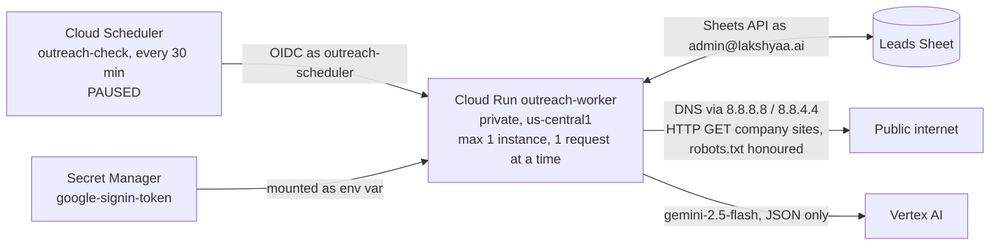

# Outreach — as built

What exists and runs today. `ARCHITECTURE.md` is the plan; this file is the truth about what
is actually built. **Updated after every change**, newest entry first in the change log.

Last updated: 2026-09-22.

Pilot-readiness evidence and blockers: `docs/PILOT_READINESS_AUDIT.md`. The full
draft-to-send-to-follow-up pipeline has not been built.

## Stage status

| Stage | Status | Proof |
| --- | --- | --- |
| 0 Setup | **Done** 2026-09-22 | Cloud Run worker read 318 A + 174 B leads, wrote a Runs row |
| 1 Email checks | **Built, review fixes applied, awaiting founder spot-check** 2026-09-22 | All 492 leads checked from Cloud Run; 98 rows rechecked after review fixes; 45 tests pass in a container; schedule paused |
| 2 Research | **Bulk fit research paused; five company profiles READY** 2026-09-22 | 69 leads fit-researched (sample 30 + batch 1 39); 26 draft-eligible; 396 pending, not to be resumed for now. Five verified offerings/markets profiles are saved; four are in the pilot and Cincinnati Air remains READY but out of it. No research schedule exists. |
| 3 Drafts (pilot) | **Drive → Gemini → checks pipeline built locally; waiting on the handbook; not deployed** | The writer, Drive loader and screening checks pass 255 tests offline in a container on synthetic inputs. Nothing is connected to a real handbook: the founder's document is not in Drive, the sign-in has no Drive scope, no offer or email is approved, no preview has an approval hash, no draft action exists in the Sheet, Gmail drafting has never run, and the draft endpoints are not deployed. |
| 4 Gmail sync | Not started | Founder chose two follow-up drafts, each due on the third business day after the preceding email is actually sent; all emails are sent by hand |
| 5 Tracking | Not started | |
| 6 Calls | Not started | |

## What runs where

**The deployed worker does not touch Gmail.** Local Stage 3 code can read prior sends and
drafts and create one guarded draft, but was not deployed or exercised against the live
mailbox. `ENABLE_GMAIL_DRAFTS` defaults off, and no schedule was added.

## GCP — project `lakshyaa-outreach`

Org `lakshyaa.ai` (787760867942). Billing: "My Billing Account" `01A2E0-CC6FD1-A94FDA`.

| Resource | Setting |
| --- | --- |
| Cloud Run `outreach-worker` | `https://outreach-worker-30387157876.us-central1.run.app`; `--no-allow-unauthenticated` (unsigned call → 403, tested); max instances 1, concurrency 1, timeout 600 s; runs as `outreach-worker@` |
| Service account `outreach-worker@` | `secretAccessor` on `google-signin-token`; `aiplatform.user` on the project (Gemini, added for stage 2) |
| Service account `outreach-scheduler@` | `run.invoker` on `outreach-worker` only |
| Cloud Scheduler `outreach-check` | `*/30 * * * *` America/New_York → `POST /jobs/check`; **paused** |
| Secret `google-signin-token` | JSON: account, OAuth client id/secret, refresh token, scopes |
| OAuth app | Internal to `lakshyaa.ai`; Desktop client `outreach-local-signin`; scopes `gmail.compose`, `gmail.readonly`, `spreadsheets` |
| Build | Default compute account holds `cloudbuild.builds.builder` (source deploys) |
| Enabled APIs | Sheets, Gmail, Drive, Cloud Run, Scheduler, Pub/Sub, Secret Manager, Vertex AI, Artifact Registry, Cloud Build, IAM Credentials |

Deploy: `sh deploy/deploy_worker.sh`.

## Worker endpoints

| Endpoint | Does |
| --- | --- |
| `POST /jobs/ping` | Counts leads in A and B, writes a Runs row |
| `POST /jobs/check` | Stage 1 email check (below) |
| `POST /jobs/research?limit=40` or `?ids=A-0001,B-0002` | Stage 2 company research (below). **Not scheduled.** |
| `POST /jobs/profile?limit=5&ids=A-0001,...` (optional `dry_run=1`) | Pilot extraction of company offerings and markets for later drafts. Available on the private `profile-review` tag only; serving revision remains 00013. No schedule. |

**Local code only, not deployed:** `POST /jobs/draft/preview` always uses Gemini with the
Drive handbook for 1–4 explicit Lead IDs. `POST /jobs/draft/create` requires the approved
`written` payload and its exact preview hash; it reloads the Drive handbook and current
quotes before creating a draft. The old fixed-template preview remains available only for
offline comparison and cannot create a Gmail draft, even with an approval hash and quote ID.
Draft creation also requires complete settings and `ENABLE_GMAIL_DRAFTS=true`; default is disabled.
`POST /jobs/draft/reconcile` looks for an existing reserved Gmail draft and never creates
a replacement. These endpoints have no Scheduler job.

## The Sheet

`OCILB_A_and_B_Outreach_2026-09-21`, id `1eEVkxc0gJMFptYSr_u9prQ5O850TOX28AEq17CKaFiA`.

| Tab | Rows | System use |
| --- | --- | --- |
| Summary | — | Not touched |
| A_Contact_Now | 318 | Read; system columns added at right |
| B_Contact_Now | 174 | Read; system columns added at right |
| C_Phone_Only | 242 | Not touched (no emails) |
| Runs | 1 per job run | Written by the system |
| Research | 1 per verified quote per research run | Written by the system; append-only history, so re-researched leads have older rows too — the lead row's `Researched at` names the current run |
| Suppression | Header only; 0 entries | Created for future opt-outs and bounces; the 14 hand-sent threads had no matches at the recorded audit time |

Row 1 of A and B is a description; **headers are in row 2**. Columns are found by header
name, never by position — A and B have different layouts.

**Stage 2 columns** (added 2026-09-22, right of the stage 1 columns): `Fit`, `Work mix`,
`Fit reason`, `Fit evidence` (up to three verified quotes with page URLs), `Researched at`.

**Company-profile pilot columns** (added 2026-09-22 to A and B): `Profile status`,
`Offerings evidence`, `Markets evidence`, `Profile reason`, `Profiled at`. Offerings and markets
are separate from the fit verdict. The Research tab also holds append-only `OFFERING` and
`MARKET` quote rows with their source URLs. These are source material for a later draft, not
email copy.

**Stage 3 columns in local code only, not added to the live Sheet:** `Draft action`,
`Draft action at`, `Draft status`, `Draft hash`, `Draft quote ID`, `Draft ID`,
`Draft link`, `Drafted at`.
They are created only by an enabled draft write. A `RESERVED` action counts toward the
daily cap and prevents automatic retry after an uncertain Gmail result.

**System columns** (added 2026-09-22, right of the founder's columns): `Lead ID`,
`Email check`, `Reason`, `Checked at`.

**Founder columns the system reads:** `BEST EMAIL`, `Their email`, `Decision maker`,
`Website`, `Warning`, `Sent by hand`.
`Where it came from` is no longer used by any rule: it was wrong for A-0155 (see below).

**Column changes made with founder approval, 2026-09-22** (`tools/tidy_columns_2026_09_22.py`):
removed from A — two empty unlabelled columns, `Sheet`, `Commercial confidence`,
`Apollo lookup`; removed from B — `Strong proof`, `Sheet`, `Commercial confidence`,
`Apollo lookup`, `Bucket`. Tab A's unlabelled column of "Sent email on 9/22/2026" marks
named `Sent by hand` (14 marks kept). Undo: File → Version history.

## Stage 1 — email check

Code: `outreach/checks.py` (rules), `outreach/job_check.py` (job).

- Gives each lead a permanent `Lead ID` (`A-0001`…, `B-0001`…); existing IDs are never changed.
- Checks only rows whose `Email check` is blank. **Clear that cell to re-check a row.**
- A before B, top to bottom: the first row with an address keeps it; later ones are DUPLICATE.
- **Write safeguard** (`Tab.write`, since the review fixes). Just before writing, the tab is
  re-read and every lead is found again: by its `Lead ID` (must be the only row with that ID),
  or, for a lead getting its first ID, by its full set of founder values among rows without an
  ID (must match exactly one row). Its founder values must be unchanged, and the system cells
  about to be written must still hold what was read. Otherwise that row is skipped, left
  blank for the next run, and named in the Runs row (result PARTIAL). Sorting, inserting,
  deleting, editing and swapping rows that share an email are all covered by tests.
  Remaining limit: Sheets has no transactions, so an edit landing in the moment between that
  re-read and the write is not detected.

| Result | Rule |
| --- | --- |
| SENT BY HAND | `Sent by hand` is filled. Never drafted to. |
| INVALID | No address; malformed; or DNS says the domain takes no mail (no domain, or null MX) |
| DUPLICATE | Same address as an earlier Lead ID (named in Reason) |
| RISKY | Apollo `Warning`; email domain differs from website; a personal mailbox (Gmail, Yahoo, ISP…) **not found on the company's own site** or the site could not be read; generic inbox (`info@`, `office@`, `hr@`…); website does not load; no website; DNS could not be read |
| OK | None of the above. **Not proof the mailbox exists** — outbound port 25 is blocked, so only a real send's bounce proves that |

**Website probe:** 2xx/3xx loads. 401/403/429 means the server is up but refuses robots — the
site exists, noted in Reason. 404, 410, other 4xx and 5xx do not load. If the listed page is
missing but the homepage answers, the site loads (noted). Each request is retried up to three
times: a passing SSLError on a working site (A-0151) otherwise marked it dead.

**Personal mailbox:** OK only if the address is actually found on the company's site — the
listed page, the homepage and up to six same-site contact/about pages, honouring robots.txt,
reading plain text, `mailto:` links, Cloudflare-protected addresses and `[at]`/`[dot]`
spellings. Image names (`logo@2x.png`) and form placeholders are ignored. Not found or not
readable → RISKY with what the site does show.

DNS is asked of Google Public DNS: the default resolvers on the founder's PC and on Cloud
Run timed out on `neo.rr.com`, which Google answers. A lookup that cannot be completed is
RISKY ("could not check"), never INVALID.

**Current results (after the role-inbox recheck, 2026-09-22):**

| | A | B | Total |
| --- | --- | --- | --- |
| OK | 202 | 115 | 317 |
| RISKY | 91 | 57 | 148 |
| DUPLICATE | 10 | 2 | 12 |
| SENT BY HAND | 14 | 0 | 14 |
| INVALID | 1 | 0 | 1 |

**Role-inbox recheck** (`tools/recheck_role_inboxes_2026_09_22.py`, Runs row
`recheck-role-inboxes`): department and role mailboxes added to the generic-inbox rule
(`checks.ROLE_INBOXES`: employment, hiring, recruiting, resumes, apply, orders, quotes,
marketing, warranty, parts, purchasing, projects, customer.service, payroll, invoices,
safety, scheduling and variants). Only OK/RISKY rows with such an address were re-checked:
5 rows, all OK→RISKY — A-0147 `customer.service@`, A-0200 `employment@`, A-0224
`employment@`, A-0275 `marketing@`, B-0062 `apply@`. No founder column written.

**Review-fix recheck** (`tools/recheck_2026_09_22_fixes.py`, run locally, Runs row
`recheck-fixes`): only OK/RISKY rows that are personal mailboxes or whose website is not a
clean load were re-evaluated, and only rows whose result or reason changed were written —
98 rows (82 OK→OK with evidence added to Reason, 16 OK→RISKY). No founder column written.
No site returned 404 for its homepage; two listed pages 404 with a live homepage (B-0058,
B-0074). The 16 now RISKY are personal mailboxes not found on the company's site:
A-0155, A-0170, A-0171, A-0177, A-0181, A-0208, A-0221, A-0223, A-0287, B-0045, B-0084,
B-0087, B-0088, B-0090, B-0134, B-0160. Of these, A-0155, A-0170, A-0171, A-0177, A-0287 and
B-0090 publish a different address on their own site.

**A-0155** (Apex Mechanical Systems, `apex.mechanical@sbcglobal.net`): labelled "read from
their website", but its `Kind` column says "on the licence", and the site's contact page and
homepage show only `apex@apexmechsys.com` (checked by hand and by the new rule). RISKY for
review; `BEST EMAIL` left as the founder has it.

**Earlier first run, 2026-09-22 20:24 UTC (492 leads), superseded above:**

| | A | B | Total |
| --- | --- | --- | --- |
| OK | 215 | 123 | 338 |
| RISKY | 78 | 49 | 127 |
| DUPLICATE | 10 | 2 | 12 |
| SENT BY HAND | 14 | 0 | 14 |
| INVALID | 1 | 0 | 1 |

RISKY reasons: generic inbox 105, Apollo warning 21, domain differs 1. The Stage 1 probe
reported every website as loading; its current status threshold also accepts HTTP 404.
INVALID: `A-0313` `tom@wrmechanical.com` — the domain publishes a null MX (accepts no mail);
the company's site is `wrmech.com`.

### Independent review, 2026-09-22

A read-only check of the live Sheet confirmed all five totals above. Nineteen selected rows
covered OK, RISKY, DUPLICATE, SENT BY HAND and INVALID; their labels agreed with the source
fields and reasons in the Sheet. The 13 local tests also passed in an isolated container.
Of four sampled personal-mailbox OK rows labelled "read from their website", three addresses
were visible on the company homepage. The fourth was not found on the homepage or its one
linked contact/about page; its source claim remains unconfirmed and needs a human check.
This sample does not validate every row or prove mailbox activity. The founder spot-check gate
remains open, and the 30-minute schedule remains paused.

Two implementation limits surfaced in review: the website probe currently treats HTTP 404 as
"loads" because it accepts any status below 500, and the pre-write row guard compares only
`BEST EMAIL`, so a sort or edit involving rows with the same email may escape detection.
These should be corrected before relying on recurring checks. The current deployed service
and 492 recorded results have not been changed by this review.

## Stage 2 — company research

Code: `outreach/research.py` (reading, verification, verdict), `outreach/job_research.py`
(job), `outreach/gemini.py` (Vertex AI), `outreach/eligibility.py` (who may get a draft).

**Company fit is separate from email risk.** Research runs for OK and RISKY leads alike and
never looks at the address. Stage 3 may draft only when `Email check` is OK **and** `Fit` is
QUALIFIED (`eligibility.draft_eligible`, tested): a RISKY address never gets a draft, however
good the company.

1. **Read the company's own site** — the listed page, the homepage and same-site pages whose
   links suggest about/services/projects/markets, up to 8 pages, 8,000 characters each;
   robots.txt honoured; scripts and styles stripped.
2. **Gemini proposes quotes** (`gemini-2.5-flash`, temperature 0, JSON schema), each tagged
   COMMERCIAL_PROJECT, COMMERCIAL_SERVICE, RESIDENTIAL or GENERAL_CONTRACTOR.
3. **The code keeps a quote only if it is on the page it names**, word for word (case, spacing
   and curly quotes ignored), and stores the page's own text, not the model's copy.
4. **Categories must be supported by the quote's own words.** A general-contractor quote with
   no general-contracting signal counts as project work. A project quote with no project
   signal at all counts as service. **A project quote counts only if it is specific**
   (`research.is_specific`, founder review 2026-09-22): it names construction activity
   (construction, build-out, fit-out, tenant, design-build, new build, bid, general
   contractor/GC, builders, prevailing wage, union, plan-and-spec, portfolio, turn-key), or
   names a commercial sector (school, hospital, industrial, facility, municipal…) together
   with project or installation work. A quote that also mentions homes or residential work
   must name construction activity. Otherwise it is **COMMERCIAL_GENERIC** — shown as
   evidence, counted like service, never qualifying. So "residential and commercial projects",
   "150+ Commercial Projects Done" and a list of customer types cannot qualify a company.
5. **The verdict is computed in code** ("project quote" below means a specific one):

| Fit | Work mix | When |
| --- | --- | --- |
| QUALIFIED | COMMERCIAL | ≥2 specific project quotes, no residential; or exactly 1, **and** a verified non-residential quote (that one or another) explicitly shows commercial construction or installation work |
| REVIEW_NEEDED | COMMERCIAL | exactly 1 specific project quote and nothing explicit (founder rule 2026-09-22: `research.is_explicit` needs a commercial setting — commercial, industrial, office, school, hospital, facility… — **and** construction or installation work — construct, install, build-out, fit-out, design-build, new build, wiring, renovat — with no residential mention) |
| QUALIFIED | MIXED | ≥2 specific project quotes and residential quotes |
| REVIEW_NEEDED | MIXED | 1 specific project quote against residential, or only generic/service plus residential |
| REVIEW_NEEDED | COMMERCIAL_SERVICE | generic or service/repair wording for businesses, no specific project work |
| REVIEW_NEEDED | GENERAL_CONTRACTOR | presents itself as a GC, construction manager or developer |
| REVIEW_NEEDED | UNCLEAR | site read, nothing says who they work for |
| REVIEW_NEEDED | UNREADABLE | no website, blocked (403 or robots.txt), no answer, or no readable text |
| DISQUALIFIED | RESIDENTIAL | residential quotes only |

A model or network failure leaves the row blank for the next run (Runs row PARTIAL). Clear
`Fit` to research a lead again.

**Final sample, 2026-09-22 — 30 leads, every 15th OK/RISKY lead across A and B.** Researched
from Cloud Run; then re-evaluated twice from the stored, verified quotes
(`tools/refit_sample_2026_09_22.py`, Runs rows `refit-sample`; no site re-read, no model call,
so each change is the rule alone): the specific-evidence rule, then the single-quote
explicit-work rule.

| | Count | Leads |
| --- | --- | --- |
| QUALIFIED — COMMERCIAL | 7 | A-0062 Conti, A-0078 Harrington, A-0112 Cincinnati Air, A-0188 Current Systems, A-0219 Guenther, A-0234 ICS, A-0280 Reddy |
| QUALIFIED — MIXED | 2 | A-0030 Monroe, A-0173 Bromack |
| REVIEW_NEEDED — COMMERCIAL | 2 | A-0250 Langdon, B-0100 HEAT |
| REVIEW_NEEDED — MIXED | 15 | A-0015, A-0127, A-0143, A-0158, A-0204, A-0295, A-0310, B-0009, B-0024, B-0039, B-0055, B-0070, B-0085, B-0115, B-0145 |
| REVIEW_NEEDED — UNREADABLE | 3 | A-0046 (HTTP 403); A-0265, B-0130 (no readable text, likely script-built) |
| REVIEW_NEEDED — GENERAL_CONTRACTOR | 1 | A-0095 Pleasant Valley |
| DISQUALIFIED | 0 | |

By email check: **OK+QUALIFIED 7 — the only draft-eligible leads** (A-0030, A-0062, A-0078,
A-0112, A-0173, A-0188, A-0219); RISKY+QUALIFIED 2 (A-0234, A-0280); OK+REVIEW 15;
RISKY+REVIEW 6.

**Single-quote rule changes** (dry run: exactly these 2 rows; 2 written):

| Lead | Was | Now | Evidence |
| --- | --- | --- | --- |
| A-0188 Current Systems | QUALIFIED/COMMERCIAL | unchanged | its one project quote is explicit: "Commercial and industrial installation of electrical power equipment." |
| A-0250 Langdon | QUALIFIED/COMMERCIAL | REVIEW_NEEDED/COMMERCIAL | one project quote, "the opportunity to bid on your project… sheet metal fabrication", names no commercial setting or installation work; its other quotes are generic or product ("spiral ductwork… ensuring easy shipping and installation" has no commercial setting) |
| B-0100 HEAT | QUALIFIED/COMMERCIAL | REVIEW_NEEDED/COMMERCIAL | one project quote, "Over 75 School District Projects Completed", names no construction or installation work; its installation quotes ("Installing occupancy sensors…") name no commercial setting |

Current Systems' row was not rewritten: its verdict did not change, and only the wording of
its reason would have.

**Verdict changes from the re-evaluation** (dry run shown to the founder before applying;
14 rows written — these 6 plus 8 QUALIFIED leads whose generic quotes were re-labelled; 12
rows whose reason would differ only in wording were left as they were):

| Lead | Was | Now | Why — the quotes it had |
| --- | --- | --- | --- |
| A-0015 Efficient Electric | QUALIFIED/MIXED | REVIEW_NEEDED/MIXED | one specific quote ("…and tenant build-outs") against three residential; "services for residential, commercial, and industrial projects" is generic |
| A-0143 Waterworks | QUALIFIED/MIXED | REVIEW_NEEDED/MIXED | only a list of customer types ("restaurants… hospitals… warehouses") and "we serve many municipalities" — no construction work named |
| A-0204 Enviro Flow | QUALIFIED/MIXED | REVIEW_NEEDED/MIXED | one specific quote (conduit lining with "the GC" at the White House); "For commercial projects, we serve the full state of Ohio" is generic |
| B-0039 Alpine Electric | QUALIFIED/MIXED | REVIEW_NEEDED/MIXED | the banner "ALL YOUR RESIDENTIAL, COMMERCIAL, OR INDUSTRIAL ELECTRICAL PROJECTS" is generic; only the heading "New Construction" is specific |
| B-0115 Kouris Electric | QUALIFIED/MIXED | REVIEW_NEEDED/MIXED | "150 + Commercial Projects Done" and "estimating and project management" are generic; four residential quotes |
| B-0145 Rapid Electric | QUALIFIED/MIXED | REVIEW_NEEDED/MIXED | "all sizes of residential and commercial projects" (twice in different words) is generic; the rest is service |

(At this point A-0188, A-0250 and B-0100 still qualified on a single specific quote; the
single-quote rule above then moved Langdon and HEAT to review.) The rule is conservative in the other direction too: Harrington's "performed work
at manufacturing plants… wastewater treatment plants" is labelled generic (no project word),
though Harrington qualifies on four other quotes.

**Bulk research of the remaining 435 leads** (founder-approved 2026-09-22; batches of at most 40
through the private worker, `POST /jobs/research?limit=40`, revision `outreach-worker-00012-fmn`,
confirmed serving 100% and matching commit `1a0045e` before the first batch; pending count
confirmed 435 = A 186 OK + 87 RISKY, B 109 OK + 53 RISKY; the 30 reviewed rows are never
selected because their `Fit` is filled).

| Batch | Researched | QUALIFIED | REVIEW_NEEDED | DISQUALIFIED | Failed (left blank) | Tokens in / out / thinking |
| --- | --- | --- | --- | --- | --- | --- |
| 1 | 39 of 40 | 25 (18 commercial, 7 mixed) | 13 | 1 | 1 — A-0026, Gemini read timeout after 120 s | 222,125 / 16,005 / 100,503 |

No reviewed row changed; nothing skipped.

**Stopped after batch 1** (founder instruction: stop if generic wording starts qualifying
firms). Every new QUALIFIED verdict was read against its stored project quotes. Most are
clearly right (e.g. A-0041 Warner's contract list, A-0017 Gateway's projects with named GCs,
A-0035 Regal's middle school). But **A-0040 The Pattie Group**, a landscape design firm,
qualified as MIXED on "from design and permits to construction" and "The Design/Build
Approach… horticulture and installation experts" — no commercial setting named — and
**A-0021 Halpin Plumbing** on "service, excavation, and construction plumbing". Cause: the
words "construction" and "design-build" make a quote specific on their own.

Candidate fix, simulated read-only over all 69 researched leads (no writes): those words count
only with a commercial setting in the same quote; commercial-only terms (tenant, build-out,
fit-out, general contractor/GC, plan-and-spec, prevailing wage, union) still count alone.
Result: 3 changes — A-0021 and A-0040 to REVIEW_NEEDED as intended, and **A-0059 Cinfab** to
REVIEW_NEEDED too, although it is a commercial sheet-metal subcontractor ("prime sheet metal
partner to a construction manager, general contractor or building owner"); none of the 30
reviewed rows changes.

**Founder decision (option 2, narrow), implemented 2026-09-22:**

- `research.is_specific`: commercial-construction-only terms (tenant, build-out, fit-out,
  general contractor/GC, plan-and-spec, prevailing wage, union) count on their own; other
  construction words (construction, design-build, new build, bid, builders, portfolio,
  turn-key) count only with a commercial setting in the same quote; with a residential
  mention, only a named sector plus construction counts; bare "commercial projects" never.
- `research.subcontracting_support` (A-0059 rule): for a commercial-only firm with one
  specific project quote, it also qualifies if a verified non-residential quote says it works
  as a subcontractor, or as a subcontractor/partner to a general contractor or construction
  manager, **and** a verified non-residential quote names construction or installation work.
  Subcontracting alone never qualifies.
- Dry run over all 69 researched leads: 2 Fit changes, 2 Work-mix-only changes, 23 rows whose
  verdict and label stay the same but some quotes would now be labelled generic. **Only the 4
  rows whose Fit or Work mix changes were written** (founder: update only affected rows):

| Lead | Was | Now |
| --- | --- | --- |
| A-0021 Halpin Plumbing | QUALIFIED/MIXED | REVIEW_NEEDED/MIXED — "construction plumbing" names no commercial setting; one specific quote left against three residential |
| A-0040 The Pattie Group | QUALIFIED/MIXED | REVIEW_NEEDED/MIXED — landscape design; no specific commercial project quote left |
| A-0058 Cabling Concepts | REVIEW_NEEDED/COMMERCIAL | REVIEW_NEEDED/COMMERCIAL_SERVICE — label only |
| A-0250 Langdon (reviewed) | REVIEW_NEEDED/COMMERCIAL | REVIEW_NEEDED/COMMERCIAL_SERVICE — label only; "bid on your project" is no longer specific |

A-0059 Cinfab stays QUALIFIED under the subcontracting rule. The 23 unwritten rows keep their
stored evidence labels, which predate this rule; their verdicts are what this rule gives.
Worker redeployed as revision `outreach-worker-00013-6vx`.

**Bulk research paused by the founder** (2026-09-22): the goal is a small set of useful Gmail
drafts, not researching every lead. The 396 pending leads stay unresearched. Next: a draft
pilot from the already-qualified leads once the founder's handbook is available.

**Draft-eligible now (OK email and QUALIFIED fit): 26 leads** — A-0017 Gateway, A-0020 Graft,
A-0022 Industrial Reliability and Repair, A-0025 Koch Refrigeration, A-0028 MJB, A-0030 Monroe,
A-0031 Muetzel, A-0033 Perfection Group, A-0036 Reliant, A-0039 Geopfert, A-0043 Wuest,
A-0045 Accurate Electric Construction, A-0047 All Phase, A-0049 Applied Mechanical, A-0051 Bay,
A-0052 Bell & Blaire, A-0053 Blau, A-0055 BMWC, A-0056 Bonham, A-0059 Cinfab, A-0062 Conti,
A-0078 Harrington, A-0112 Cincinnati Air, A-0173 Bromack, A-0188 Current Systems,
A-0219 Guenther. 23 have a named owner, president or CEO; A-0173, A-0188 and A-0219 use a
company or office mailbox. QUALIFIED with a RISKY address (no draft): 6.

**How the rule got here.** The first sample run used "any project quote qualifies": 22
QUALIFIED, and reading them showed the model labelling fixture lists, product lines, a dealer
statement and a customer testimonial as project work (A-0295, B-0039, A-0127, A-0204). Adding
the project-signal check and the two-quote bar for mixed firms gave 15/15; the model then
called two trades (A-0112 design-build HVAC, B-0115 electrical) general contractors, fixed by
the general-contracting signal check. Founder review then found generic wording still
qualifying mixed firms (B-0039, B-0145, A-0143): the specific-evidence rule took the sample
from 17 to 11 QUALIFIED; the single-quote explicit-work rule took it to 9. Each fix has a test from the case that caused it
(`tests/test_research_specific.py` uses the sample's own quotes).

**Cost, measured:** the 30-lead sample used 164,522 input, 10,303 output and 81,206 thinking
tokens — about 5,500 / 340 / 2,700 per company. No price is stated here; it has not been
checked against current Vertex AI pricing.

## Known limits after the review fixes

- Company-profile extraction selects exact 5–50-word quotes from the company's own site,
  verifies each quote against its named page, and marks a profile READY only when it has an
  offering quote. A READY result still needs human review before its facts enter a draft:
  Gateway Electric's dry-run quotes described project coordination, not a concrete electrical
  offering, so that lead was not written. Monroe's profile includes a residential-service
  quote; a commercial draft should select its separately verified commercial offerings.
- The profile job selects only unsent leads with OK email and QUALIFIED fit, and does not
  change fit or research the contact's private life. `dry_run=1` makes no Sheet changes.
  There is no profile schedule, draft generator, or sending code.

- A 403 to robots varies between runs on some sites; it changes only a note, never a result.
- The role-inbox list is a fixed word list; a role mailbox using a word not on it is still OK.
- OK is still not proof a mailbox exists; only a bounce after a real send proves that.
- Research: script-built sites with no server-rendered text read as UNREADABLE.
- Research: "specific" is a word test. It can miss specific work phrased without its words
  (Harrington's plant list) and would accept a construction word used loosely. "Explicit"
  is a word test too; A-0188 Current Systems is the one sample lead qualifying on a single
  project quote.
- Research: the model is not fully repeatable at temperature 0; re-running a lead can change
  which quotes it proposes, and so occasionally its verdict.

## Safety checks in code

- `tests/test_no_send.py` fails if any sending code appears (`.send(`, `smtplib`, `SMTP(`,
  `gmail.send`, `sendmail`). Proven to fail on a planted `import smtplib`.
- `tests/test_checks.py` covers every stage 1 rule, the website status codes (200/301/401/403/
  429 load; 400/404/410/500/503 do not), homepage fallback, retry, address finding
  (mailto, Cloudflare, `[at]`, robots.txt, other sites ignored, junk dropped).
- `tests/test_sheet_write.py` drives the write safeguard against a fake Sheet: sort, swap of
  two rows sharing an email, insert, delete, founder edit, copied Lead ID, identical new rows,
  and a system cell filled by someone else.
- `tests/test_research.py` runs research against fake sites and a fake model: commercial,
  residential, mixed (two and one project quotes), service-only, unclear, four unreadable
  cases (no answer, HTTP 500, robots.txt, script-only), paraphrased and misattributed quotes
  discarded, script text ignored, fixture-list downgrade, GC and mislabelled-GC cases, and
  draft eligibility (RISKY never eligible, even when QUALIFIED).
- `tests/test_research_specific.py` replays the sample's own quotes: generic phrases (Alpine,
  Rapid, Waterworks, Efficient, Kouris, Enviro) never qualify; Monroe (mixed), Conti and Reddy
  still do. Single-quote cases: Current Systems qualifies; Langdon's and HEAT's full stored
  evidence does not; a single project quote backed by another explicit verified quote does.
- Batch-1 cases: A-0040 Pattie and A-0021 Halpin do not qualify; A-0059 Cinfab does; subcontracting
  without construction or installation work, or mentioning homes, does not count.
- `tests/test_company_profile.py` covers quote verification, off-domain redirects, unreadable
  sites, long navigation text, pilot selection, and dry-run write isolation.
- All 138 tests run in a clean container with no network:
  `docker build -f deploy/test.Dockerfile -t outreach-tests . && docker run --rm --network none outreach-tests`
- `.secrets/` and client/token JSON are git-ignored; a pre-commit hook refuses them
  (proven to block a planted file).

## Stage 3 live preview review, 2026-09-22

Run locally, read-only (`python -m outreach.job_draft --ids A-0030,A-0062,A-0078,A-0112`),
against the live Sheet with `.secrets/pilot_handbook.json` (git-ignored). Filled only with
verified values — product `Lakshyaa`, sender email `admin@lakshyaa.ai` (the signed-in mailbox),
website `https://lakshyaa.ai` (HTTP 200), daily cap 4. Sender name, title, postal address,
intended use, next-week action and CTA are visible `[FOUNDER: …]` placeholders;
`offer_approved` is false. No preview has a hash; no Sheet or Gmail write.

| Lead | Opening quote chosen | Reads as |
| --- | --- | --- |
| A-0078 Harrington | "Harrington Electric Co. is Cleveland's oldest and finest electrical and voice-data-video contracting firm." | fine |
| A-0030 Monroe | "New Construction Plumbing Plumbing layout, rough-in…" — from the **residential** page | weak: heading run into the sentence |
| A-0112 Cincinnati Air | "Commercial HVAC Comfort cooling, chillers, DX systems, boilers…" | weak: heading plus equipment list |
| A-0062 Conti | "The Conti Corporation specializes in heating and plumbing services" | weak: bland, cut off |

**Cause is quote selection, not the companies:** `drafting.preview` always uses the first
stored OFFERING quote. Each weak lead has a better verified quote in its own profile (Monroe:
"…installs and modifies commercial gas lines for equipment upgrades, renovations, and new
connections…"; Conti's strongest line — "portfolio includes schools, hospitals…" — is stored as
a MARKET quote, which the template never uses; all three Cincinnati Air offerings have run-in
headings because page text joins headings to paragraphs). Profiling replacement companies
would not help, since the same first-quote rule would apply; not done.

**Greeting:** every preview says "Hi there" because the code reads a `First Name` column the
Sheet does not have. For all four leads `Decision maker` is the person at `BEST EMAIL`
(`Their email` equals `BEST EMAIL`), so a first-name greeting would be accurate.

**Local Windows runs** need `tzdata` in the venv (`zoneinfo` has no system time-zone data on
Windows); installed locally only. The container resolves `America/New_York` without it.

**Superseding copy check after the local selection fix, 2026-09-22:** a read-only
rerun of the same four leads now selects Monroe's commercial gas-line installation
sentence, Conti's schools/hospitals portfolio sentence, and Harrington's original
company sentence. Cincinnati Air has no clean complete-sentence default among
its four stored quotes (three headings run into lists and one is a sector list),
so its preview is held for an explicit reviewed quote or better source evidence.
Greetings now say Hi Brian, Hi John, Hi Tom and Hi Mark respectively because
`Their email` matches `BEST EMAIL`; a mismatch or role inbox falls back to
“Hi there.” The previews remain blocked by founder fields, approval and the
missing Suppression tab; no draft or send occurred.

## Pilot set after replacing Cincinnati Air, 2026-09-22

A-0112 Cincinnati Air's four stored quotes all had run-in headings or were bare lists, so it
has no default opening. Under the founder's instruction to profile a replacement when a
profile gives weak copy, **A-0049 Applied Mechanical** (OK email, QUALIFIED, Michael Ayers,
President; `Their email` = `BEST EMAIL`) was profiled alone through the private
`profile-review` tag: dry run first, then one write — READY, 3 offering and 2 market quotes,
tokens 6,757 in / 352 out / 1,532 thinking. No other lead was profiled.

Read-only previews for the pilot four (A-0030, A-0062, A-0078, A-0049) — all still blocked on
handbook fields, offer approval and Suppression; no hash; no Sheet or Gmail write:

| Lead | Greeting | Opening quote (source) |
| --- | --- | --- |
| A-0030 Monroe | Hi Brian | "Monroe Plumbing installs and modifies commercial gas lines for equipment upgrades, renovations, and new connections with safety and code compliance at the center." (commercial-gas-lines page) |
| A-0062 Conti | Hi John | "The Conti Corporation portfolio includes schools, hospitals, sewage/wastewater treatment facilities, and churches throughout northeast Ohio and western Pennsylvania." (home) |
| A-0078 Harrington | Hi Tom | "Harrington Electric Co. is Cleveland's oldest and finest electrical and voice-data-video contracting firm." (about) |
| A-0049 Applied Mechanical | Hi Michael | "Our specialties include plumbing and process piping, sheet metal fabrication, MEP, system retrofits, service, controls, design-build, plan & spec, and fast-track projects." (home) |

**Applied opener changed on review:** the default above is a service list, so the pilot uses
A-0049's complete MARKET sentence, selected explicitly with
`--quote-choice A-0049=83f3b598a4a1d94f`: "AMS is a regional mechanical contractor
specializing in the design, installation, and service of heating, ventilation, air
conditioning, and plumbing systems for commercial, industrial, and institutional clients."
Read-only rerun: all four render with first-name greetings; still blocked (no hash) on the
same missing founder values; the approval hash will cover the selected quote ID.

A-0112 keeps its READY profile but is out of the pilot. No opt-outs from the 14 hand-sent
emails are known; checking those threads is a precaution awaiting the founder's yes.

## Hand-sent emails: read-only Gmail check, 2026-09-22

Founder-authorised, read-only (`messages.list` / `messages.get` with `format=metadata`: headers
and Gmail's snippet only) in `admin@lakshyaa.ai`, for the 14 leads marked `Sent by hand`:

- **14 sent** on 2026-09-22 between 13:18 and 14:41 EDT, from `Admin Lakshyaa
  <admin@lakshyaa.ai>`; subjects "…Advice on how a tight cash week gets decided" (12) and
  "Contracts from ten thousand to forty million" (A-0012).
- **0 replies, 0 bounces, 0 opt-out wording** as of the check.
- **A-0005 Approved Plumbing was sent to `jeff@approvedplumbing.com`, not the Sheet's
  `BEST EMAIL` `dennis@approvedplumbing.com`.** Nothing from that domain has come back either.
- The sender's display name is "Admin Lakshyaa". Drafts created in this mailbox would show the
  same name unless the founder changes it in Gmail settings.

**Proposed Suppression entries: none** (no opt-outs or bounces). The `Suppression` tab has not
been created: it waits for the founder's go, and would start with only its header
(`Address or domain`, `Reason`, `Added at`, `Source`).

**Offer wording:** the founder rejected the first suggestion as too narrow. Three options
built on the inputs in the product's cash-flow inputs document (bank balances, open invoices
and bills with due dates, payroll dates, fixed costs, upcoming billings by job; retainage and
committed costs where relevant) were rendered read-only for the pilot four (130–153 words
each); `offer_approved` stays false; none chosen yet.

## Proposed template v3, under founder review 2026-09-22

Rendered read-only with the proposed template substituted in memory; **no code changed,
`offer_approved` stays false, nothing drafted or deployed.** Changes from the live template:

- The product paragraph and question the founder asked to keep as the working version, ending
  on one question instead of an invitation sentence.
- **The opening is a natural observation written for each company** instead of
  `Your site says, "…"`. It restates that company's stored quote in plain words, says nothing
  about their cash or finances (checked against a money-word list), and the review preview
  still shows the quote and its page URL beside the email.
- **A truthful per-lead subject** that names the company, not the product.

| Lead | Subject | Opening | Rests on (source) | Words |
| --- | --- | --- | --- | --- |
| A-0030 Monroe | Question for Monroe Plumbing | "I noticed Monroe handles commercial gas-line work for equipment upgrades and renovations." | "…installs and modifies commercial gas lines for equipment upgrades, renovations…" (monroeplumbing.net/commercial-gas-lines) | 103 |
| A-0062 Conti | Question for Conti Corporation | "I noticed Conti's portfolio runs to schools, hospitals and treatment plants across northeast Ohio." | "…portfolio includes schools, hospitals, sewage/wastewater treatment facilities, and churches…" (theconticorporation.com) | 105 |
| A-0078 Harrington | Question for Harrington Electric | "I noticed Harrington works on commercial, industrial and institutional facilities across Northeast Ohio." | "…solutions for commercial, industrial and institutional facilities in Northeast Ohio." (harringtonelectric.com) | 104 |
| A-0049 Applied Mechanical | Question for Applied Mechanical | "I noticed AMS designs and installs HVAC and plumbing systems for commercial, industrial and institutional clients." | "AMS is a regional mechanical contractor specializing in the design, installation, and service…" (appliedmechanicalsys.com) | 107 |

**Open design question:** these openings are written by hand for four leads. Generating them
for more leads needs a model step that rewrites a stored quote, with its own check that the
result adds no fact the quote does not contain. Not built.

**Suppression tab created 2026-09-22** with header only (`Address or domain`, `Reason`,
`Added at`, `Source`) and no entries; the Gmail check found no opt-outs **as of that check**.
Recorded in Runs as `suppression-tab`.

## Stage 3 — the written-draft pipeline (built 2026-09-22, not deployed)

Code: `outreach/handbook_drive.py` (the handbook), `outreach/writer.py` (Gemini, then the
checks), `outreach/drafting.py` (assembly, gates, approval hash), `outreach/job_draft.py`
(the job), `outreach/eligibility.py` (who may be written to).

**1. The handbook comes from Drive, or drafting stops.** `handbook_drive.load` reads one
document by ID (`HANDBOOK_DOC_ID`, else `handbook_doc_id` in settings; no default), exports a
Google Doc as text, and returns the text with a SHA-256 of its bytes. It raises
`HandbookUnavailable` — which blocks every preview — when the ID is missing or malformed, the
file is absent, unshared, not text, empty, over 60,000 characters, or when Drive refuses the
read. **A local file never substitutes for it.** Reading needs the `drive.readonly` scope,
which the current sign-in does not have, so today every written preview is blocked with that
reason. That is the intended state until the founder's document exists.

**2. Gemini writes, but only sentences.** `writer.compose` sends the handbook as instructions
and the lead's verified quotes as **data, explicitly labelled not-instructions**. The model
returns a subject and three to five labelled sentences: one COMPANY (citing one quote's id),
one to three PRODUCT, one ASK.

**3. Code screens the wording before approval.** `writer.verify` — no model involved, so it
can be re-run later — rejects a draft unless every content word is already present in the
source the sentence claims: the cited quote for a company sentence, the handbook for a product
or ask sentence. Plurals and contractions fold; filler words are ignored. It also refuses a
banned claim (guarantees, "available today", invented cash trouble), any link, address or
phone number inside the copy, a missing or misordered part, an ask that is not a question, and
an ungrounded, over-long or exclamatory subject. It also rejects obvious reversals of a
quote's negation or the handbook's qualified product state. These checks cannot establish
semantic entailment: a sentence can reuse source words while making a different claim.
The founder must compare every exact preview with its cited quote and handbook before approval.
**The greeting, signature, website, phone,
postal address and opt-out line are written by `drafting.assemble`, never by the model.**

**4. The approval binds everything.** The preview hash now covers the handbook's content hash
and document ID alongside the recipient, subject, body, sender, evidence and quote ID. Editing
the Drive document changes the hash, so an approval made before the edit no longer matches and
the draft is refused.

**5. Creating a draft re-checks; it never re-writes.** The live preview endpoint always uses
the Drive writer, and `create` refuses a missing `written` payload. It reloads the
handbook, re-runs `writer.verify` against the live quotes, rebuilds the same body, recomputes
the hash and compares it to the founder's approved hash. The model is not called — a test
asserts that. Everything from before still applies: `ENABLE_GMAIL_DRAFTS` off by default, one
lead at a time, OK email plus QUALIFIED fit, Suppression, HOLD, daily cap, the mailbox must be
the configured sender, no prior send or existing draft, a RESERVED row that blocks any retry
after an uncertain Gmail result, and no sending code anywhere.

**Tests: 255 pass offline in the container** (`docker run --rm --network none lakshyaa-outreach-audit`),
using `examples/synthetic_handbook.txt` and synthetic leads. They prove fail-closed behaviour
for: no handbook, unreadable Drive, a handbook edited after approval, a handbook whose offer
was removed, an unsupported company claim, an invented capability, a promise, an injected
instruction or address inside a quote, a tampered sentence, a wrong or empty hash, missing
authorization, the old-template bypass, two polarity reversals, a second draft for the same
lead, an uncertain Gmail result, and a mailbox that
is not the sender. A synthetic run through the CLI in the container produced a complete,
approvable draft with its evidence and hashes.

**What this does not prove:** no real handbook has been read, no real email has been written
by Gemini, and no Gmail draft has ever been created. Copy quality against the founder's own
handbook is unknown. The lexical and polarity screens do not prove all generated claims true;
human review of the exact copy and source remains essential.

## The handbook in Drive, and the first real previews (2026-09-23)

**Drive read access added.** `outreach/signin.py` now also requests `drive.readonly`; the
founder signed in once and the new token replaced the Secret Manager version. The worker's
stored credentials are read-only for Drive: they can read the handbook and nothing else.

**The handbook document.** `1lnKJMRZe0QPyxFZaV6zNq_GI-HNudncnW1uzrvwzeuU`,
"OUTREACH_HANDBOOK_DRAFT" — a copy of this repo's template draft, holding the writing rules,
the field table, the initial-email template and both follow-ups. A second ID the founder sent
(`1im_UBYRaRCrrvwNtnWc39I8TEJ6MpL-A`) is an uploaded Word file and is refused by design: the
loader accepts Google Docs and text files only.

**First real Gemini run, against that document as it stood.** It produced a good company
sentence from a verified quote, but the only product sentence it could write was "The MVP is
still being finished", and it reused the subject line as the ask. Cause: the document named
the fields `[INTENDED_USE]`, `[NEXT_WEEK_ACTION]` and `[CTA_QUESTION]` but never gave their
values, so there were no product or offer words to ground a sentence in. The pipeline behaved
correctly — it cannot invent what the handbook does not authorise.

**Founder-instructed edit, 2026-09-23** (`tools/edit_handbook_doc.py`): a read-only check
first, then a **separate one-time Google Docs sign-in held in memory only** — never written to
disk or Secret Manager, so the worker's Drive access stays read-only — inserted a
"Draft offer values for founder review" block after the Status paragraph with the three
values. The tool then re-read the document and verified the insertion and that the writing
rules, field table, initial-email template and both follow-ups survived. Content hash
`992bd199043912d1` → `e6415247176218e2`; 5,029 → 5,416 characters. **These values are the
founder's to review; they are not approved copy.**

**Read-only previews after the edit** — all four pilot leads now produce a complete email
whose **only** blocker is `founder has not approved the offer wording`, so no approval hash
exists and none can become a Gmail draft:

| Lead | Opening sentence | Rests on (source) |
| --- | --- | --- |
| A-0030 Monroe | "Monroe Plumbing works with offices, retail spaces, restaurants and hospitality, medical and dental offices, and warehouses across Northeast Ohio." | the same sentence on monroeplumbing.net/commercial-plumbing |
| A-0062 Conti | "The Conti Corporation specializes in heating and plumbing services." | theconticorporation.com |
| A-0078 Harrington | "Harrington Electric Co. is Cleveland's oldest and finest electrical and voice-data-video contracting firm." | harringtonelectric.com/about |
| A-0049 Applied Mechanical | "APPLIED MECHANICAL SYSTEMS INC is a regional mechanical contractor specializing in the design, installation, and service of heating, ventilation, air conditioning, and plumbing systems…" | appliedmechanicalsys.com |

**Copy problems for the founder to judge, not defects in the checks:**

- **A-0049 uses the Sheet's shouted company name**, "APPLIED MECHANICAL SYSTEMS INC". The site
  says "AMS". Nothing in the handbook tells the writer how to name a company.
- **Three of four say the invitation twice** — once in the product paragraph (from the
  template's "I'd like to invite you to…" line) and again as the question. A-0049 does not.
- **Conti and Harrington quote the companies' own marketing back at them** ("first-class",
  "oldest and finest"). Accurate to the source, but it reads as flattery.
- **Monroe's opening is a list of customer types**, accurate but flat.

Each is a handbook question, not a code question: the writer may only use what the handbook
and the quotes give it.

## Four copy fixes, 2026-09-23 (founder-instructed, all still unapproved)

**Two handbook edits** (`tools/edit_handbook_2026_09_23b.py`, a second one-time in-memory Docs
sign-in; the worker's Drive access stays read-only). Read-only check first, then verified after:

1. **Removed** "I'd like to invite you to [NEXT_WEEK_ACTION] and hear where this direction does
   or doesn't fit the way your team works." from the **initial email template only**, so each
   email makes one ask, in its closing question. Both follow-ups keep their own wording, which
   uses different sentences ("If you choose to…", "If you'd like to…") and was not touched.
2. **Added writing rule 6:** prefer a concrete, verified activity over a list of markets or a
   self-promotional phrase such as "first-class" or "oldest and finest".

Content hash `e6415247176218e2` → `b1237580414fe948`; 5,416 → 5,521 characters. Every kept
section verified present afterwards, including both follow-ups and the offer values.

**Two code changes, treated as evidence selection, not as company facts in the handbook:**

- **`drafting.verified_company_name`** takes the Sheet's shouted name, strips a legal suffix
  and finds that name **in the company's own site text**, using the site's capitalisation.
  "APPLIED MECHANICAL SYSTEMS INC" → "Applied Mechanical Systems" (their site writes it that
  way throughout; it also uses "AMS" 48 times, but an abbreviation is never invented here). A
  name that cannot be found on the site **blocks the preview** and, at draft time, raises
  rather than creating. `create` re-derives the same name, so the approved hash still matches.
- **`written_preview(..., quote_id=...)`** lets the operator choose which verified quote the
  writer may use; only that quote is offered to the model, and an unknown id blocks rather
  than silently falling back. Monroe now opens on its commercial gas-lines quote instead of
  the customer-type list.

**A stemming bug this exposed and fixed:** the grounding check folded "serves" to "serv" but
left "serve" alone, so a sentence that faithfully repeated its quote was rejected. Stems are
now compared as sets, symmetrically.

**Previews after the fixes** — all four render, each with one ask, and the **only** blocker on
every one is `founder has not approved the offer wording`:

| Lead | Name used | Opening rests on |
| --- | --- | --- |
| A-0030 Monroe | Monroe Plumbing | "Monroe Plumbing installs and modifies commercial gas lines for equipment upgrades, renovations…" (chosen by the operator) |
| A-0062 Conti | Conti Corporation | "The Conti Corporation specializes in heating and plumbing services" |
| A-0078 Harrington | Harrington Electric Co | "Our Telecommunications Division specializes in engineering, design, and installation of structured cabling systems" — the writer moved off "oldest and finest" under rule 6 |
| A-0049 Applied Mechanical | Applied Mechanical Systems | "AMS is a regional mechanical contractor specializing in the design, installation, and service…" |

Bodies are 97–106 words, down from 130.

**Subjects can be customised without inventing facts.** The subject is screened against the
handbook, the company name and the verified quotes. Checked against the live handbook:
"Question for Monroe Plumbing", "Commercial gas lines at Monroe Plumbing" and "A conversation
about equipment upgrades and renovations" all pass; "Cut your collection time by 30 days" is
refused (invents "collection", "cut", "time") and "Monroe Plumbing is losing money on
slow-paying GCs" is refused (invents "losing", "money", "slow-paying", "gcs"). All four
previews currently use the handbook's own template subject, "A conversation about Lakshyaa
next week?", because that is what the handbook supplies.

260 tests pass offline in the container, including new ones for verified naming, a name absent
from the site, an unconfirmed name at draft time, operator quote choice and an unknown choice.

## Change log

- **2026-09-23** Founder-instructed copy fixes: removed the duplicate invitation from the
  initial template, added writing rule 6 against market lists and self-promotional phrases,
  derived company names verified against each company's own site, and let the operator pick
  the quote (Monroe now opens on commercial gas lines). Fixed an asymmetric stemming bug.
  All four previews rerun read-only; only blocker is the unapproved offer. Nothing approved,
  drafted, sent, deployed or scheduled.

- **2026-09-23** Added `drive.readonly` and re-signed in; read the founder's handbook from
  Drive; ran the first real Gemini previews. Inserted the three draft offer values into the
  Doc through a one-time in-memory Docs sign-in, verified the templates survived, and reran
  read-only previews: all four leads now render a complete email blocked only on approval.
  Nothing approved, drafted, sent, deployed or scheduled.
- **2026-09-22** Created an editable Word copy of the existing
  `docs/OUTREACH_HANDBOOK_DRAFT.md` for founder review. It preserves the draft's
  placeholders and pre-launch wording; it is not an approved or Drive-hosted runtime
  handbook. No pipeline, Sheet, Gmail, deployment or schedule change.

- **2026-09-22** Audited the local Stage 3 pipeline. The live create endpoint could accept
  the old fixed-template path with no Drive handbook, and word-overlap checks accepted two
  opposite-meaning claims. Live preview now always uses the Drive writer, creation requires
  its written payload, and obvious negation/product-state reversals are rejected. The full
  255-test offline suite passes in a network-disabled container. No deployment, schedule,
  Sheet or Gmail write. Semantic claim support still requires founder review.

- **2026-09-22** Built the Stage 3 Drive → Gemini → checks pipeline: read-only Drive handbook
  loader with content hash, Gemini writer whose every word must trace to the handbook or a
  verified quote, handbook hash bound into the approval, and creation that re-checks rather
  than re-writes. 251 tests pass offline in a container. Not deployed, no live traffic or
  schedule changed, no real handbook read, no draft created, offer still unapproved.

- **2026-09-22** Read-only status audit reconciled the summary with the live Sheet:
  492 checked leads, 69 with fit verdicts, 5 READY profiles, 26 OK/QUALIFIED
  leads, no draft actions, and a header-only Suppression tab. Cloud Run still
  serves worker revision 00013; the check schedule remains paused. Corrected
  stale stage and tab summaries; no operational change.

- **2026-09-22** Founder clarified the final stage-3 architecture: the final
  handbook **will be** placed in Google Drive; it is **not there yet**. The
  private GCP worker will read that document for Gemini drafting. The existing
  local fixed-template pilot is a disabled prototype, not the intended writer.
  No Drive link, reauthorization, deployment, draft or schedule change occurred.

- **2026-09-22** Created the empty Suppression tab (header only). Rendered proposed template
  v3 read-only for the pilot four: per-company natural openings grounded in each stored quote,
  per-lead truthful subjects, source still shown in review. No code change, no approval, no
  drafts, nothing deployed.

- **2026-09-22** Read-only Gmail check of the 14 hand-sent emails: all sent, no replies,
  bounces or opt-outs; A-0005 went to a different address than the Sheet's; display name is
  "Admin Lakshyaa". No Suppression entries proposed; tab not created. Three offer options
  rendered for review; nothing approved, drafted, deployed or sent.

- **2026-09-22** Founder also rejected the vague "accounting and operational data"
  phrasing for the offer. The current product input checklist specifically names bank
  balances, open invoices and bills, payroll dates, fixed costs and upcoming job
  billings; commitments, retainage and credit-line details apply where present.
  Replacement outreach wording remains a proposal, not approved or placed in the
  pilot settings. No preview, draft, deployment or schedule changed.

- **2026-09-22** Founder rejected the proposed "see cash needs" offer as too narrow.
  The intended positioning is AI-powered cash-flow decision support for construction
  subcontractors: combine accounting and operational data, analyze the situation,
  compare scenarios, and recommend next steps. No replacement offer wording has
  been approved; `.secrets/pilot_handbook.json` still has offer placeholders and
  `offer_approved=false`. No preview, draft, deployment or schedule changed.

- **2026-09-22** Signature gains an optional phone line (`sender_phone`, between website and
  postal address; omitted cleanly when unset; malformed numbers block approval; part of the
  approval hash). Founder supplied sender name, title, postal address and phone; they are in
  the git-ignored `.secrets/pilot_handbook.json`. Pilot previews now block only on the offer
  wording (intended use, next-week action, CTA, approval) and the missing Suppression tab.
  175 tests pass in a container. Nothing deployed, drafted or sent.

- **2026-09-22** Profiled A-0049 Applied Mechanical as the replacement for A-0112 (dry run,
  then one write). Read-only previews for the pilot four all give usable openings and
  first-name greetings; all blocked pending founder values, offer approval and Suppression.
  Nothing deployed, drafted or sent; schedules paused.

- **2026-09-22** Local Stage 3 copy fix: replaced first-OFFERING selection with a
  list of verified OFFERING/MARKET quotes and quote IDs. Defaults avoid
  residential text/pages, run-in headings, fragments and lists; explicit choice
  is bound to the approved hash and recorded in `Draft quote ID` on a future
  reservation. First-name greetings use `Decision maker` only when `Their email`
  matches `BEST EMAIL` and is not a role inbox. Read-only preview of the four
  current leads yielded three complete default observations and held Cincinnati
  Air. Container build, `compileall`, Ruff E4/E7/E9/F checks and 169/169 offline
  tests passed. No live Sheet/Gmail write, deployment or schedule change.

- **2026-09-22** Read-only live previews for the four READY leads: all correctly blocked; 1 of
  4 openings reads well. Weakness traced to first-quote selection and a missing first-name
  source, not to the profiles; no replacement profiled. `profile-review` tag kept. Bulk
  research and schedules paused; no drafts; nothing sent.

- **2026-09-22** Local Stage 3 initial-email pipeline: added versioned runtime template,
  offline preview from matched current-profile Research quotes, configurable subject,
  missing-field and suppression gates, exact-hash founder approval, conservative prior
  send/draft checks, a date-bound approval hash, a Sheets reservation before Gmail
  draft creation, and read-only Gmail reconciliation of uncertain creates.
  `ENABLE_GMAIL_DRAFTS` defaults off. The initial-email copy is template-rendered
  from the earlier Gemini-researched quote; a free-form AI writer is not built. No live
  Google API call, Gmail draft, deployment, Scheduler change, or email send occurred.
  Container build, `compileall`, and Ruff's E4/E7/E9/F checks passed; 162/162
  offline tests passed. Real-copy
  previews from the four profiled companies and Gmail/Sheet integration are UNVERIFIED.

- **2026-09-22** Founder clarified the MVP is expected to be completed by the end of the
  week and wants to begin outreach with appointments later. The template now states the
  MVP is unfinished and invites a next-week conversation, without promising access or a
  finished demo. The pilot audit reflects this pre-launch path. A prospect may reply
  immediately; the founder can answer and schedule later. No Gmail draft or send occurred.

- **2026-09-22** Draft-pilot readiness audit: clean local checkout and 138/138 existing
  tests pass in a network-isolated container; Cloud Run still serves revision 00013,
  while the profile-review revision has 0% traffic, and the only Scheduler job remains
  paused. Stage 3 is blocked on filled handbook values, a validated draft preview and
  idempotent Gmail draft writes. Gmail sent/reply sync and follow-up scheduling do not
  exist. Findings and build gates in `docs/PILOT_READINESS_AUDIT.md`.

- **2026-09-22** Founder corrected the cadence: **three business days**, superseding the
  calendar-day wording below. Count Monday–Friday in America/New_York; the next business
  date after an actual send is day 1. A September 22 send is due September 25; a September
  23 send is due Monday, September 28. Holiday exclusions are not decided yet. Updated the
  architecture and template draft. No follow-up job or Gmail drafts exist yet.

- **2026-09-22** Reviewed the founder's pasted handbook and prepared a placeholder-only
  revision in `docs/OUTREACH_HANDBOOK_DRAFT.md`. Removed unverified pay-app product examples,
  false select-group scarcity, ambiguous company-name fields, and the drift to business-day
  follow-ups. Follow-ups remain at least three calendar days after each actual send and stop
  for replies, bounces, opt-outs or holds. The handbook is awaiting founder review and real
  MVP/trial/footer facts; no Gmail drafts or sends were created.

- **2026-09-22** Founder chose a three-email sequence: initial email, follow-up 1 at least
  three days after the initial is sent, and follow-up 2 at least three days after follow-up 1
  is sent. Templates are forthcoming. This is a plan only; no follow-up job, draft or send
  exists yet.

- **2026-09-22** Company-profile pilot added in response to the founder's clarification:
  research what each company offers and which markets it serves so verified details can inform
  later email drafts. The five-lead tagged-revision dry run returned profiles for Gateway,
  Monroe, Conti, Harrington and Cincinnati Air; Gateway's generic project-coordination quotes
  were held back. Four profiles (A-0030, A-0062, A-0078, A-0112) were written with exact
  offerings/markets quotes and URLs. A repeat dry run selected none of those four. 138 tests
  pass in a network-isolated container. Private review revision `outreach-worker-00016-rop`
  has tag `profile-review` and 0% traffic; serving revision 00013 retains 100%. Check schedule
  PAUSED, no research/profile schedule, no drafts or sends. Bulk 396 remain paused.

- **2026-09-22** Batch-1 fix (founder option 2, narrow): construction words need a commercial
  setting; subcontracting to GCs/CMs plus verified installation work can support a single
  project quote. 4 rows written (A-0021, A-0040 → REVIEW_NEEDED; A-0058, A-0250 label only);
  A-0059 Cinfab stays QUALIFIED. 131 tests pass in a container. Revision 00013. Bulk research
  paused by the founder; next is a draft pilot from the 26 draft-eligible leads once the
  handbook arrives. Schedules off; no drafts; nothing sent.

- **2026-09-22** Bulk research batch 1: 39 researched (25 QUALIFIED, 13 REVIEW_NEEDED,
  1 DISQUALIFIED), 1 Gemini timeout left blank; tokens 222,125 in / 16,005 out / 100,503
  thinking. Stopped: construction/design-build wording without a commercial setting qualified
  A-0040 and A-0021. Candidate fix simulated only. 396 pending. Schedules off; nothing sent.

- **2026-09-22** Single-quote rule: a commercial-only firm with one specific project quote
  qualifies only if a verified non-residential quote explicitly shows commercial construction
  or installation work. Sample re-evaluated from stored quotes: A-0250 Langdon and B-0100 HEAT
  QUALIFIED→REVIEW_NEEDED; A-0188 Current Systems stays QUALIFIED; 2 rows written. Sample now
  9 QUALIFIED (7 draft-eligible), 21 REVIEW_NEEDED. 118 tests pass in a container. Worker
  revision 00012. Schedules off; no drafts; nothing sent.

- **2026-09-22** Specific-evidence rule: a generic phrase ("residential and commercial
  projects", project counts, customer-type lists) can no longer establish commercial project
  work; mixed firms still qualify on two specific quotes. Sample re-evaluated from stored
  quotes (no model calls): 6 QUALIFIED→REVIEW_NEEDED (A-0015, A-0143, A-0204, B-0039, B-0115,
  B-0145), 14 rows written, BEST EMAIL and founder columns untouched. 107 tests pass in a
  container. Worker revision 00011. Schedules off; no drafts; nothing sent.

- **2026-09-22** Stage 2 built: research of OK and RISKY leads from the company's own site,
  verbatim quotes with URLs in the lead row and a Research tab, verdict computed in code,
  REVIEW_NEEDED for unclear or unreadable sites; draft eligibility needs OK email and
  QUALIFIED fit. 30-lead sample researched from Cloud Run (17 QUALIFIED, 13 REVIEW_NEEDED)
  after two rule tightenings found by reading the sample. Worker has `aiplatform.user`;
  revision 00010. No research schedule; check schedule still paused; nothing sent.

- **2026-09-22** Role inboxes (employment@, hiring@, orders@, quotes@, marketing@,
  warranty@ and others) added to the RISKY rule with tests; 5 matching rows rechecked, all
  OK→RISKY. Totals now OK 317, RISKY 148.

- **2026-09-22** Review fixes: HTTP 404/4xx no longer counts as a loaded site (homepage
  fallback, retries); write safeguard re-finds each lead by Lead ID or full founder
  fingerprint and skips anything ambiguous; personal mailboxes must be found on the company's
  site (A-0155 was not). 98 affected rows rechecked, 16 OK→RISKY. 45 tests pass in a
  container. Worker redeployed (revision 00006); schedule still paused; nothing sent.

- **2026-09-22** Independent read-only Stage 1 review: live totals confirmed, 19 rows sampled,
  one personal-mailbox website source unconfirmed; identified the 404 website probe and
  same-email row-guard limits. Scheduler remains paused.
- **2026-09-22** Stage 1 built and run from Cloud Run. Two rule fixes found on real data:
  personal mailboxes (Gmail, Yahoo, ISP) that the company publishes on its own website were
  wrongly RISKY (92 rows) — now OK with a note; a DNS timeout was wrongly INVALID — now
  retried against Google Public DNS and, if still unknown, RISKY. Scheduler
  `outreach-check` created and paused; a forced run proved the scheduler identity.
- **2026-09-22** Removed founder-approved columns from A and B; named `Sent by hand`.
- **2026-09-22** Stage 0: project, sign-in, private worker, Runs tab.
- **2026-09-22** Repo started; architecture plan.
