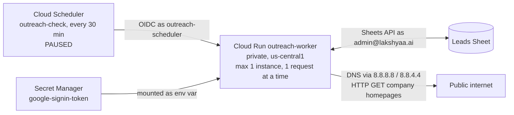

# Outreach — as built

What exists and runs today. `ARCHITECTURE.md` is the plan; this file is the truth about what
is actually built. **Updated after every change**, newest entry first in the change log.

Last updated: 2026-09-22.

## Stage status

| Stage | Status | Proof |
| --- | --- | --- |
| 0 Setup | **Done** 2026-09-22 | Cloud Run worker read 318 A + 174 B leads, wrote a Runs row |
| 1 Email checks | **Built, awaiting founder spot-check** 2026-09-22 | Run from Cloud Run over all 492 leads; schedule created, paused |
| 2 Research | Not started | |
| 3 Drafts | Not started | |
| 4 Gmail sync | Not started | |
| 5 Tracking | Not started | |
| 6 Calls | Not started | |

## What runs where

**Nothing touches Gmail yet.** The sign-in includes Gmail permissions for later stages; no
code reads or writes mail.

## GCP — project `lakshyaa-outreach`

Org `lakshyaa.ai` (787760867942). Billing: "My Billing Account" `01A2E0-CC6FD1-A94FDA`.

| Resource | Setting |
| --- | --- |
| Cloud Run `outreach-worker` | `https://outreach-worker-30387157876.us-central1.run.app`; `--no-allow-unauthenticated` (unsigned call → 403, tested); max instances 1, concurrency 1, timeout 600 s; runs as `outreach-worker@` |
| Service account `outreach-worker@` | `secretAccessor` on `google-signin-token` only |
| Service account `outreach-scheduler@` | `run.invoker` on `outreach-worker` only |
| Cloud Scheduler `outreach-check` | `*/30 * * * *` America/New_York → `POST /jobs/check`; **paused** |
| Secret `google-signin-token` | JSON: account, OAuth client id/secret, refresh token, scopes |
| OAuth app | Internal to `lakshyaa.ai`; Desktop client `outreach-local-signin`; scopes `gmail.compose`, `gmail.readonly`, `spreadsheets` |
| Build | Default compute account holds `cloudbuild.builds.builder` (source deploys) |
| Enabled APIs | Sheets, Gmail, Drive, Cloud Run, Scheduler, Pub/Sub, Secret Manager, Vertex AI, Artifact Registry, Cloud Build, IAM Credentials |

Deploy: `sh deploy/deploy_worker.sh`.

## Worker endpoints

| Endpoint | Does |
| --- | --- |
| `POST /jobs/ping` | Counts leads in A and B, writes a Runs row |
| `POST /jobs/check` | Stage 1 email check (below) |

## The Sheet

`OCILB_A_and_B_Outreach_2026-09-21`, id `1eEVkxc0gJMFptYSr_u9prQ5O850TOX28AEq17CKaFiA`.

| Tab | Rows | System use |
| --- | --- | --- |
| Summary | — | Not touched |
| A_Contact_Now | 318 | Read; system columns added at right |
| B_Contact_Now | 174 | Read; system columns added at right |
| C_Phone_Only | 242 | Not touched (no emails) |
| Runs | 1 per job run | Written by the system |

Row 1 of A and B is a description; **headers are in row 2**. Columns are found by header
name, never by position — A and B have different layouts.

**System columns** (added 2026-09-22, right of the founder's columns): `Lead ID`,
`Email check`, `Reason`, `Checked at`.

**Founder columns the system reads:** `BEST EMAIL`, `Website`, `Warning`, `Sent by hand`,
`Where it came from`.

**Column changes made with founder approval, 2026-09-22** (`tools/tidy_columns_2026_09_22.py`):
removed from A — two empty unlabelled columns, `Sheet`, `Commercial confidence`,
`Apollo lookup`; removed from B — `Strong proof`, `Sheet`, `Commercial confidence`,
`Apollo lookup`, `Bucket`. Tab A's unlabelled column of "Sent email on 9/22/2026" marks
named `Sent by hand` (14 marks kept). Undo: File → Version history.

## Stage 1 — email check

Code: `outreach/checks.py` (rules), `outreach/job_check.py` (job).

- Gives each lead a permanent `Lead ID` (`A-0001`…, `B-0001`…); existing IDs are never changed.
- Checks only rows whose `Email check` is blank. **Clear that cell to re-check a row.**
- A before B, top to bottom: the first row with an address keeps it; later ones are DUPLICATE.
- Before writing, re-reads the tab and aborts if any row's `BEST EMAIL` moved (founder sorted
  or edited mid-run).

| Result | Rule |
| --- | --- |
| SENT BY HAND | `Sent by hand` is filled. Never drafted to. |
| INVALID | No address; malformed; or DNS says the domain takes no mail (no domain, or null MX) |
| DUPLICATE | Same address as an earlier Lead ID (named in Reason) |
| RISKY | Apollo `Warning`; email domain differs from website (except a personal mailbox the company publishes on its own site); generic inbox (`info@`, `office@`, `hr@`…); website does not load; no website; DNS could not be read |
| OK | None of the above. **Not proof the mailbox exists** — outbound port 25 is blocked, so only a real send's bounce proves that |

DNS is asked of Google Public DNS: the default resolvers on the founder's PC and on Cloud
Run timed out on `neo.rr.com`, which Google answers. A lookup that cannot be completed is
RISKY ("could not check"), never INVALID.

**Result of the run on 2026-09-22 20:24 UTC (492 leads):**

| | A | B | Total |
| --- | --- | --- | --- |
| OK | 215 | 123 | 338 |
| RISKY | 78 | 49 | 127 |
| DUPLICATE | 10 | 2 | 12 |
| SENT BY HAND | 14 | 0 | 14 |
| INVALID | 1 | 0 | 1 |

RISKY reasons: generic inbox 105, Apollo warning 21, domain differs 1. The Stage 1 probe
reported every website as loading; its current status threshold also accepts HTTP 404.
INVALID: `A-0313` `tom@wrmechanical.com` — the domain publishes a null MX (accepts no mail);
the company's site is `wrmech.com`.

### Independent review, 2026-09-22

A read-only check of the live Sheet confirmed all five totals above. Nineteen selected rows
covered OK, RISKY, DUPLICATE, SENT BY HAND and INVALID; their labels agreed with the source
fields and reasons in the Sheet. The 13 local tests also passed in an isolated container.
Of four sampled personal-mailbox OK rows labelled "read from their website", three addresses
were visible on the company homepage. The fourth was not found on the homepage or its one
linked contact/about page; its source claim remains unconfirmed and needs a human check.
This sample does not validate every row or prove mailbox activity. The founder spot-check gate
remains open, and the 30-minute schedule remains paused.

Two implementation limits surfaced in review: the website probe currently treats HTTP 404 as
"loads" because it accepts any status below 500, and the pre-write row guard compares only
`BEST EMAIL`, so a sort or edit involving rows with the same email may escape detection.
These should be corrected before relying on recurring checks. The current deployed service
and 492 recorded results have not been changed by this review.

## Safety checks in code

- `tests/test_no_send.py` fails if any sending code appears (`.send(`, `smtplib`, `SMTP(`,
  `gmail.send`, `sendmail`). Proven to fail on a planted `import smtplib`.
- `tests/test_checks.py` covers every stage 1 rule.
- `.secrets/` and client/token JSON are git-ignored; a pre-commit hook refuses them
  (proven to block a planted file).

## Change log

- **2026-09-22** Independent read-only Stage 1 review: live totals confirmed, 19 rows sampled,
  one personal-mailbox website source unconfirmed; identified the 404 website probe and
  same-email row-guard limits. Scheduler remains paused.
- **2026-09-22** Stage 1 built and run from Cloud Run. Two rule fixes found on real data:
  personal mailboxes (Gmail, Yahoo, ISP) that the company publishes on its own website were
  wrongly RISKY (92 rows) — now OK with a note; a DNS timeout was wrongly INVALID — now
  retried against Google Public DNS and, if still unknown, RISKY. Scheduler
  `outreach-check` created and paused; a forced run proved the scheduler identity.
- **2026-09-22** Removed founder-approved columns from A and B; named `Sent by hand`.
- **2026-09-22** Stage 0: project, sign-in, private worker, Runs tab.
- **2026-09-22** Repo started; architecture plan.
