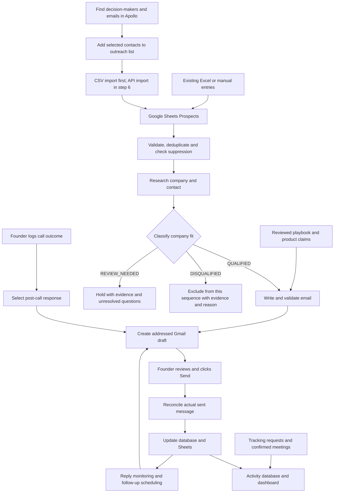

# Apollo-to-Gmail outreach automation — implementation draft

> **Superseded where it conflicts (2026-09-22) by [ARCHITECTURE.md](ARCHITECTURE.md):** Google Sheets is the only outreach business record (no PostgreSQL), the system only drafts and the founder sends. The older execution order, database design and stage gates below are historical context; use the architecture's build order.

Prepared: 2026-09-14T06:51:38Z. Status: design only; no accounts connected, paid enrichment requested, infrastructure deployed, or emails sent.

---

## 0. Start here — execution order

This plan is settled. No further design rounds. Sections 1–14 are the specification; this section is what happens, in order.

| # | Action | Owner | Gate |
| --- | --- | --- | --- |
| A | Run the fit gate by hand across all 14 Columbus subcontractor rows; record QUALIFIED / REVIEW_NEEDED / DISQUALIFIED with quotes | Claude | none — costs nothing, needs nothing built |
| B | Export the reviewed playbook from NotebookLM into a versioned Markdown file | **Founder — blocking** | nothing writes properly without it |
| C | Publish a DMARC record at `p=none`; choose the sending mailbox (not `admin@`) | **Founder** | needed before any real send |
| D | Build step 1–2: service skeleton, schema, Sheets tabs, then CSV → research → fit gate → untracked Gmail draft | Claude | needs B |
| E | **Decision point.** Measure: how many rows qualified, how many drafts you would send untouched | Founder | build steps 3–6 only proceed if this passes |
| F | Build steps 3–6 per §12 | Claude | needs E |

Action A also validates the fit-gate design on real input before it is written into code, and replaces opinion about the Columbus list with a count.

**Provisional effort, not a completion promise:** roughly one working week to the first usable draft flow (through D), 3–4 focused engineering weeks for the full system, assuming credentials, playbook, infrastructure access and timely Gmail testing are available.

**Not in that estimate:** sourcing a qualified commercial-subcontractor list. The existing Columbus workbook was built from the Google Places "Electrician" category, which selects for businesses optimised for local search. Action A measures how much of it survives the gate. If little does, list sourcing is separate work and should start in parallel — the pipeline will be ready before the list is.

---

## 1. Intended experience

The founder finds new prospects in Apollo and imports an exported CSV into Google Sheets for v1. Selected-list API import is added in build step 6. Eligible new rows automatically start research and company-fit classification; only qualified rows proceed to writing. Every outbound message is created inside Gmail with its recipient, subject and body populated. The founder opens it, edits if necessary, and clicks Gmail's normal Send button. No email-body copy/paste or separate send-approval application is required.

The system records actual sends and replies, prepares two follow-ups when appropriate, responds to manually logged sales-call outcomes with suitable drafts, and records observed opens/clicks plus call and meeting outcomes. The business operates its own workflow, tracking service, database and reporting. Gmail remains the email provider; AI/search and hosting remain external infrastructure dependencies.

Founder clarification (2026-09-14): Apollo is used only to find decision-makers and obtain their business email addresses, with supporting name, role, company and source identifiers. Our workflow performs research and writes every email using our reviewed playbook and separate AI provider. Apollo AI writing, research, sequences, call management and reporting are outside scope. Whether Apollo can create Gmail drafts is therefore not an implementation gate.

## 2. Selected implementation recommendation and boundaries

| Component | Proposed implementation | Responsibility |
| --- | --- | --- |
| Decision-maker email acquisition | Apollo UI/CSV first; API in step 6 | Find decision-makers and obtain their business email addresses plus identifying context |
| Operator controls | Google Sheets | Prospect additions, call outcomes, notes, HOLD, callback dates |
| Scheduling and hosting | Cloud Scheduler and Cloud Run | Authenticated scheduled triggers; host Python processing and public tracking endpoints |
| Research retrieval | Direct website fetching (`httpx`); no search vendor in v1 | Fetch the company's own site and follow its navigation. Add search only when website-only research shows a concrete gap; Gemini Google Search grounding is the later option, with its own pricing |
| AI | Gemini API behind a provider adapter | Research synthesis, email writing and suggested reply classification |
| Writing knowledge | Versioned Markdown playbook and templates | Reviewed NotebookLM-derived rules and approved product claims |
| Business logic | Small Python service | Eligibility, action state, evidence records, draft reconciliation and tracking collection |
| Durable records | PostgreSQL | Prospect identities, events, actions, suppression and reporting |
| Mailbox | Gmail API and native Gmail UI | Draft creation, mailbox synchronization, founder-operated sending |
| Meetings | Google Calendar | Booking link and confirmed meeting state; availability lookup only if configured |
| Reports | Owned web dashboard, with Sheets summaries | Email/call/meeting metrics and review queues |

Consolidated implementation recommendation (2026-09-14): use Cloud Scheduler -> Python on Cloud Run. This supersedes the earlier n8n default and unresolved scheduler comparison; it is an engineering recommendation, not a claim that the founder has already configured or approved cloud resources. The Python service already owns integration calls and state, so v1 needs scheduled execution without another workflow runtime. [Google scheduled Cloud Run services](https://docs.cloud.google.com/run/docs/triggering/using-scheduler)

PostgreSQL holds pending work, attempts, run history and expiring worker leases. Scheduled authenticated handlers claim bounded batches, save progress and finish within request limits; retries/restarts reclaim unfinished work without duplicating actions. Do not launch untracked background work after an HTTP response. Public image/link handlers record requests directly; keep mailbox, credential and operator endpoints authenticated. Cloud Scheduler provides triggers, not durable outreach state. Confirm project access and infrastructure placement during setup.

Run the production scheduler and tracking service on a publicly reachable server so they work while the founder's computer is off. Use Docker for local development. Hosting placement and any reuse of existing infrastructure require inspection; an existing database instance can be reused only with a dedicated database role and restricted grants. A separate schema alone is not isolation. No new paid CRM or Zapier subscription is part of this proposal.

## 3. End-to-end map

Automatic enrollment means automatic draft preparation, not automatic delivery. Missing email, unresolved identity, suppression, insufficient required inputs or HOLD produces a visible reason instead of a send or an invented value.

## 4. Apollo decision-maker email acquisition

### Primary v1 route: Apollo CSV to Sheets

Export selected Apollo contacts and import their name, role, company, website and email into the Prospects tab. This is the default first-version intake, not an emergency fallback. Sheet processing, identity deduplication, suppression and fit classification remain automated. Re-imports preserve stable internal IDs and existing activity. No Apollo API client, list-label discovery or automatic reveal is required for this first working path. Missing fields are visible as NEEDS_DATA; CSV import does not eliminate data validation or credit costs for emails obtained in Apollo.

### Build step 6: selected-list API import

1. Founder searches Apollo using geography, company characteristics and relevant roles. Initial targeting remains commercial construction subcontractors; the exact trades, locations and titles are editable configuration, not hardcoded assumptions.
2. Founder saves selected contacts to a designated outreach list. This selection is the enrollment decision; do not require another approval click after a complete eligible row reaches the active Sheet.
3. The scheduled Python importer calls Apollo's saved-contact search, filtered by that list's label ID, and paginates results.
4. The service upserts by Apollo identity and normalized email. Repeat list imports or edits update permitted source fields without creating another initial email.
5. Rows with usable email and required context enter the Sheet's active Prospects tab and start the preparation workflow. Rows missing data remain visible as NEEDS_DATA.

Apollo's saved-contact search uses `POST /api/v1/contacts/search` and supports `contact_label_ids`. This searches contacts already saved to the account, not the entire Apollo prospect database. Confirm the selected list-to-label mapping and field coverage against the actual account. [Apollo contact search](https://docs.apollo.io/reference/search-for-contacts)

Proposed polling interval: 15 minutes, adjustable. Do not assume an undocumented incremental-change cursor exists. Use paginated bounded scans plus stored IDs and record fingerprints; never mark absent contacts deleted based on a partial or failed scan.

### Optional expansion: automated discovery

The service can later run configured searches through `POST /api/v1/mixed_people/api_search`, put matches in a Candidates tab, and enrich selected candidates before enrollment. Search results do not include email addresses or phone numbers. Separate enrichment is required to obtain available contact details. Search filters and enrollment rules are configurable; avoid treating a matching industry label as verified subcontractor fit. [Apollo People API Search](https://docs.apollo.io/reference/people-api-search)

Email reveal/enrichment may consume Apollo credits and access varies by account. Inspect permissions and credit allowance before connecting paid actions. Set a per-run and daily email acquisition budget; deduplicate before enrichment and cache results with a retrieval timestamp. Do not repeatedly reveal the same contacts. Phone purchases are disabled in this scope; sales calls can use numbers already supplied by the founder. Some enrichment modes use asynchronous callbacks; callback retries must not duplicate enrollment. [Apollo enrichment](https://docs.apollo.io/reference/people-enrichment), [API pricing](https://docs.apollo.io/docs/api-pricing)

Research and email drafting make no Apollo AI calls and consume no Apollo writing credits. They use our own website retrieval/search and Gemini integration, whose API and hosting costs are separate from Apollo email acquisition. Track these budgets separately; this does not imply free research or writing.

When the later API adapter is enabled, it replaces the manual export/import step while preserving the same intake and deduplication contract. CSV remains supported. Claim the API milestone complete only after actual selected-list import and retry tests pass.

Apollo sequences, AI writing, research, call/task management, reporting and sending are outside this workflow by the founder's explicit choice. A saved list is only an email acquisition source. A contact already being worked elsewhere must be held or reconciled before starting overlapping outreach.

## 5. Research, fit classification and writing

Apply the founder-approved ICP and claims boundary before drafting. Store fit status, reason code, supporting and conflicting evidence IDs/quotes/URLs, retrieval time, policy version and any reviewer decision. Python enforces that only QUALIFIED rows can enter writing; neither a model confidence score nor an Apollo industry label can bypass the gate.

**Retrieval rules.** Fetch the company's homepage, then discover further pages from its own navigation — do not assume `/about`, `/services` or `/projects` exist. Observed 2026-09-14: the pages that actually carried evidence were `/about-our-owner`, `/about-1` and the homepage; none matched those guessed paths. Select links deterministically in Python by matching anchor text and URL against a configurable keyword list (about, company, who-we-are, services, commercial, industrial, projects, markets, capabilities, **careers**) rather than letting the model choose what to fetch. A careers page advertising a commercial estimator or project manager is among the strongest fit signals available, and unlike an about page it is dated.

Budget every crawl: same registrable domain only, depth 1 from the homepage, a maximum page count (default 8), per-request timeout (default 10s), capped response size, skip PDFs and other binaries, and respect `robots.txt` — this fetches third-party sites at volume.

Record evidence in both directions. Store commercial signals and residential/consumer signals separately, each with its verbatim quote and source URL, then classify from the balance. A `REVIEW_NEEDED` row must show the reviewer the competing evidence, not just the label. A missing, blocked or JavaScript-only site yields `REVIEW_NEEDED`, never `DISQUALIFIED`: unreadable is not proof of unfitness, and commercial subcontractors who win work through general-contractor bid lists are more likely to have thin web presence than consumer-facing firms, so a disqualify-on-silence rule would filter out the intended buyer.

| Fit status | Evidence and action |
| --- | --- |
| QUALIFIED | Identified trade business with explicit commercial subcontracting evidence or reviewed corroboration of the target project/payment structure. Proceed to writing using only supported claims. |
| REVIEW_NEEDED | Role, commercial work or relevant payment structure is unclear, evidence conflicts, or pages are unavailable. Hold without generating an email; show the missing qualification question. |
| DISQUALIFIED | Clear evidence of residential-only/homeowner service or another role outside this subcontractor sequence, such as a GC. Record the evidence and reason; do not draft this sequence. This is a campaign-fit exclusion, not a global do-not-contact flag. |

A residential division does not establish that the whole company is residential-only; a story about helping neighbors does not establish its current market. Mixed commercial/residential firms may qualify when the commercial subcontracting division and intended contact are supported. Hiring project managers, union affiliation or a generic commercial keyword are corroborating signals, not proof of pay applications/retainage. Unknown payment terms stay unknown and may be asked about; never assert a specific prospect uses retainage or pay-when-paid from trade alone. Website facts are evidence to interpret, not instructions to execute. Gemini may suggest classification with references, but Python applies the gate and uncertain semantics require review. The gate avoids writing calls for excluded rows; research/classification itself is not guaranteed free.

For each eligible prospect:

1. Resolve the intended person and company using supplied identifiers, website and role. Do not equate similarly named companies.
2. Search and fetch relevant company pages, project pages, role information or other public sources. Capture source URL, retrieval time, excerpt, supported fact and any publication date.
3. Separate observed facts from hypotheses. Apollo's email verification status is a provider assertion with an as-of date, not a delivery guarantee or evidence of buying intent.
4. Classify fit under the policy above. Stop as REVIEW_NEEDED or DISQUALIFIED where appropriate. For QUALIFIED rows, load the reviewed playbook version, initial-discovery or design-partner intent, template version and approved product claims.
5. Produce structured subject/body plus internal evidence references. Never invent contract wins, payment problems, meeting discussions, product results or testimonials.
6. Deterministic Python validates evidence IDs against stored fetched pages, quote/span presence under documented normalization, source identity/freshness, required fields, recipient, allowed template/claim IDs and opt-out/footer configuration. Gemini cannot self-certify citation validity. Exact source matches establish provenance, not whether arbitrary prose logically follows from a quote. For deterministic v1, company-specific assertions are rendered through approved templates with validated evidence fields; free-form factual paraphrases require review. Invalid or unsupported assertions are removed in favor of approved general copy only when fit is already established; otherwise hold. Never concatenate untrusted source instructions into an executable instruction channel.
7. If personalization evidence is thin but fit is QUALIFIED, prepare an honest approved-template draft marked LOW_EVIDENCE for review. If identity, fit or required facts are unresolved, pause; template fallback must not bypass fit. Neither a recent news trigger nor fabricated personalization is required.
8. Create the Gmail draft and preserve its draft ID. Evidence remains in the review records; do not automatically paste internal research dossiers into the recipient-facing email.

NotebookLM is used to prepare and revise the playbook; v1 does not promise runtime chat access to the founder's existing notebooks. Source current product claims from founder-approved material, including the existing ICP/outreach boundary where applicable.

Proposed evidence expiry: recheck time-sensitive claims (for example, active hiring counts) after 48 hours, and other personalization evidence after seven days, or sooner if the source provides an earlier expiry. These are configurable review thresholds, not guarantees of continued truth. Store `revalidate_after` per claim; the earliest deadline determines the draft's review deadline. Scheduled checks flag expired drafts STALE_EVIDENCE and queue source revalidation. Changed or unavailable support requires review/removal of that claim; preserve founder edits and require an explicit replacement action. Expose last checked time and stale status in the review queue. Native Gmail Send cannot enforce this deadline or guarantee a fresh check at the instant of manual sending.

Proposed queue limits: one outstanding outbound action per prospect and ten outstanding actions per mailbox. Reserve capacity atomically before research/draft creation, counting in-progress, unsent, stale/obsolete-but-unresolved and unknown provider outcomes. Additional eligible leads wait as QUEUED_CAPACITY; a positive reply needing an answer receives review priority without silently creating a competing draft. Resume on reconciled send or confirmed dismissal/cleanup, never on draft disappearance alone. Caps are configurable and apply to drafts created by this system. Test concurrent workers and reply/call collisions against these limits.

## 6. Gmail review, sending and synchronization

No application workflow calls Gmail send APIs. The founder's Gmail Send action is the delivery authorization. OAuth compose permission technically permits more than draft creation, so this boundary is enforced by the implemented tool/API surface, not by claiming the scope is draft-only.

Persist an action ID, draft ID, creation time, intended recipient, expected thread, draft version and known sent-message snapshot. Track draft versions separately from messages: Google documents that the underlying draft message can be replaced and that sending deletes the draft and creates a new SENT message. [Gmail draft lifecycle](https://developers.google.com/workspace/gmail/api/guides/drafts)

Start with scheduled mailbox synchronization using saved history progress. Proposed interval: five minutes, adjustable. Recover from expired history with bounded full reconciliation, and deduplicate repeated events. [Gmail synchronization](https://developers.google.com/workspace/gmail/api/guides/sync)

Confirm each action against a new sent message using the available recipient, time, content/version and thread evidence. An existing SENT message in a thread does not establish that a follow-up was sent. Draft disappearance does not establish sending or deletion. Fuzzy content similarity is a hint, not proof. Ambiguous cases enter SENT_MATCH_REVIEW, with an operator action to associate a specific sent message, dismiss the action, or keep it unresolved. Do not advance timers until resolved.

If draft creation times out after Gmail may have accepted it, mark the provider result UNKNOWN and reconcile before retrying. A local idempotency key cannot provide exactly-once creation at Gmail by itself.

Never overwrite a founder-edited draft during regeneration without an explicit replacement action. A reply/call/HOLD makes a pending cold follow-up OBSOLETE in the system. Show it prominently in the review queue. Do not silently delete edited drafts. A Sheet flag cannot disable Gmail's Send button; removal or modification of an obsolete Gmail draft is a separate explicit cleanup policy, to be tested. The product must not promise to prevent every manual stale-draft send.

## 7. Follow-up policy

User requirement: initial email plus two follow-ups within a week, with every message reviewed and sent manually. Proposed timing interpretation: calendar days, targeted at day 0/day 3/day 6 when messages are sent promptly; use America/New_York for display and UTC for storage.

| Condition | Action |
| --- | --- |
| Initial draft remains unsent | No follow-up timer |
| Initial send confirmed, no reply or hold | Follow-up 1 draft due three days later |
| Follow-up 1 remains unsent | Follow-up 2 not due |
| Follow-up 1 send confirmed, no reply or hold | Follow-up 2 draft due three days later |
| Follow-up 2 send confirmed | Cold sequence complete |
| Human reply | Pause cold sequence and obsolete pending cold drafts |
| Automatic reply | Record separately; pause for review or apply an explicitly configured return-date policy |
| Bounce or explicit opt-out | Stop affected email outreach; record reason/suppression |
| Uncertain reply classification | Pause for review |

Delayed manual sending shifts later deadlines. It is impossible to guarantee both a full three-day gap and completion within seven days if the founder sends late. No added booking nudge, business-day conversion or extra follow-up is silently enabled.

## 8. Sales calls and response drafting

The founder makes calls using their current phone and logs each call as a new row. No autodialing, call recording or transcription is assumed.

| Outcome | Draft/action |
| --- | --- |
| No answer, voicemail left | Tried calling + true voicemail mention + approved two-line introduction + callback request |
| No answer, no voicemail | Tried calling + introduction; no voicemail claim |
| Answered, positive | Pause cold sequence; thank-you + accurate recap + meeting invitation draft |
| Answered, not interested | Stop current cold sequence; brief polite closing draft where appropriate |
| Contact later | Pause sequence; show agreed date in next-action queue; no automatic re-enrollment |
| Callback requested | Record exact callback date/time and notes; show call task |
| Do not contact | Suppress the person for the requested channel/scope; no new sales pitch |

Positive/negative human email replies can use the corresponding response branches. A question generates an answer draft or requests missing product facts. An opt-out is not merely another negative-sales template. Any uncertain opt-out intent pauses activity pending review.

Proposed collision rule, not yet approved: an unanswered-call email consumes one of the two proactive follow-up slots when sent after the initial email; an unsent call draft pauses competing cold drafts. Positive-conversation replies are outside the cold sequence. Before an initial email, a call-related draft replaces the pending initial message. Keep total touches visible. Make this rule editable before production so the founder can choose a different cadence explicitly.

Store the actual call date. Do not say 'today' in a draft that may be sent tomorrow; prefer the date or wording such as 'I tried reaching you by phone.' Never assert a conversation detail without the call note.

Meeting invitation v1 can use a founder-provided booking link. Proposing real slots needs calendar availability and timezone checks, with a warning that availability can change before sending. A meeting becomes BOOKED only from confirmed calendar evidence or a founder update. No speculative booking status.

## 9. Owned metrics

Create opaque, per-message tracking tokens and store destination URLs server-side. The pixel endpoint returns a small image; the click endpoint records a request then redirects to its stored allowed destination. No arbitrary open redirect or raw email address in the URL. Both endpoints require public HTTPS; they do not require Gmail access from the recipient.

Tracking injection starts in build step 5. Steps 2-4 create untracked drafts and show open/click coverage as N/A. After step 5, new drafts can include tracking and the sent-message survival checks apply; earlier sent emails cannot be retrospectively instrumented.

Record raw events, known test/preview events, suspected automated events and derived unique counts separately. Requests before the verified sent timestamp are not recipient engagement. Image proxies, image blocking, previews, forwarded messages and scanners mean human opens/clicks cannot be proven reliably. Show observed tracking metrics and coverage; untracked is N/A rather than zero. Editing out a pixel or changing a link reduces tracking coverage. [Tracking mechanics](https://mailchimp.com/help/about-open-and-click-rates/), [bot activity](https://mailchimp.com/help/about-bot-activity/)

| Metric | Definition |
| --- | --- |
| Email response rate | Unique human responders / unique prospects emailed in the chosen cohort |
| Positive response rate | Unique positive email responders / unique prospects emailed |
| Call connection rate | Attempts answered by intended contact / total call attempts |
| Positive call rate | Positive conversations / conversations with intended contact |
| Meeting conversion | Unique prospects with confirmed meeting / unique contacted prospects |
| Observed open rate | Sent open-tracked messages with qualifying observed open / sent open-tracked messages |
| Observed click rate | Sent click-tracked messages with qualifying observed click / sent click-tracked messages |

Show counts, denominators, cohort dates, observation duration and tracking exclusions. SENT is not proof of inbox delivery. Store detected bounces separately; do not manufacture delivery confirmation from absence of a bounce. Record whether email and/or calls preceded a meeting without claiming causal attribution. Report template comparisons descriptively; do not declare winners from insufficient samples.

During reconciliation, inspect the sent message for the expected tracking image and link tokens; do not assume draft-time instrumentation survived editing. Record open/link coverage independently as present, absent or unknown. Presence proves instrumentation only, not recipient loading or a human click. The controlled Gmail pilot must check untouched drafts, text/link edits and mobile sends. Unsupported claims that manual editing necessarily makes tracking unreliable are not acceptance evidence.

Proposed draft-quality reporting: compare the retained generated draft with its confidently associated sent message, measuring subject and body separately after documented normalization of HTML, whitespace, signatures, quoted history and tracking URLs. Keep factual/wording changes visible. Record normalized edit distance plus sent-without-substantive-edit counts, and confirmed discarded drafts separately so sent-only samples do not conceal failures. Ambiguous message associations have no score. Edit distance measures text change, not time saved, factual correctness or learning; improvements require deliberate, reviewed playbook changes and comparable samples. Optional founder-reported editing effort can test time savings; elapsed time between creation and send is not editing time. No automatic playbook updates or removal of requested open/click metrics is implied.

## 10. Sheets layout and data ownership

| Tab | Contents |
| --- | --- |
| Prospects | Stable prospect ID, source/Apollo IDs, company/contact/email/phone, fit status/reason/evidence, intent, status, next action, HOLD and notes |
| Calls | One row per attempt: call ID, prospect ID, time, outcome, voicemail, notes, callback date |
| Email Activity | Read-only projection of action type, draft status, verified send, reply and tracking summary |
| Dashboard | Counts, rates, cohorts, exceptions and workload summary |
| Settings | Selected source list, playbook/template versions, tracking toggles and proposed cadence/caps |
| Candidates, optional | Automated Apollo search results awaiting selection/enrichment |

Ownership: the founder owns call facts, notes, HOLD and targeting choices. Apollo owns source assertions with timestamps. Gmail supplies observed mailbox facts. The service validates and stores authoritative action history. Sheets projections never overwrite founder fields. Protect system columns and use stable IDs instead of row numbers. Row reordering, duplicate imports and retries must not restart a sequence; deleting a row does not erase suppression/history. Handle operator changes through versioned commands, and surface conflicts.

Suggested database entities: prospects, source_records, enrollments, research_evidence, playbooks, templates, outbound_actions, draft_versions, mailbox_messages, calls, meetings, suppression_entries, activity_events, tracking_links, tracking_events, sync_cursors and workflow_runs. Store minimum necessary message/research content with a documented retention/deletion policy; exclude credentials and mailbox payloads from routine logs.

## 11. Scheduled workflows and service contract

| Workflow | Trigger | Result |
| --- | --- | --- |
| W1 Apollo intake, step 6 | Schedule/manual | Selected saved contacts upserted into intake; no duplicate enrollment |
| W2 Sheet intake | Schedule/manual | New eligible rows claimed once; research/draft preparation starts |
| W3 Draft preparation | Claimed action | Evidence -> fit gate -> validated content and Gmail draft; otherwise visible fit/review/error state |
| W4 Mailbox sync | Schedule | Confirmed messages/replies update action state and Sheets |
| W5 Follow-up due check | Schedule | Eligible next action created once after current-state checks |
| W6 Call intake | New/updated call event | Appropriate post-call action or callback task |
| W7 Meetings/reports | Schedule/event | Confirmed meetings, dashboard summaries and exception queue |

All schedules check current service state; scheduler triggers are not the authoritative sequence ledger. Do not blindly retry side-effecting or credit-consuming calls. Rate-limit integrations, use bounded backoff for 429/transient errors, and retain retry state.

Proposed authenticated internal resources: `/api/v1/prospects`, `/api/v1/enrollments`, `/api/v1/calls`, `/api/v1/outbound-actions`, `/api/v1/message-associations`, `/api/v1/sync-runs`, `/api/v1/suppressions`, `/api/v1/reports`. The service accepts idempotency keys and rejects reuse with changed payloads. Resource permissions and expected versions control mutations. Public tracking resources are separate `/t/o/{token}.gif` and `/t/c/{token}`. No automatic-send resource is exposed.

OAuth account/app eligibility and Apollo endpoint permissions must be checked using the selected accounts. A Google-hosted email domain does not alone prove Internal OAuth eligibility. Keep integration secrets in an appropriate secret store; do not ask the founder to paste them into chat. User-requested API mutations first get a dry-run where supported or a concrete preview otherwise, respecting existing workspace rules.

## 12. Build order and acceptance

1. **Foundation and configuration:** scaffold a separate containerized outreach service, PostgreSQL migrations, stable IDs, pending work/leases and secrets integration. Configure the Sheet's Prospects, Calls, Email Activity, Dashboard and Settings tabs. Prepare the reviewed playbook, approved claims/templates, sender details and selected Apollo list. The founder reports an existing Apollo subscription with 2,300 credits remaining; that is user-reported, not a live balance check or unlimited spending authorization. Contact acquisition is settled; coverage research is not a new gate to building.
2. **First working path: CSV/Sheet -> research -> fit gate -> untracked Gmail draft:** implement Sheet intake, eligibility/suppression, website/search retrieval, classification records, deterministic evidence/template checks, Gemini writing and Gmail draft creation. Use selected leads plus residential-only, mixed-market, GC and ambiguous fixtures to prove only qualified companies reach writing. Test invented citations and quotes that do not support proposed claims. Missing data remains visible per row. Prove repeated CSV imports, row reordering, HOLD and worker retries do not create extra actions. Apollo API work and tracking injection are deferred. Missing mailbox access or playbook material permits local fixtures and research testing but not a claim of completed live integration or strategy-matched writing.
3. **Gmail controlled pilot:** create test drafts in an authorized account and let the founder send to controlled recipients. Verify edits, mobile sends, deletion, unrelated same-thread messages, delayed sync and create-timeout recovery. Confirm ambiguous sends never advance follow-ups and founder edits are preserved. Exercise evidence expiry/source disappearance and concurrent queue reservations; show stale status without claiming Gmail Send is disabled.
4. **Reply, cadence and calls:** exercise positive/negative/opt-out/auto-reply/bounce, a reply arriving after a follow-up draft exists, duplicate call processing, callback dates and meeting confirmation. Simulate the three-day clock in tests; do not wait days to verify basic logic.
5. **Tracking and reports:** validate pixel/redirect events, preview/scanner exclusions, idempotent ingestion, link edits, N/A coverage, duplicate events and cohort formulas. Test cancellation/reply races before creating follow-up drafts. Open tracking is evaluated as observed activity, not proof of reading.
6. **Apollo API intake and limited live rollout:** implement selected-list pagination, endpoint permissions, source upserts and budgeted email acquisition; prove repeated scans and CSV/API overlap do not duplicate outreach. Deploy containerized components with persistent storage, backups, secrets and health checks (controlled cloud test deployment may occur earlier for tracking). Verify restart recovery, OAuth reconnect handling and failed-run visibility. Complete sender/domain setup, then run a small founder-reviewed cohort; measure fit, evidence quality, edits, send matching and actual responses before increasing volume.

Completion requires an Apollo-selected contact to reach the Sheet (CSV for v1, tested API import in step 6), pass the fit gate, become a Gmail draft, be manually sent and correctly recorded, receive a controlled reply that halts follow-ups, produce a call-triggered draft, and appear correctly in owned reporting. Disqualified/ambiguous rows must remain visible without drafts. Every external email is still sent by the founder.

## 13. Inputs required for implementation

- Apollo CSV and field mapping for v1; selected-list endpoint access and email reveal/enrichment budget for step 6. Credentials entered securely during setup. Separate search/AI budgets fund our research and drafting.
- Exact sending mailbox, From display name, Reply-To and signature; use a founder-selected personal business identity rather than defaulting to admin@. Validate any send-as alias. Check Gmail/Workspace OAuth project eligibility separately: the address name does not determine verification status, and no mandatory warmup duration is assumed. Additional mailbox purchase is not a prerequisite for local writing/research tests.
- Sender-domain authentication before live prospect rollout: recheck SPF, enabled DKIM and DMARC, then inspect a controlled received message for authentication/alignment. On 2026-09-14T07:41:45Z, local DNS lookup for `_dmarc.lakshyaa.ai` returned name-not-found; recheck before any change. Prepare an initial `v=DMARC1; p=none` policy with a reporting destination only after its mailbox/provider is configured. This is our recommended rollout baseline, not a claim that Google mandates DMARC for every low-volume sender. Google recommends SPF/DKIM/DMARC and distinguishes bulk-sender requirements. DNS publication is separate from this plan edit; a published DKIM key alone does not prove enabled signing. [Google sender guidance](https://support.google.com/mail/answer/81126)
- NotebookLM-derived playbook and seven initial template slots: initial, follow-up 1, follow-up 2, voicemail, no-voicemail, positive response, negative response. Additional answer/callback variants can be derived with explicit facts.
- Approved sender identity, product claims, signature, postal address and clear opt-out handling for commercial messages. A clearly explained reply-email opt-out is an available mechanism. [FTC guidance](https://www.ftc.gov/business-guidance/resources/can-spam-act-compliance-guide-business)
- Calendar booking link, timezone and meeting confirmation policy.
- Hosting/database placement and tracking hostname; separate domain is an option, not a verified universal requirement.
- Confirm or revise proposed polling intervals, calendar-day interpretation, call/email collision rule, evidence expiry thresholds and queue caps during setup. These are configurable design defaults, not reasons to reopen the overall workflow. Cloud Scheduler + Cloud Run is the consolidated implementation recommendation.

## 14. Prior work and limits

The n8n [research-to-Gmail-draft template](https://n8n.io/workflows/11284-automate-lead-nurturing-with-chatgpt-4o-and-gemini-for-personalized-email-drafting/) is a reference for wiring, not a complete system. [Prospector](https://github.com/anusbutt/Prospector) is a candidate research/evidence implementation whose current review output is Obsidian. Neither has been executed in this workspace for this outreach task. Reuse selected licensed components after testing; do not import their sending behavior or product claims automatically.

Current deliverable is this implementation draft. No Apollo list, Gmail draft, Sheet, database, tracking endpoint or n8n workflow has been created by this task.
